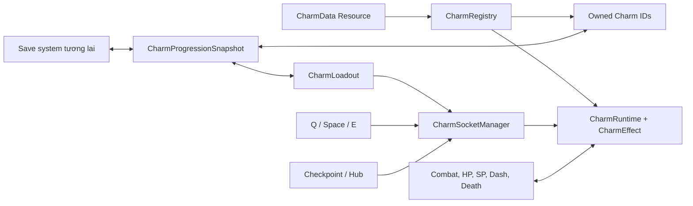

# Charm System - Business Logic

> Trạng thái: đã triển khai foundation, socket/loadout, 10 Charm playable, progression
> adapter và test harness. Cập nhật lần cuối: 2026-10-25.

## 1. Mục đích và phạm vi

Charm System cho phép Player sở hữu, gắn và sử dụng Charm để nhận kỹ năng chủ động
(Active) hoặc hiệu ứng bị động (Passive). Hệ thống chịu trách nhiệm cho:

- catalog và validation của Charm;
- ownership, socket, loadout và lifecycle equip/unequip;
- activation, SP cost và cooldown của Active Charm;
- stat modifier, damage modifier và event proc của Passive Charm;
- safe-location permission, mua thêm socket, nguồn nhận Charm và snapshot save/load;
- công cụ debug để kiểm tra Charm trực tiếp trong game.

UI quản lý Charm, shop hoàn chỉnh, boss reward flow, economy thật và save service thật chưa
thuộc phạm vi hiện tại. Hệ thống chỉ cung cấp API/adapter để các module đó tích hợp sau.

## 2. Thuật ngữ

| Thuật ngữ | Ý nghĩa |
| --- | --- |
| Charm definition | `CharmData` Resource chứa ID, loại, balance, acquisition metadata và effect scene. |
| Registry | Catalog definition, ownership và runtime đang equip của một Player. |
| Socket | Một vị trí gắn Charm, cố định theo phím Q, Space hoặc E. |
| Loadout | Số socket đã mở và Charm ID đang nằm trong từng socket. |
| Runtime | Trạng thái phát sinh khi equip, gồm effect instance và cooldown còn lại. |
| Effect | Logic gameplay của một Charm; được tạo khi equip và hủy khi unequip. |
| Safe location | Vùng cho phép đổi loadout và mở socket, ví dụ Checkpoint hoặc Hub. |
| Proc | Một lần kiểm tra xác suất của Passive theo một damage/death event cụ thể. |

## 3. Mô hình nghiệp vụ



Nguồn dữ liệu cân bằng duy nhất là các `.tres` trong
`gameplay/charms/charm_data`. Effect script không được giữ một bản balance riêng.

## 4. Luật dữ liệu và catalog

Mỗi Charm phải thỏa tất cả điều kiện sau:

1. Có `charm_id` ổn định, không rỗng và không trùng trong catalog.
2. Có `display_name` không rỗng.
3. `resource_cost` và `cooldown_seconds` không âm.
4. `proc_chance` nằm trong khoảng `0.0` đến `1.0`.
5. Active Charm phải có `effect_scene`.
6. Passive Charm không được có activation cost hoặc cooldown.
7. Charm chỉ được xem là playable khi data hợp lệ và có effect scene hợp lệ.

`CharmData.sprite: Texture2D` là ảnh tùy chọn dùng trong ô trang bị HUD. Gán ảnh ở
trường `Sprite` của từng `.tres` trong Inspector. Ảnh không tham gia validate hoặc
logic hiệu ứng: chưa có ảnh vẫn trang bị và dùng Charm bình thường.

`charm_id` là khóa dùng cho ownership, loadout, modifier source, proc result và save data.
Không dùng tên hiển thị hoặc node path làm khóa persistence.

## 5. Socket, ownership và loadout

### 5.1 Socket cố định

Hệ thống có đúng ba socket theo thứ tự:

| Socket ID | Input action | Phím mặc định |
| --- | --- | --- |
| `Q` | `charm_slot_q` | Q |
| `E` | `charm_slot_e` | E |
| `SPACE` | `charm_slot_space` | Space |

- Player mới bắt đầu với đúng một socket Q.
- Socket được mở tuần tự: Q, sau đó E, sau đó Space, dùng `SOCKET_UNLOCK_ORDER`.
- ID số vẫn giữ nguyên `Q = 0`, `SPACE = 1`, `E = 2`; thứ tự mở ô không dựa vào ID.
  Luật normalize và gắn Charm trong loadout cũng dùng thứ tự mở này. Thứ tự áp dụng
  modifier vẫn giữ Q → Space → E.
- Không thể có nhiều hơn ba socket.
- Passive Charm không đăng ký input; input trên socket chứa Passive không kích hoạt action.

### 5.2 Quy tắc equip

Equip chỉ thành công khi:

- Player đang ở safe location;
- socket đã được mở và đang trống;
- Charm tồn tại trong Registry và Player sở hữu Charm đó;
- cùng một Charm chưa được equip ở socket khác;
- effect có thể khởi tạo hợp lệ cho Player.

Unequip cũng chỉ được phép tại safe location. Khi unequip, effect phải gỡ modifier,
callback, active execution và runtime state thuộc Charm đó. Gỡ một Charm không được làm mất
modifier hoặc effect của Charm khác.

### 5.3 Safe location

Safe-location state được tổng hợp từ nhiều source. Loadout được phép thay đổi khi còn ít nhất
một source hợp lệ. Việc rời hoặc giải phóng một source không được tắt permission nếu source
khác vẫn còn hoạt động.

- Checkpoint thêm permission khi Player đi vào và xóa khi Player đi ra.
- Hub giữ permission trong suốt thời gian Player ở scene Hub.
- UI visibility không quyết định safe-location state.

## 6. Mở khóa socket và economy

Giá socket do caller cung cấp; Charm System chưa hard-code bảng giá. Transaction mua socket
tuân theo thứ tự:

1. Validate manager, economy adapter và giá không âm.
2. Kiểm tra safe location và giới hạn ba socket.
3. Kiểm tra đủ tiền.
4. Trừ tiền qua `CharmEconomyAdapter.try_spend()`.
5. Mở socket kế tiếp.
6. Nếu bước mở socket thất bại bất ngờ, hoàn tiền toàn bộ.

Mua thất bại do request sai, ngoài safe location, đã đạt giới hạn, thiếu tiền hoặc economy từ
chối đều không được làm mất currency.

## 7. Active Charm

Khi người chơi nhấn Q, Space hoặc E, activation đi qua transaction sau:

1. Socket phải tồn tại, đã mở và có Charm.
2. Player phải còn sống và tạo được `AttackContext` hợp lệ.
3. Runtime phải đang equip, là Active Charm và hết cooldown.
4. Effect phải validate được context/target/execution trước khi trừ SP.
5. Player phải đủ SP.
6. Effect bắt đầu thực thi.
7. SP được trừ atomically; nếu trừ thất bại, execution bị hủy.
8. Cooldown chỉ bắt đầu sau khi activation và SP transaction thành công.

Cooldown thuộc từng `CharmRuntime`, không ghi ngược vào Resource dùng chung và không dùng
chung dictionary cooldown của weapon. Unequip hoặc scene teardown phải hủy execution đang chạy.

## 8. Passive Charm, damage và proc

Passive effect được áp dụng khi equip và gỡ khi unequip. Ba nhóm hook chính:

- stat modifier: max HP, max SP và movement speed;
- damage modifier: outgoing/incoming/attack-level damage;
- event: damage dealt, damage received, target defeated và dash lifecycle.

Thứ tự damage hiện tại:

1. Weapon base damage.
2. Weapon forge multiplier.
3. Charm modifier theo thứ tự socket Q, Space, E.
4. Damage được áp dụng lên target.
5. `damage_dealt` và `target_defeated` được dispatch sau khi có damage thực tế.

Mỗi hit tạo một `DamageContext` riêng. Kết quả proc được ghi theo `charm_id`, gồm success,
reason và multiplier. Một Charm không được roll hoặc áp dụng hai lần trên cùng context. RNG
thuộc từng proc effect và có thể inject seed để test deterministic.

Stat modifier dùng `charm_id` làm source key. Công thức movement stat là:

```text
final = max(0, (base + tổng flat modifier) * tích multiplier)
```

Khi max HP/SP giảm, current HP/SP bị clamp về max mới và component phát signal để HUD cập nhật.

## 9. Danh sách Charm playable

### 9.1 Active

| Charm | Acquisition | SP | Cooldown | Business effect |
| --- | --- | ---: | ---: | --- |
| Arrow Rain | Merchant/enemy drop | 300 | 6 giây | Bắn 8 mũi về phía con trỏ trong 1,4 giây. Mỗi mũi gây 35% base weapon damage dạng `float`, không ép tối thiểu 1 HP; range 8 units. |
| Crescent Cleave | Merchant/enemy drop | 100 | 4 giây | Gây 200% base weapon damage trong bán nguyệt 180 độ phía trước, bán kính 2,8 units. Mỗi target chỉ bị hit một lần mỗi activation. |
| Tide Grapple | Fixed boss reward | 150 | 5 giây | Gây 250% base weapon damage trong range 4 units. Target nhỏ bị kéo và stun 1 giây; target lớn/Boss/địa hình kéo Player tới điểm dừng cách mục tiêu 1 unit. Miss không tạo effect. |

### 9.2 Passive stat

| Charm | Acquisition | Business effect |
| --- | --- | --- |
| Gale Pace | Merchant/enemy drop | Movement speed x1,2; max SP -100. |
| Turtle Shell | Merchant/enemy drop | Max HP +2; movement speed x0,8. |
| Endurance Vessel | Merchant/enemy drop | Max SP +200; max HP -2. |

### 9.3 Passive event/condition

| Charm | Acquisition | Business effect |
| --- | --- | --- |
| Life Steal | Merchant/enemy drop | Normal attack gây damage thực tế có 5% cơ hội hồi 1 HP; không vượt max HP. |
| Double Strike | Merchant/enemy drop | Mỗi hit của normal attack roll đúng một lần; 20% cơ hội nhân đôi damage. |
| Adrenaline Surge | Merchant/enemy drop | Khi target thực sự chết do Player gây ra, có 20% cơ hội hồi 100 SP và reset cooldown của toàn bộ Active Charm đang equip. |
| Backstabber | Merchant/enemy drop | Melee normal attack từ nửa sau hướng nhìn của target gây 150% damage. Không áp dụng cho ranged hoặc skill. |

## 10. Acquisition

### 10.1 Boss reward

Boss reward chỉ grant Charm có `acquisition_source = fixed_boss_reward`. Trong scope hiện tại,
Tide Grapple là fixed boss reward. Active khác không được đi nhầm flow này.

### 10.2 Shop pool

Shop pool hiện chỉ nhận Passive Charm thỏa tất cả điều kiện:

- data hợp lệ và effect scene tồn tại;
- acquisition source là `shop` hoặc `merchant_or_enemy_drop`;
- chưa owned, trừ khi caller chủ động yêu cầu gồm cả owned.

Placeholder, Active Charm và data invalid không được xuất hiện trong pool. Random offer sử dụng
`RandomNumberGenerator` do caller truyền vào để có thể tái hiện bằng seed.

## 11. Persistence

`CharmProgressionSnapshot` version 1 serialize payload thuần `Dictionary`:

```json
{
  "version": 1,
  "unlocked_socket_count": 1,
  "owned_charm_ids": ["gale_pace"],
  "equipped_charm_ids": ["gale_pace", "", ""]
}
```

Quy tắc restore:

- socket count bị clamp trong khoảng 1 đến 3;
- ID rỗng, trùng hoặc không còn trong catalog bị bỏ qua;
- chỉ Charm owned mới được restore vào loadout;
- entry ngoài số socket đã mở bị bỏ qua;
- duplicate equip chỉ giữ entry hợp lệ đầu tiên theo thứ tự socket;
- payload rỗng hoặc dependency không hợp lệ làm restore thất bại an toàn.

Snapshot là adapter cho save system tương lai; module này không tự ghi file và không tạo autoload.

## 12. Signal và rejection reason cho UI

`CharmSocketManager` phát các signal chính:

- `socket_unlocked(socket_id, unlocked_socket_count)`;
- `safe_location_changed(is_safe)`;
- `loadout_changed(socket_id, charm_id)`;
- `loadout_change_rejected(reason)`;
- `charm_activation_rejected(socket_id, reason)`.

Loadout rejection có thể là `unsafe_location`, `socket_locked`, `charm_not_owned`,
`duplicate_charm`, `socket_occupied` hoặc `registry_rejected`. Activation rejection có thể là
`socket_unavailable`, `actor_unavailable`, `actor_context_unavailable`,
`attack_context_unavailable`, `registry_unavailable` hoặc `registry_rejected`.

Socket purchase rejection có thể là `invalid_request`, `unsafe_location`, `max_socket_count`,
`insufficient_funds`, `economy_rejected` hoặc `unlock_failed`.

## 13. Runtime debug

Trong debug build, Remote Inspector của `Player/CharmSocketManager` có nhóm
`Runtime Charm Debug (Debug Builds Only)`:

1. Chọn `Debug Socket`: Q, Space hoặc E.
2. Chọn `Debug Charm` từ dropdown lấy trực tiếp từ Registry.
3. Charm được equip ngay; socket cần thiết được mở tạm trong instance đang chạy.
4. Chọn `<Unequip>` để tháo Charm khỏi socket đang chọn.

Debug equip bỏ qua ownership và safe-location restriction, không grant ownership và bị từ chối
trong release build. Nó chỉ phục vụ gameplay verification, không phải flow sản phẩm.

## 14. Dependency và giới hạn hiện tại

- Chưa có UI quản lý loadout/socket chính thức.
- Chưa có economy service thật; `CharmEconomyAdapter` là contract tích hợp.
- Chưa có shop UI hoặc merchant flow; service hiện chỉ tạo pool/offer.
- Chưa nối reward service vào boss cụ thể; metadata fixed reward đã sẵn sàng.
- Chưa có save manager thật; snapshot capture/restore đã sẵn sàng để nhúng vào payload chung.
- Placeholder Charm ngoài 10 Charm trên không được đánh dấu playable hoặc đưa vào pool.

## 15. Acceptance và regression tests

Các test độc lập chính:

- `gameplay/charms/active/charm_active_test.gd`;
- `gameplay/charms/passive/charm_passive_test.gd`;
- `gameplay/charms/passive/charm_event_passive_test.gd`;
- `gameplay/charms/progression/charm_progression_test.gd`;
- `test/player_combat_test.gd`;
- `test/test_scene.tscn` cho 1 socket ban đầu và Gale Pace equip/unequip tại test zone.

Trước khi merge phải đạt `gdlint`, `gdformat --check`, Godot import/reference check, toàn bộ
harness Charm, Player combat regression và smoke test scene liên quan.
