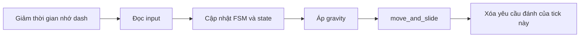

# Player và state machine

Player nhận thao tác của người chơi, còn state quyết định nhân vật được làm gì ở
từng thời điểm. Khi đang chạy, nhân vật có thể dash hoặc đánh. Khi bị trúng đòn,
thao tác bị tạm ngắt để xử lý phản ứng Hit.

## Code nằm ở đâu?

| File | Phần việc chính |
| --- | --- |
| [player.gd](../gameplay/player/player.gd) | Đọc input, gọi FSM, di chuyển vật lý, nhận damage và xử lý chết |
| [foxy.tscn](../gameplay/player/foxy.tscn) | Ghép các state, HP, SP, CP, vũ khí, camera và HUD thành nhân vật Foxy |
| [fsm.gd](../core/state_machine/fsm.gd) | Giữ state hiện tại, state đang chờ và xét ưu tiên chuyển state |
| [player_state.gd](../gameplay/player/states/player_state.gd) | Các luật chuyển state dùng chung |
| [states/](../gameplay/player/states/) | Logic của từng state |
| [player_visual.gd](../gameplay/player/player_visual.gd) | Chọn animation theo hành động và hướng nhìn |
| [foxy_data.tres](../data/foxy/foxy_data.tres) | Chỉ số riêng của Foxy, dùng cùng mặc định trong [PlayerData](../data/foxy/foxy_data.gd) |

## Từ input đến chuyển động

Khi khởi tạo, Player đăng ký các state, chọn Idle làm state đầu tiên, khởi tạo đầy
HP/SP, đặt CP về 0 rồi thiết lập HurtBox và vũ khí. Thiếu PlayerData hoặc setup FSM thất bại thì
Player ngừng cập nhật vật lý.

Mỗi physics tick chạy theo thứ tự:



State chọn vận tốc; Player gọi `move_and_slide()` một lần để thực sự di chuyển.
Gravity vẫn áp dụng khi đang đánh, dash, bị hit hoặc chết.

WASD di chuyển theo góc camera. Hướng được chuẩn hóa nên chạy chéo không nhanh hơn
chạy thẳng. Khi thả phím, nhân vật giảm tốc dần. Hướng nhìn gần nhất được giữ lại
để đánh hoặc dash khi đứng yên.

| Thao tác | Cách xử lý |
| --- | --- |
| WASD | Cập nhật hướng di chuyển; state quyết định có cho di chuyển hay không |
| Shift | Ghi nhớ yêu cầu dash trong 0,1 giây |
| Chuột trái | Yêu cầu đánh thường trong tick hiện tại |
| Chuột phải | Input Map `secondary_attack` → `request_attack(&"secondary")`; controller yêu cầu đầy CP |
| T | Nút debug: gây 1 damage sau bước cập nhật FSM |

Dash và đánh chỉ nhận lúc vừa nhấn, không lặp khi giữ nút. Yêu cầu đánh không được
giữ lại: nhấn khi đang Attack, Dash, Hit hoặc Fall sẽ không tự đánh khi state đó
kết thúc. Nếu nhấn cả hai nút chuột cùng tick, đòn thường được ưu tiên trong `_read_input()`.

## FSM chuyển state như thế nào?

`change_state()` chỉ ghi nhận state muốn chuyển tới. Đầu lần cập nhật FSM tiếp theo,
FSM thoát state cũ, vào state mới, phát `state_changed` rồi cập nhật state mới.
Yêu cầu phát sinh trong lúc state đang chạy sẽ chờ lần cập nhật sau.

Trong Idle và Run, thứ tự xét là **mất sàn → dash → đánh → chạy hoặc đứng yên**.
Nhấn dash và đánh cùng tick thì dash được xét trước. Nếu thiếu SP, Dash bị từ chối
khi vào state; lệnh đánh cùng tick không được thử lại.

| Yêu cầu | Priority |
| --- | --- |
| Idle, Run | 0 |
| Dash, Attack | 10 |
| Fall | 20 |
| Hit | 50 |
| Death | State kết thúc, không cho chuyển ra |

Priority dùng để phân xử yêu cầu đang chờ. Hai yêu cầu bằng priority thì yêu cầu
đến sau có thể ghi đè yêu cầu trước. Death đang chờ không bị state thường ghi đè;
khi đã vào Death, FSM khóa mọi chuyển state.

## Bảy state của Player

| State | Nhân vật làm gì? | Khi nào rời state? |
| --- | --- | --- |
| **Idle** | Đứng yên, giảm vận tốc ngang còn dư | Có hướng di chuyển, dash, đánh hoặc mất sàn |
| **Run** | Quay theo hướng đi và tăng tốc tới tốc độ chạy | Thả phím, dash, đánh hoặc mất sàn |
| **Fall** | Rơi và giảm vận tốc ngang; không điều khiển trên không | Chạm sàn |
| **Dash** | Lao theo hướng đã chốt lúc bắt đầu | Hết thời gian hoặc bị ngắt |
| **Attack** | Dừng di chuyển ngang, giao đòn đánh cho WeaponController | Đòn xong, bị từ chối hoặc bị ngắt |
| **Hit** | Bị đẩy lùi, nhấc nhẹ lên và tạm mất điều khiển | Hết thời gian Hit hoặc chết |
| **Death** | Khóa điều khiển và phát animation chết | Không tự rời state |

Khi Dash, Attack hoặc Hit kết thúc, `return_to_locomotion()` chọn state tiếp theo:
không trên sàn thì Fall; trên sàn và có hướng di chuyển thì Run; còn lại là Idle.
Fall cũng dùng cách chọn này khi chạm sàn.

Damage có thể ngắt các state còn sống để vào Hit hoặc Death. Attack, Dash và Hit
không tự chuyển Fall ngay khi mất sàn; chúng xét lại khi kết thúc.

### Dash

Dash thường dùng `last_facing_direction`, trừ SP một lần lúc bắt đầu và không đổi
hướng giữa chừng. Đổi hướng và nhấn dash cùng tick có thể khiến nhân vật dash theo
hướng cũ, vì dash được xét trước bước cập nhật hướng chạy.

Thiếu SP thì phát `action_rejected(dash)` rồi quay về Idle/Run/Fall. Bị ngắt không
được hoàn SP. Va chạm có thể làm quãng đường thực tế ngắn hơn cấu hình.

`dash_started` báo dash đã bắt đầu. Khi thoát, `dash_finished(interrupted)` cho biết
dash có bị ngắt trước khi hết timer hay không. Dash bị từ chối trước khi bắt đầu
không phát hai signal này. Dash hiện không tự cho bất tử.

`request_free_dash(direction)` cho phép dash không tốn SP theo hướng chỉ định.
Nhân vật phải còn sống, trên sàn, hướng ngang khác zero và FSM chấp nhận yêu cầu.
API trả true nghĩa là đã nhận yêu cầu chuyển state.

### Attack

State Attack tạo `AttackContext`, gọi `WeaponController.try_attack()` rồi mới phát
animation nếu đòn được nhận. Tốc độ animation được chỉnh cho khớp thời gian đòn.
Sát thương do vũ khí xử lý.

Mỗi đòn lấy hướng từ nhân vật tới con trỏ chuột trên mặt phẳng XZ ngang nhân vật,
kể cả đòn tiếp theo trong combo. Animation, hitbox và bước tiến dùng cùng hướng
đã chốt; rê chuột hoặc đổi hướng chạy giữa đòn không xoay đòn hiện tại. Khi trở
về Run, nhân vật lại quay theo hướng di chuyển. Không có camera hoặc con trỏ nằm
đúng vị trí nhân vật thì giữ hướng nhìn gần nhất.

Khi nhận `attack_finished`, state đánh dấu đòn đã xong và yêu cầu quay về di chuyển
trong lần cập nhật sau. Thoát Attack sẽ trả tốc độ animation về bình thường,
ngắt kết nối signal và hủy phần đòn còn lại.

### Contract chaos point (CP)

[ChaosComponent](../core/components/chaos_component.gd) là component riêng của Player,
được gán qua `Player.chaos`, `WeaponController.chaos` và `PlayerHUD.chaos` trong Foxy.
`_setup_stats()` gọi `chaos.init(data.max_chaos)`; `_setup_combat()` gán chaos cho
controller và nối `damage_dealt` trước khi gọi setup vũ khí.

| API | Hành vi / giá trị trả về |
| --- | --- |
| `current: float`, `maximum: float` | CP hiện tại và sức chứa; cập nhật qua API để giữ signal đồng bộ |
| `init(capacity: float) -> void` | Clamp sức chứa tối thiểu 0, reset current về 0, luôn phát signal |
| `gain(amount: float) -> void` | Bỏ qua phần âm, clamp current trong `[0, maximum]`; chỉ phát signal nếu current đổi |
| `is_full() -> bool` | True khi maximum > 0 và current >= maximum; sức chứa 0 vô hiệu hóa kỹ năng |
| `try_consume_full() -> bool` | Chưa đầy: false và giữ nguyên; đầy: đặt current = 0, phát signal và trả true |
| `chaos_changed(current: float, maximum: float)` | Signal cho HUD và các bên nghe cập nhật giá trị |

Luật tích và dùng CP:

- `PlayerData.max_chaos` mặc định 100, `chaos_per_hit` mặc định 20. Resource
  `foxy_data.tres` hiện override thành 100 CP/hit.
- Player chỉ cộng khi còn sống, có chaos, `applied_hp > 0`, nguồn damage là chính
  Player và target là `EnemyBase`. Lượng cộng cố định theo hit, không nhân damage.
- Đánh hụt hoặc không gây mất HP không tăng CP. Normal và secondary đều có thể
  tăng CP; dagger trúng cả lượt đi và về có hai lần cộng CP, luôn clamp ở maximum.
- CP không tự hồi hoặc giảm theo thời gian. Chuột phải dùng kỹ năng riêng của
  vũ khí qua `secondary_attack`, chỉ được controller nhận khi thanh đầy.
- Trừ toàn bộ CP lúc controller nhận đòn sau bước validate/thanh toán, trước khi
  hết windup. Bị ngắt sau khi đã trả CP không hoàn lại CP.
- Thiếu CP, thiếu đòn phụ, scene không hợp lệ, busy, cooldown hoặc Player không
  cho phép đánh sẽ bị từ chối ở bước kiểm tra trước khi tiêu CP.

HUD nghe `chaos_changed`, đồng bộ lại giá trị sau khi ready, hiển thị thanh CP và
nhãn `CP: current / maximum`. Khi đầy và maximum > 0, icon kỹ năng sáng; chưa đầy
thì icon tối. Trạng thái này chỉ báo đủ CP, không bảo đảm actor đang được phép đánh
hoặc đã hết cooldown.

### Contract các phần hiển thị HUD

`player_hud.tscn` giữ layout, sprite và các node chỉ số. Logic được chia như sau:

| Script / node | Trách nhiệm và API |
| --- | --- |
| [player_hud.gd](../../gameplay/player/hud/player_hud.gd), root `PlayerHUD` | Nhận `health`, `stamina`, `chaos`; nối signal và sync cuối frame để chờ Player khởi tạo chỉ số |
| [stat_arc.gd](../../gameplay/player/hud/stat_arc.gd), `Stats/HealthArc`, `StaminaArc`, `ChaosArc` | Dùng chung `HudStatArc.set_stat(current: float, maximum: float)` để đồng bộ nền, fill, bóng và tooltip; `sync_preview()` hỗ trợ chạy riêng scene HUD |
| [hud_portrait.gd](../../gameplay/player/hud/hud_portrait.gd), `StatControl/Portrait` | `set_health(current: int, maximum: int)`, `play_hit_feedback(amount: int)`, `show_death()`; ưu tiên chết → hit → ít máu → khỏe |
| [hud_tooltip.gd](../../gameplay/player/hud/hud_tooltip.gd), `StatTooltip` | Nhận `hud_layer` và danh sách `bars`, xử lý hover có delay, đổi hệ tọa độ khi scale và giữ panel trong viewport |
| [bar_fill_effect.gd](../../gameplay/player/hud/bar_fill_effect.gd), `Effects/*FillEffect` | Giữ hiệu ứng màu/trắng khi tăng hoặc giảm chỉ số |
| [arc_tooltip_bar.gd](../../gameplay/player/hud/arc_tooltip_bar.gd), các node `*Capacity` | Kiểm tra pixel và góc cung dưới con trỏ, lưu nội dung tooltip |
| [equipment_control.gd](../../gameplay/player/hud/equipment_control.gd), `EquipmentControl` | Nhận manager qua `bind_manager(manager: CharmSocketManager)`, đọc trạng thái mở ô và cooldown runtime, không tự giảm cooldown |

Chỉnh góc bắt đầu, độ dài cung và số điểm tương ứng cung đầy trên từng node
`Stats/*Arc` trong Inspector, thay vì trên root HUD. Các node này tham chiếu
capacity, fill, shadow và fill effect qua export. `ChaosArc` có thêm `value_label`
và `readiness_icon`; script không phụ thuộc trực tiếp vào ChaosComponent.
Texture phản ứng, ngưỡng ít máu và thời gian hit chỉnh trên `StatControl/Portrait`;
thời gian chờ tooltip chỉnh trên `StatTooltip`.

[test/hud_test.gd](../../test/hud_test.gd) kiểm tra component thật cập nhật cả ba
thanh, thay đổi sức chứa, hiệu ứng tăng/giảm, icon CP, hit/heal/death của portrait,
tooltip trên từng cung có scale và chạy riêng scene HUD không có component.

### Equipment HUD: mở ô và cooldown

`PlayerHUD.charm_socket_manager` được gán từ Foxy, sau đó HUD gọi
`equipment.bind_manager()` ở cuối frame để đợi manager khởi tạo. Ô được mở theo
Q → E → Space: một ô chỉ hiện Q, hai ô hiện Q/E, ba ô hiện cả ba. `Potion_socket`
luôn hiện; chưa gắn dữ liệu inventory hoặc timer potion.

Mỗi khung Charm có node icon, `Cooldown` và `CooldownLabel`.
EquipmentControl đọc `manager.is_socket_unlocked(socket_id)` và
`manager.registry.get_equipped(socket_id)` mỗi frame hiển thị. Chỉ Active Charm
đang cooldown mới hiện lớp tối theo tỷ lệ thời gian còn lại và số giây làm tròn lên.
Ô trống, Passive, cooldown kết thúc hoặc bị reset đều ẩn hai lớp này.
UI không sửa runtime hoặc tạo cooldown riêng; `refresh()` cho phép đồng bộ ngay
sau thao tác debug. Khi không có manager, chỉ ô potion được hiện.

Icon Q/E/Space lấy `CharmRuntime.definition.sprite` từ Charm đang gắn vào đúng ô.
Ảnh được giữ tỷ lệ và căn giữa trong rect icon có sẵn; không tự giãn kích thước
khung. Tháo Charm, khóa ô, mất manager hoặc Charm chưa có sprite sẽ xóa ảnh cũ và
ẩn node icon, giữ nền của ô đã mở. Icon potion chưa gắn với dữ liệu vật phẩm.

Có thể thử bằng Remote Inspector → `Foxy/CharmSocketManager` → `Debug Socket` và
`Debug Charm`, không cần inventory. Debug equip tự mở đủ ô theo thứ tự mới.
Chọn Arrow Rain, nhấn phím socket đã gắn để xem cooldown; chọn `<Unequip>` để tháo.

[test/equipment_test.gd](../../test/equipment_test.gd) kiểm tra mở ô, debug equip,
cooldown từ activation thật, reset, hết thời gian, tháo charm và ô potion.

## Nhận sát thương và chết

```text
HitBox đối phương → HurtBox → Player.receive_damage()
→ phòng thủ của vũ khí → trừ HP
→ còn HP: hủy đòn đang đánh, yêu cầu Hit
→ hết HP: die(), yêu cầu Death
```

HurtBox và Player lọc damage không hợp lệ, tự đánh và damage cùng đội.
`take_damage()` nhận damage trực tiếp nhưng vẫn đi qua phòng thủ của vũ khí.
Nếu phòng thủ chặn hết damage thì không mất HP và không vào Hit.

HP, damage, hồi máu và lượng HP áp dụng trong signal/API đều dùng `float`.
Forge và Charm giữ phần thập phân xuyên suốt, không làm tròn từng bước hoặc ép
damage tối thiểu 1 HP. HealthComponent chặn NaN/vô cực, giới hạn damage/heal theo
HP thực tế, và chuẩn hóa đòn kết liễu gần bằng HP còn lại để tránh dư sai số.
HUD/debug label chỉ định dạng tối đa hai chữ số thập phân; không sửa HP runtime.

Khi vào Hit, nhân vật bị đẩy ra xa nguồn đánh. Không xác định được nguồn thì đẩy
ngược hướng nhìn. Nhận thêm damage khi đang Hit chỉ đặt lại timer; không lặp lại
knockback, cú nhấc lên hay animation. Hit không có khoảng miễn nhiễm sát thương.

Đòn làm HP về 0 đi thẳng vào luồng chết. `die()` lập tức đặt `dead`, tắt HurtBox,
xóa yêu cầu hành động, ngừng hồi SP, hủy đòn và dừng vận tốc ngang. Death được áp
dụng ở lần cập nhật FSM tiếp theo. Nhân vật vẫn chịu gravity. Sau ít nhất
`reload_delay` và đủ thời lượng animation, Death yêu cầu GameManager reload scene
qua fade; chưa có luồng hồi sinh riêng tại checkpoint.

## Chỉ số và hiển thị

| Chỉ số Foxy hiện tại | Giá trị |
| --- | --- |
| HP / SP tối đa | 8 / 350 |
| CP tối đa / CP mỗi hit gây sát thương | 100 / 100 (resource Foxy override) |
| Hồi SP | 25 SP/giây, chờ 1 giây sau khi tiêu SP |
| Tốc độ chạy | 8 đơn vị/giây |
| Gia tốc / giảm tốc | 25 / 25 |
| Dash | 5 đơn vị trong 0,2 giây; tốn 50 SP |
| Thời gian Hit | 0,6 giây |
| Knockback / giảm tốc knockback | 8 / 16 |
| Tốc độ nhấc lên khi Hit | 3,2 theo trục Y |

HP/SP nằm trong component riêng. SP vẫn hồi khi đánh, dash hoặc bị hit nếu đã hết
thời gian chờ; chết mới tắt hồi. HUD nghe signal để cập nhật chỉ số. Phản ứng trúng
đòn của portrait có timer riêng, không quyết định thời gian Hit.

PlayerVisual chọn animation `down/up/side` theo hướng nhìn so với camera và lật
sprite khi cần. Bụi chạy, bụi dash và ghost phản hồi trạng thái của nhân vật.

## Những điểm cần nhớ khi sửa code

### Bước tiến khi chém

Đòn `normal` được controller chấp nhận sẽ cho Player tiến theo hướng đánh đã
chốt, mặc định 0.28 đơn vị trong 0.12 giây, giảm tốc dần. Chỉnh tại
`Foxy/States/Attack` → `Forward Step`; đặt `Step Distance = 0` để tắt.

Trong Attack, WASD không cộng vận tốc chạy vào bước tiến. Giữ hướng chạy ngược
hướng chém cũng không kéo nhân vật lùi lại trong recovery; hết đòn mới tiếp tục
chạy theo phím đang giữ. Trường `MeleeComboStep.movement_multiplier` đã được bỏ
cùng các giá trị trong resource dagger; bước tiến chỉ dùng `step_distance` và `step_duration`.

State chọn vận tốc, Player vẫn dùng `move_and_slide()` một lần mỗi physics
frame nên có va chạm tường/enemy. Đòn bị từ chối không tạo bước tiến; thoát
Attack hoặc rời mặt đất sẽ kết thúc bước tiến. Mở inventory giữ nguyên tiến độ.
Đòn secondary ném dao giữ nguyên vị trí thân Player.

`DaggerAttack` lấy lại vị trí actor khi activate và theo actor trong active
phase, để hitbox chém không bị bỏ lại tại điểm bắt đầu đòn.

### Quy tắc chuyển trạng thái

- Đổi vũ khí chỉ cho Idle/Run/Fall. Bắt đầu đánh cần trên sàn và chỉ cho
  Idle/Run/Attack. Cả hai đều kiểm tra state hiện tại lẫn state đang chờ.
- Hit thoát theo timer stun, độc lập với thời lượng animation. Death hỏi thời lượng
  qua `PlayerVisual.get_current_animation_duration()` để chờ đủ clip trước khi reload.
- Controller nhận đòn phải phát `attack_finished`; Player chưa có timeout dự phòng.
- `_setup_combat()` gọi setup vũ khí ngoài guard kiểm tra controller, nên cần
  gán controller hợp lệ cho Player.
