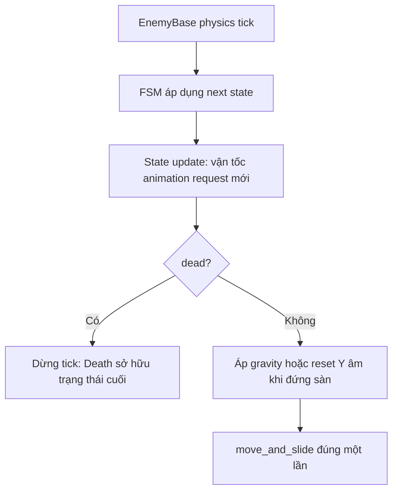
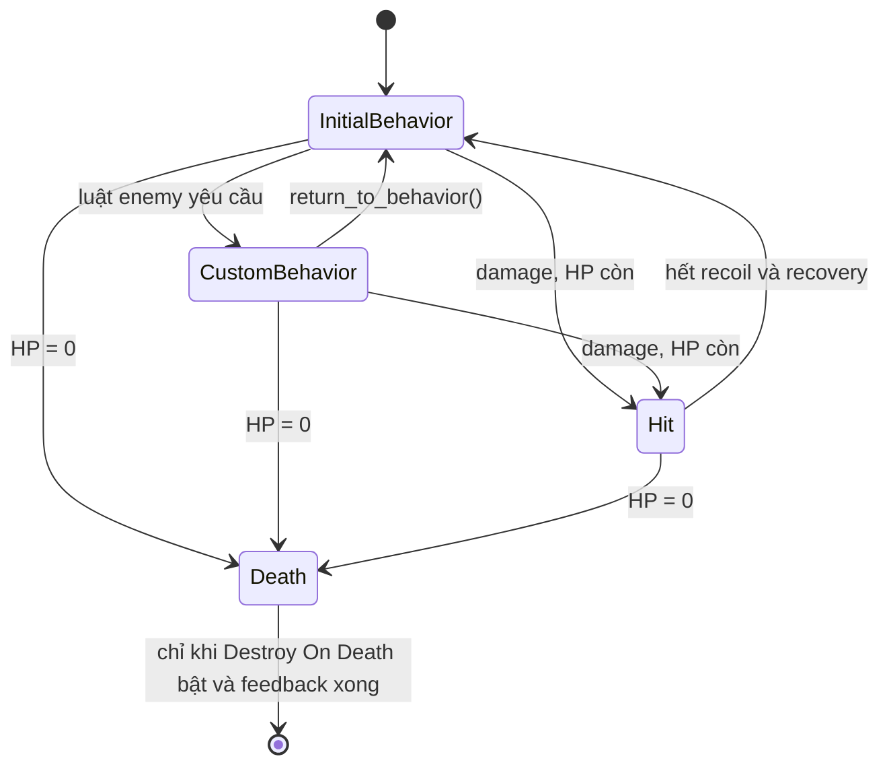
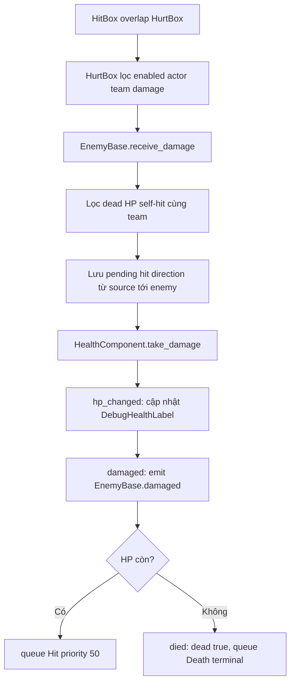

# Business logic: EnemyBase và enemy FSM

`EnemyBase` là khung dùng chung cho enemy 3D: máu, nhận sát thương, di
chuyển, hướng nhìn, animation theo hướng và FSM. Mỗi enemy chỉ thêm collider,
animation, state và luật riêng của mình.

> [!IMPORTANT]
> `EnemyBase` **không tự tạo hành vi tấn công hay phát hiện Player cho mọi
> enemy**. `TargetDetector`, `ActiveHitBox`, `ContactHitBox`, Front/Ground ray
> đều là thành phần tùy chọn. Chỉ thêm và bật chúng khi luật của enemy cần đến.

Scene gốc:

```text
gameplay/enemies/base/enemy_base.tscn
```

Ví dụ sử dụng: `Crab`, `Barrel`, `Starfish` trong
`gameplay/enemies/`.

## 1. Bản đồ code và ownership

| Thành phần | Ownership / trách nhiệm |
| --- | --- |
| [enemy_base.tscn](../gameplay/enemies/base/enemy_base.tscn) | Lắp body, Visual, Direction, HurtBox, FSM, state chung, HP và debug label. |
| [enemy_base.gd](../gameplay/enemies/base/enemy_base.gd) | Điều phối vòng đời, physics, hướng, target, stat/combat layer, damage và yêu cầu state; không chứa luật attack cụ thể. |
| [enemy_visual.gd](../gameplay/enemies/base/enemy_visual.gd) | Chọn clip theo hướng, flip sprite ngang, feedback hit/death. |
| [enemy_state.gd](../gameplay/enemies/base/states/enemy_state.gd) | API state: `enemy`, `request_state()` và `return_to_behavior()`. |
| `enemy_idle.gd`, `enemy_hit.gd`, `enemy_death.gd` | Hành vi chung đứng yên, phản ứng khi bị đánh và kết thúc vòng đời. |
| [enemy_patrol.gd](../gameplay/enemies/base/states/enemy_patrol.gd) | State tuần tra tái sử dụng, chỉ thêm vào enemy cần nó. |
| [fsm.gd](../core/state_machine/fsm.gd) | Đăng ký state, giữ `current_state`/`next_state`, áp dụng priority và khóa terminal state. |
| [health_component.gd](../core/components/health_component.gd) | Sở hữu HP runtime; phát `hp_changed`, `damaged`, `died`. |
| [hitbox_component.gd](../core/components/hitbox_component.gd) và [hurtbox_component.gd](../core/components/hurtbox_component.gd) | Lọc va chạm combat, tạo/chuyển `DamageContext`, kiểm soát số lần trúng. |
| [enemy_data.gd](../data/enemies/enemy_data.gd) | Chỉ số chung được tách khỏi scene/script enemy. |

Nguyên tắc ownership: **Base sở hữu cơ chế**, state sở hữu **quyết định hành
vi theo thời điểm**, scene enemy sở hữu **collider, animation, data và component
tùy chọn**. Ví dụ Starfish sở hữu luật khóa vị trí Player rồi dash; Base chỉ
cung cấp target, di chuyển và contact damage.

## 2. Khởi tạo

`EnemyBase._ready()` chạy theo thứ tự:

1. Kiểm tra component bắt buộc. Thiếu `EnemyData`, `HealthComponent`,
   `Direction/HurtBox`, FSM, initial state, `Hit` hoặc `Death` thì báo lỗi và
   tắt physics process.
2. Nối signal HP và gọi `hp.init(data.max_hp)`.
3. Gán combat runtime: body, HurtBox và HitBox có mặt nhận layer/mask,
   `actor = self` và team Enemy.
4. Gán mask World cho hai raycast.
5. Nếu có `TargetDetector`, gán layer/mask, nối signal enter/exit và quét ngay
   các body đang nằm trong vùng.
6. Đặt `initial_facing`, xoay `Direction`, force update raycast đang bật.
7. Gọi `fsm.setup(self, States, initial_state)`. Setup chỉ queue initial state;
   `_enter()` thực sự chạy ở `fsm._update()` đầu tiên.

`initial_state_name` là tên node trong `States`, mặc định `Idle`. Enemy có thể
bắt đầu `Patrol`, nhưng `Hit` và `Death` vẫn phải là node cùng cấp dưới `States`.

## 3. Luồng mỗi physics tick



State **không** tự gọi `move_and_slide()`. State chỉ dùng Base để đặt vận tốc
ngang; Base thực hiện di chuyển vật lý đúng một lần. Các API chính:

| API | Hành vi |
| --- | --- |
| `move_in_direction(direction, delta, speed_scale)` | Chuẩn hóa XZ, cập nhật facing nếu có hướng, tiến tới `move_speed * speed_scale` theo acceleration/deceleration. |
| `move_forward(delta, speed_scale)` | Đi theo `last_facing_direction`. |
| `move_toward_target(delta, stop_distance)` | Đi tới target; trả `false` nếu không có target hoặc đã đủ gần. |
| `stop_movement(delta)` | Giảm vận tốc ngang về 0 theo `deceleration`. |
| `_set_horizontal_velocity()` | Đặt ngay XZ; chỉ dùng khi state cần hành vi chính xác như Idle/Hit. |
| `_damp_horizontal_velocity()` | Giảm XZ theo tốc độ giảm riêng, dùng cho knockback. |

`last_facing_direction` chỉ thay đổi khi gọi `face_direction()` hoặc di chuyển
với hướng khác zero. `Down` tương ứng `Vector3.BACK`, `Up` tương ứng
`Vector3.FORWARD`; đây là quy ước world XZ, không phải trục sprite.

## 4. Cơ chế FSM và chuyển state

`Fsm.change_state()` chỉ ghi `next_state`; nó không gọi `_exit()`/`_enter()`
ngay. Ở đầu lần `fsm._update()` tiếp theo, nếu state chờ khác state hiện tại,
FSM thực hiện:

```text
old_state._exit()
previous_state = old_state
current_state = next_state
current_state.timer = 0
current_state._enter()
state_changed(previous_state, current_state)
current_state._update(delta)
```

Request tạo trong `_enter()` hoặc `_update()` chỉ được áp dụng ở physics tick
sau; không có chuỗi enter nhiều state trong một tick. Request về state hiện tại
cũng không restart `_enter()`.

| Yêu cầu | Priority | Ý nghĩa |
| --- | --- | --- |
| Chuyển behavior thông thường | `0` | Luồng mặc định. |
| Hit từ `EnemyBase._notify_hit()` | `50` | Đè request behavior priority thấp hơn đang chờ. |
| Death từ `EnemyBase.die()` | terminal | Chặn non-terminal ghi đè và khóa FSM khi Death enter. |

Priority chỉ phân xử request đang chờ, không phải thuộc tính cố định của state.
State cùng priority có thể ghi đè request trước đó. Sau khi terminal state enter,
FSM từ chối mọi state khác.



`InitialBehavior` không phải node mới: nó là initial state cấu hình trên root.
`return_to_behavior()` luôn quay về state đó. Vì vậy enemy bắt đầu `Patrol` sẽ
trở về `Patrol` sau Hit, trừ khi state riêng chủ động yêu cầu behavior khác.

## 5. Damage, Hit và Death



`HealthComponent` phát `hp_changed`, rồi `damaged`, sau cùng mới `died` khi HP
về 0. Một đòn chí mạng có thể queue Hit trước, nhưng Death terminal được queue
ngay sau đó và là state sẽ enter. `receive_damage()` trả lượng HP thực sự mất;
HitBox không giữ lượt trúng nếu kết quả là 0.

`Hit` có ownership rõ ràng: kết thúc hai HitBox, phát `hit_*` và feedback,
đặt recoil theo `pending_hit_direction * hit_knockback_speed`, giảm recoil trong
`hit_duration`, đứng recovery với `recovery_animation` trong
`hit_recovery_duration`, rồi mới `return_to_behavior()`.

`Death` là terminal: dừng movement, dừng hai HitBox, tắt combat/HurtBox/detector
và xóa target. Nếu `Destroy On Death` tắt, corpse còn trong scene nhưng không
tương tác combat. Nếu bật, state chờ clip `death_*`, chạy fade/scale feedback,
rồi mới `queue_free()`.

## 6. Contract khi viết state riêng

State riêng kế thừa `EnemyState`, là con **trực tiếp** của `States` và chỉ sở
hữu luật của chính state đó:

```gdscript
class_name MyEnemyAttack
extends EnemyState

func _enter() -> void:
	enemy.stop_movement()
	enemy.play_directional_animation(&"charge", true)

func _update(_delta: float) -> void:
	if not enemy.has_target():
		return_to_behavior()
		return
	# Bật ActiveHitBox đúng active frame của đòn.

func _exit() -> void:
	enemy.end_active_attack()
```

- Không viết luật của enemy cụ thể vào `EnemyBase` hay `EnemyPatrol`. Crab đổi
  trục sau Hit thuộc `CrabPatrol`; Starfish khóa vị trí thuộc `StarfishAttack`.
- State bật `ActiveHitBox` phải tắt nó trong `_exit()`, kể cả khi Hit/Death
  ngắt giữa đòn. State sở hữu contact damage cũng phải gọi `_stop_contact_damage()`.
- Không đổi layer/mask hoặc kích thước runtime để biểu đạt active frame; giữ
  collider trong scene và dùng `begin_attack()` / `end_attack()`.
- Không gọi `_disable_combat_collision()` ngoài Death, và không `queue_free()`
  trong state custom khi chết. Death sở hữu cleanup/animation cuối.
- Kiểm tra `has_target()` trước `face_target()` hoặc trước khi đọc `target`.

## 7. Phạm vi component Base

- `EnemyData`: máu, tốc độ, gia tốc/giảm tốc, sát thương và phản lực khi bị
  đánh.
- `HealthComponent` + `HurtBox`: nhận damage từ Player; khi còn sống thì yêu
  cầu state `Hit`, khi hết máu thì vào `Death`.
- Di chuyển trên mặt phẳng: `move_in_direction`, `move_forward`,
  `move_toward_target`, `stop_movement`.
- Hướng nhìn: `face_direction`, `face_target`, `turn_around`. Tất cả node nằm
  trong `Direction` sẽ xoay cùng hướng enemy.
- `EnemyVisual`: gọi animation theo hướng, hiệu ứng flash/pulse khi trúng đòn
  và fade khi chết.
- FSM, state chung `Idle`, `Hit`, `Death`, và nhãn debug HP.

Base không quyết định enemy đi tuần ra sao, có đuổi Player hay không, đạn bay
thế nào, thời điểm bật HitBox hoặc điều kiện chuyển state. Những luật đó thuộc
về state hoặc script riêng của enemy.

## 8. Cấu trúc scene

```text
EnemyBase (CharacterBody3D)
├── Visual (EnemyVisual)
│   ├── Sprite3D
│   └── AnimationPlayer
├── Direction (Node3D)                         # pivot quay theo facing
│   ├── FrontRayCast3D              [tùy chọn]
│   ├── GroundRayCast3D             [tùy chọn]
│   ├── HurtBox (Area3D)                        # bắt buộc
│   │   └── CollisionShape3D
│   ├── ActiveHitBox (HitBox)        [tùy chọn]
│   │   └── CollisionShape3D
│   └── ContactHitBox (HitBox)       [tùy chọn]
│       └── CollisionShape3D
├── FSM
├── States
│   ├── Idle
│   ├── Hit                                  # bắt buộc
│   ├── Death                                # bắt buộc
│   └── ... state riêng của enemy
├── CollisionShape3D                         # body collider
├── HealthComponent
├── DebugHealthLabel
└── TargetDetector (Area3D)        [tùy chọn]
	└── CollisionShape3D
```

`EnemyBase` kiểm tra lúc chạy rằng có `EnemyData`, `HealthComponent`,
`Direction/HurtBox`, `FSM`, initial state, `Hit` và `Death`. Thiếu một trong
những phần bắt buộc này, enemy sẽ báo lỗi và dừng xử lý physics.

Đặt **mọi collider/hitbox/raycast phụ thuộc hướng** vào `Direction`. Base sẽ
báo lỗi nếu các node tùy chọn này nằm ngoài pivot, vì khi enemy quay chúng sẽ
không còn khớp với hình ảnh.

## 9. Tạo enemy mới

1. Tạo scene kế thừa hoặc instance `enemy_base.tscn`.
2. Tạo `EnemyData` `.tres` riêng và gán vào `Data` của root.
3. Thay `Sprite3D` và gán `AnimationLibrary` cho `Visual/AnimationPlayer`.
4. Chỉnh body collider và `Direction/HurtBox/CollisionShape3D` theo kích thước
   thật của enemy. Collider không bị cố định theo Base.
5. Thêm các component tùy chọn cần dùng: detector, raycast, hitbox, điểm bắn…
6. Thêm state con trực tiếp dưới `States`; đặt `Initial State Name` đúng tên
   node state ban đầu.
7. Chọn `Initial Facing` (`Down`, `Up`, `Left`, `Right`), sau đó chạy scene để
   kiểm tra collider, hướng và animation.

`EnemyData` có các nhóm thông số sau:

| Nhóm | Thông số |
| --- | --- |
| Health | `max_hp` |
| Movement | `move_speed`, `acceleration`, `deceleration` |
| Combat | `attack_damage` |
| Hit Reaction | `hit_duration`, `hit_recovery_duration`, `hit_knockback_speed`, `hit_deceleration` |

## 10. State chung và Patrol tái sử dụng

`EnemyState` đã có `enemy`, `request_state()` và `return_to_behavior()`.
Tên state được FSM tra bằng key chữ thường, nhưng `Initial State Name` vẫn phải
trùng tên node trong `States`.

| State | Khi enter | Update / thoát |
| --- | --- | --- |
| `Idle` | Đặt ngay vận tốc ngang 0, phát `idle_*`. | Mỗi tick tiếp tục giữ XZ bằng 0. Có thể thay bằng Idle riêng nếu cần kiểm tra target hoặc timer. |
| `EnemyPatrol` | Random generator được randomize mỗi lần vào; bắt đầu phase di chuyển; reset timer đổi trục; bật ContactHitBox nếu `Use Contact Damage`. | Khi di chuyển: đổi trục nếu đến hạn, `move_forward`, phát movement animation rồi quay khi ray tường/vực báo nguy hiểm. Khi pause: giảm tốc và phát pause animation. `_exit()` tắt contact damage. |
| `Hit` | Dừng hai loại attack, phát `hit_*`, feedback và recoil. | Giảm knockback trong hit duration, đứng recovery rồi quay về initial behavior. |
| `Death` | Dừng ngang, kết thúc hai HitBox, tắt combat/detector/target, phát `death_*`. | Terminal; chỉ callback animation/fade mới có thể xóa node khi `Destroy On Death` bật. |

`EnemyPatrol` **không có sẵn trong scene Base**. Thêm node `Patrol` có script
này nếu enemy cần nó. Tùy chọn của state gồm quay ở tường/vực, scale tốc độ,
damage khi chạm, random pause và random đổi giữa trục ngang/dọc. Khi tắt random
pause, nó đi liên tục; khi tắt random axis change, nó giữ trục hiện tại.

Attack, shoot, dash, charge hoặc luật đổi quỹ đạo riêng phải nằm trong state
riêng. Ví dụ Starfish lưu vị trí Player và dash đến vị trí đã lưu; Barrel có
state bắn đạn. Không thêm các luật này vào `EnemyBase` hoặc `EnemyPatrol`.

## 11. Phát hiện Player

Enemy cần phát hiện Player thì thêm một `Area3D` **tên chính xác**
`TargetDetector` ở root, cùng `CollisionShape3D` có bán kính/phạm vi mong muốn.
Base tự cấu hình layer/mask và chỉ chọn node thuộc group `player`; target gần
nhất trong vùng được lưu tại `enemy.target`.

Trong state, dùng:

```gdscript
if enemy.has_target():
	enemy.face_target()
	# enemy.target là Node3D của Player
```

Không thêm detector cho enemy không cần Player, như trap thuần hoặc enemy chỉ
patrol. Kích thước collider của detector chính là phạm vi nhận diện, không có
một giá trị range riêng trong Base.

## 12. Combat: HurtBox và hai loại HitBox

| Node | Mục đích | Khi dùng |
| --- | --- | --- |
| `HurtBox` | Vùng enemy **bị Player đánh trúng**. | Bắt buộc. |
| `ActiveHitBox` | Vùng enemy **gây damage trong một đòn chủ động**. | State attack gọi `begin_active_attack()` đúng frame gây sát thương, rồi `end_active_attack()`. |
| `ContactHitBox` | Damage khi Player chạm body enemy. | `EnemyPatrol.use_contact_damage` hoặc state riêng gọi `_start_contact_damage()` / `_stop_contact_damage()`. |

`ActiveHitBox` và `ContactHitBox` không bắt buộc; enemy bắn đạn có thể không
cần cả hai. Giữ HurtBox lớn hơn vùng gây damage nếu thiết kế yêu cầu Player có
thể đánh từ khoảng an toàn. Collider của chúng cũng thuộc từng enemy, không bị
Base ép cùng kích thước.

Base gán collision layer/mask lúc `_ready()`, vì vậy không cần gán tay các số
layer mặc định trên từng enemy:

| Thành phần | Layer | Mask |
| --- | --- | --- |
| Enemy body | `ENEMY_BODY` | World + Player body |
| HurtBox | `ENEMY_HURTBOX` | Player attack |
| HitBox | `ENEMY_ATTACK` | Player hurtbox |
| TargetDetector | `TARGET_DETECTOR` | Player body |
| Front/Ground raycast | — | World |

`team` là luật combat tách biệt với physics layer: nó ngăn một HitBox gây damage
cho cùng team. Các tên/layer được khai báo ở
`gameplay/combat/combat_layers.gd`; cần giữ nhãn 3D Physics Layer trong
`project.godot` đồng bộ với file này.

`begin_active_attack(attack_id, tag)` lấy `data.attack_damage` và dùng policy
`ONCE_PER_ATTACK`: mỗi actor chỉ mất HP một lần trong một lần mở ActiveHitBox,
dù actor có nhiều HurtBox. `_start_contact_damage()` cũng lấy damage từ data,
nhưng dùng `ONCE_PER_CONTACT`: Player chỉ có thể bị đánh lại sau khi toàn bộ
HurtBox của Player đã rời ContactHitBox rồi chạm lại. Mỗi lần `begin_attack()`
đều xóa danh sách target đã trúng của lần trước.

## 13. Animation và hướng

`Visual` dùng `AnimationPlayer`. State thường gọi:

```gdscript
enemy.play_directional_animation(&"run")
```

Tên clip ưu tiên theo mẫu sau:

```text
<action>_down
<action>_up
<action>_side
```

Khi đi ngang, sprite `side` tự flip cho hướng trái. Nếu art có clip riêng, có
thể dùng `<action>_left` và `<action>_right`; chúng được ưu tiên hơn `side`.
Ví dụ: `idle_down`, `run_up`, `hit_side`, `charge_left`, `death_right`.

`play_directional_animation()` tự lấy hướng hiện tại của enemy. Với animation
không theo hướng, gọi `enemy.play_animation(&"spawn")` bằng tên clip chính xác.
Nên luôn có `idle_*`, `hit_*` và `death_*` tương ứng cho hướng mà enemy dùng;
nếu thiếu, state vẫn chạy nhưng không có clip để phát.

## 14. Raycast, Patrol và debug

Thêm `EnemyPatrol` vào `States` nếu cần tuần tra. Bật `FrontRayCast3D` để quay
khi gặp tường, bật `GroundRayCast3D` để tránh rơi vực. Cả hai raycast đã được
Base cấu hình mask World và phải ở dưới `Direction`.

`EnemyPatrol` cho phép:

- `Turn On Wall`, `Turn At Ledge`.
- `Use Random Pauses` với thời gian đi/dừng ngẫu nhiên.
- `Use Random Axis Changes` để đổi giữa trục trái-phải và lên-xuống.
- `Use Contact Damage` nếu enemy thực sự gây damage khi chạm.

Bật `Show Debug Health` trên root để hiển thị `HP: current / max` phía trên
enemy khi test. Đây chỉ là debug, không phải UI gameplay.

## 15. Checklist trước khi dùng

1. Data, body collider và HurtBox đã gán/chỉnh đúng kích thước.
2. `Hit`, `Death` và initial state đều là state con trực tiếp của `States`.
3. Collider theo hướng đều nằm trong `Direction`.
4. Animation có đúng tên action/hướng mà state gọi.
5. Chỉ thêm detector/hitbox/raycast nếu enemy thực sự dùng.
6. Test damage, recoil, death, raycast và việc Player vào/ra detector trong
   scene test trước khi đặt vào map.
