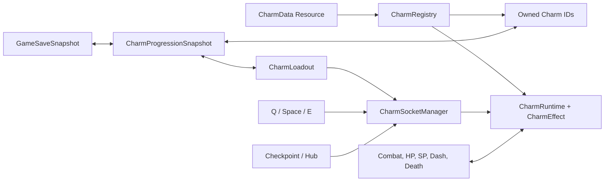

# Charm System - Business Logic

Catalog ngày 27/11/2026 có 25 charm, tất cả đều playable.
[Bảng thông số và từng ô Sheet Config cần cập nhật](../../plans/charm-gamefeel-playtest.md).

## 1. Mục đích và phạm vi

Charm System cho phép Player sở hữu, gắn và sử dụng Charm để nhận kỹ năng chủ động
(Active) hoặc hiệu ứng bị động (Passive). Hệ thống chịu trách nhiệm cho:

- catalog và validation của Charm;
- ownership, socket, loadout và lifecycle equip/unequip;
- activation, SP cost và cooldown của Active Charm;
- stat modifier, damage modifier và event proc của Passive Charm;
- safe-location permission, mua thêm socket, nguồn nhận Charm và snapshot save/load;
- công cụ debug để kiểm tra Charm trực tiếp trong game.

HUD, Equipment, pickup và giao dịch Silas dùng cùng definition với Registry.

## 2. Thuật ngữ

| Thuật ngữ | Ý nghĩa |
| --- | --- |
| Charm definition | `CharmData` Resource chứa ID, loại, balance, acquisition metadata và effect scene. |
| Registry | Catalog definition, ownership và runtime đang equip của một Player. |
| Socket | Một vị trí gắn Charm, cố định theo phím Q, Space hoặc E. |
| Loadout | Số socket đã mở và Charm ID đang nằm trong từng socket. |
| Runtime | Trạng thái phát sinh khi equip, gồm effect instance và cooldown còn lại. |
| Effect | Logic gameplay của một Charm; được tạo khi equip và hủy khi unequip. |
| Safe location | Vùng cho phép đổi loadout và mở socket, ví dụ Checkpoint hoặc Hub. |
| Proc | Một lần kiểm tra xác suất của Passive theo một damage/death event cụ thể. |

## 3. Mô hình nghiệp vụ



Nguồn dữ liệu cân bằng duy nhất là các `.tres` trong
`gameplay/charms/charm_data`. Effect script không được giữ một bản balance riêng.

## 4. Luật dữ liệu và catalog

Mỗi Charm phải thỏa tất cả điều kiện sau:

1. Có `charm_id` ổn định, không rỗng và không trùng trong catalog.
2. Có `display_name` không rỗng.
3. `resource_cost` và `cooldown_seconds` không âm.
4. `proc_chance` nằm trong khoảng `0.0` đến `1.0`.
5. Active Charm phải có `effect_scene`.
6. Passive Charm không được có activation cost hoặc cooldown.
7. Charm chỉ được xem là playable khi data hợp lệ và có effect scene hợp lệ.

`CharmData.sprite: Texture2D` là ảnh tùy chọn dùng trong ô trang bị HUD. Gán ảnh ở
trường `Sprite` của từng `.tres` trong Inspector. Ảnh không tham gia validate hoặc
logic hiệu ứng: chưa có ảnh vẫn trang bị và dùng Charm bình thường.

`charm_id` là khóa dùng cho ownership, loadout, modifier source, proc result và save data.
Không dùng tên hiển thị hoặc node path làm khóa persistence.

## 5. Socket, ownership và loadout

### 5.1 Socket cố định

Hệ thống có đúng ba socket theo thứ tự:

| Socket ID | Input action | Phím mặc định |
| --- | --- | --- |
| `Q` | `charm_slot_q` | Q |
| `E` | `charm_slot_e` | E |
| `SPACE` | `charm_slot_space` | Space |

- Player mới bắt đầu với đúng một socket Q.
- Socket được mở tuần tự: Q, sau đó E, sau đó Space, dùng `SOCKET_UNLOCK_ORDER`.
- ID số vẫn giữ nguyên `Q = 0`, `SPACE = 1`, `E = 2`; thứ tự mở ô không dựa vào ID.
  Luật normalize và gắn Charm trong loadout cũng dùng thứ tự mở này. Thứ tự áp dụng
  modifier vẫn giữ Q → Space → E.
- Không thể có nhiều hơn ba socket.
- Passive Charm không đăng ký input; input trên socket chứa Passive không kích hoạt action.

### 5.2 Quy tắc equip

Equip chỉ thành công khi:

- Player đang ở safe location;
- socket đã được mở và đang trống;
- Charm tồn tại trong Registry và Player sở hữu Charm đó;
- cùng một Charm chưa được equip ở socket khác;
- effect có thể khởi tạo hợp lệ cho Player.

Unequip cũng chỉ được phép tại safe location. Khi unequip, effect phải gỡ modifier,
callback, active execution và runtime state thuộc Charm đó. Gỡ một Charm không được làm mất
modifier hoặc effect của Charm khác.

### 5.3 Safe location

Safe-location state được tổng hợp từ nhiều source. Loadout được phép thay đổi khi còn ít nhất
một source hợp lệ. Việc rời hoặc giải phóng một source không được tắt permission nếu source
khác vẫn còn hoạt động.

- Checkpoint thêm permission khi Player đi vào và xóa khi Player đi ra.
- **Safe room**: phòng `BaseRoom` có `safe_room = true` (Inspector, nhóm *Safe room*) giữ
  permission suốt thời gian Player ở phòng đó. Phòng là source, nên đổi phòng sẽ giải phóng
  nó và tự tắt permission.
  - Toàn bộ Hub: bật trên ba scene gốc `world/biomes/hub/base_scenes/base_*_room.tscn`, nên
    mọi phòng Hub kế thừa chúng (như `silas_tent.tscn`) đều là safe room. Hub trung tâm
    `castaway_cove.tscn` kế thừa thẳng `hub_room.tscn` nên tự bật cờ trên gốc scene.
  - Phòng nghỉ có lửa trại: bật trên từng phòng (hiện là Coral Valley `room_00`, `room_05`,
    `room_07`). Phòng boss `room_08` bật cờ khi Blubberbeard đã bị hạ.
    Lửa trại chỉ là prop phá được, không tự tạo permission; đặt lửa trại vào phòng mới thì
    bật thêm cờ cho phòng đó.
- UI visibility không quyết định safe-location state.

## 6. Mở khóa socket và economy

Giá socket do caller cung cấp; Charm System chưa hard-code bảng giá. Transaction mua socket
tuân theo thứ tự:

1. Validate manager, economy adapter và giá không âm.
2. Kiểm tra safe location và giới hạn ba socket.
3. Kiểm tra đủ tiền.
4. Trừ tiền qua `CharmEconomyAdapter.try_spend()`.
5. Mở socket kế tiếp.
6. Nếu bước mở socket thất bại bất ngờ, hoàn tiền toàn bộ.

Mua thất bại do request sai, ngoài safe location, đã đạt giới hạn, thiếu tiền hoặc economy từ
chối đều không được làm mất currency.

## 7. Active Charm

`CharmData.content_status` phân biệt `PLAYABLE`, `PROTOTYPE` và `DISABLED`. Prototype chỉ được
equip qua Runtime Charm Debug, không đi qua shop, enemy drop, fixed reward hoặc save production.
`drop_chance = -1` là giá trị chưa chốt, không phải tỷ lệ 0%. Charm playable bắt buộc có
`drop_chance`; `0` nghĩa là không tự rơi từ quái, chỉ nhận qua pickup hoặc rương được đặt sẵn.

Khi người chơi nhấn Q, Space hoặc E, activation đi qua transaction sau:

1. Socket phải tồn tại, đã mở và có Charm.
2. Player phải còn sống và tạo được `AttackContext` hợp lệ.
3. Runtime phải đang equip, là Active Charm và hết cooldown.
4. Effect phải validate được context/target/execution trước khi trừ SP.
5. Player phải đủ SP.
6. Effect bắt đầu thực thi.
7. SP được trừ atomically; nếu trừ thất bại, execution bị hủy.
8. Cooldown chỉ bắt đầu sau khi activation và SP transaction thành công.

Cooldown thuộc từng `CharmRuntime`, không ghi ngược vào Resource dùng chung và không dùng
chung dictionary cooldown của weapon. Unequip hoặc scene teardown phải hủy execution đang chạy.

## 8. Passive Charm, damage và proc

Passive effect được áp dụng khi equip và gỡ khi unequip. Ba nhóm hook chính:

- stat modifier: max HP, max SP và movement speed;
- damage modifier: outgoing/incoming/attack-level damage;
- event: damage dealt, damage received, target defeated và dash lifecycle.

Thứ tự damage hiện tại:

1. Weapon base damage.
2. Weapon forge multiplier.
3. Charm modifier theo thứ tự socket Q, Space, E.
4. Damage được áp dụng lên target.
5. `damage_dealt` và `target_defeated` được dispatch sau khi có damage thực tế.

Mỗi hit tạo một `DamageContext` riêng. Kết quả proc được ghi theo `charm_id`, gồm success,
reason và multiplier. Một Charm không được roll hoặc áp dụng hai lần trên cùng context. RNG
thuộc từng proc effect và có thể inject seed để test deterministic.

Stat modifier dùng `charm_id` làm source key. Công thức movement stat là:

```text
final = max(0, (base + tổng flat modifier) * tích multiplier)
```

Khi max HP/SP giảm, current HP/SP bị clamp về max mới và component phát signal để HUD cập nhật.

## 9. Danh sách Charm playable

### 9.1 Active

| Charm | Acquisition | SP | Cooldown | Business effect |
| --- | --- | ---: | ---: | --- |
| Arrow Rain | Merchant/enemy drop 5% | 100 | 6 s | Đứng yên tới phát cuối. Bắn 8 mũi trong 1 s, mỗi mũi 1× sát thương cơ bản. |
| Crescent Cleave | Merchant/enemy drop 5% | 100 | 4 s | Giữ chân qua cú quét 0,12 s, bán nguyệt 180°, bán kính 2,8. Mỗi mục tiêu nhận 2× một lần. |
| Shadow Lunge | Merchant/enemy drop 5% | 125 | 6 s | Lướt tối đa 5 đơn vị trong 0,18 s, dừng ở địa hình hoặc địch đầu tiên. Đâm 3× và có thể bị ngắt khi nhận đòn. |
| Buckshot Salvo | Merchant/enemy drop 5% | 150 | 7 s | Giữ chân 0,18 s rồi bắn 8 viên theo 8 hướng, tầm 8 đơn vị, 0,5× mỗi viên. |
| Tide Grapple | Rương thưởng Raid `room_16` (Coral Valley) | 150 | 5 s | Tầm 7 đơn vị, 2,5× khi móc chạm. Kéo quái nhỏ và choáng 1 s. Kéo Foxy tới cách boss, địch lớn hoặc địa hình 1 đơn vị. Cọc neo (`grapple_post.tscn`) là địa hình móc được, dùng để vượt vực ở các [phòng kỳ quan](../../world/coral_valley_wonder_rooms.md) và là chìa khóa giữa map Coral Valley ([tiến trình](../../systems/coral_valley_progression.md)). |
| Glacial Spikes | Borelis | 125 | 7 s | Vận 0,28 s. Chốt hướng nhìn lúc nhấn, chông mọc từ gần ra xa theo ba hàng 1–2–3, cách nhau 0,12 s. Mỗi chông kiểm tra va chạm với hurtbox mục tiêu ngay lúc trồi lên. Mỗi mục tiêu nhận 1,5× một lần, quái thường choáng 1 s. |
| Meteor Strike | Cinderclaw | 250 | 10 s | Vận 0,38 s, ba thiên thạch 2× mỗi viên. Vùng lửa tồn tại 3 s, mỗi giây gây Bleed bằng 2% HP tối đa. Các vùng giao nhau dùng chung một tick cho mỗi mục tiêu. |
| Devil Contract | Queen Seraphina | Toàn bộ SP, cần ≥300 | 20 s | Ký khế ước trong 0,32 s. Trong 10 s sau khi ký, tàn lửa đỏ bao quanh Foxy, sát thương và tốc độ chạy đều ×1,3. Hồi SP tự nhiên và từ vật phẩm đều bị khóa. |

Player sở hữu khóa vận theo effect để một effect kết thúc chỉ trả khóa của chính nó. Foxy tiếp tục chịu trọng lực và nhận đòn trong lúc vận. Hit, chết hoặc tháo charm giải phóng khóa. Hệ thống vẫn nhận thao tác nhả phím của Salute.

### 9.2 Passive stat

| Charm | Acquisition | Business effect |
| --- | --- | --- |
| Gale Pace | Merchant/enemy drop 10% | Movement speed x1,2; max SP -100. |
| Turtle Shell | Merchant/enemy drop 10% | Max HP +2; movement speed x0,85. |
| Endurance Vessel | Merchant/enemy drop 10% | Max SP +150; max HP -2. |

### 9.3 Passive event/condition

| Charm | Acquisition | Business effect |
| --- | --- | --- |
| Life Steal | Merchant/enemy drop 10% | Hit normal attack hợp lệ thứ 12 hồi 1 HP; không vượt max HP. |
| Double Strike | Merchant/enemy drop 10% | Hit normal attack hợp lệ thứ 4 roll 50% để nhân đôi damage. |
| Chaos Collector | Merchant/enemy drop 25% | Mỗi normal attack gây damage thực tế cộng 2 CP. |
| Backstabber | Merchant/enemy drop 10% | Melee normal attack từ nửa sau hướng nhìn của target gây 150% damage. Không áp dụng cho ranged hoặc skill. |
| Crimson Band | Silas / quái 10% | Đòn thường lên quái hoặc boss gây Bleed 0,5 HP mỗi giây trong 3 nhịp; cỏ và vật phá được không chảy máu. Đánh tiếp làm mới số nhịp và giữ thời điểm tick kế tiếp. |
| Skull Cracker | Silas / quái 10% | Đòn thường thứ tư gây sát thương lên cùng một quái giữ nguyên frame và choáng 0,6 s. Boss miễn choáng. |
| Momentum Strike | Silas / quái 10% | Hoàn thành dash nạp ×1,5 cho toàn bộ đòn thường kế tiếp. Tiêu lượt khi phát đòn kể cả hụt. |
| Fortune Leaf | Silas / quái tinh anh 25% | Nhân xác suất rơi vật phẩm của quái với 1,10, tối đa 100%. Vàng, ghi chú và thưởng boss giữ luật riêng. |

## 10. Acquisition

### 10.1 Boss reward

Fixed reward dùng definition có nguồn `fixed_boss_reward`. Glacial Spikes, Meteor Strike và Devil Contract là thưởng boss 100%. Tide Grapple có nguồn riêng `fixed_trial_reward`: thưởng cố định trong rương thưởng Raid `room_16` (Coral Valley), nhặt như mọi Charm rơi. Rương boss Blubberbeard giờ cho Chìa khóa Thủy Triều. Checkout có encounter Blubberbeard. Ba boss mới chỉ có thể kiểm tra qua đường grant và pickup.

Năm prototype cũ chưa có nguồn nhận đã chốt nay là playable với `drop_chance = 0`: nhặt được từ
pickup đặt sẵn, không tự rơi. Adrenaline Surge đã bị bỏ khỏi game (data, item, icon, effect).
Anchor đặt ấn tốn 300 SP, HUD hiện phím gọi về trong 5 s. Hồi chiêu 8 s từ lúc gọi về hoặc hết hạn. Whirlpool vận 1,5 s, kéo quái thường và nổ 2,5×, tốn 300 SP, hồi 8 s. Salute giữ chân và tiêu 100 SP/s, nhả phím hoặc cạn SP thì nổ và bắt đầu hồi 6 s. Death Bloom nổ sau 0,32 s khi hạ quái bằng đòn thường, gây 1 HP cho cả Foxy lẫn địch trong bán kính 2. Shadow Renment để bóng ở điểm bắt đầu dash, nổ 1,5× sau 0,5 s trong bán kính 2. Hai passive chưa có nguồn hoặc tỉ lệ nhận trên Sheet.

### 10.2 Shop pool

Shop pool hiện chỉ nhận Passive Charm thỏa tất cả điều kiện:

- data hợp lệ và effect scene tồn tại;
- acquisition source là `shop` hoặc `merchant_or_enemy_drop`;
- chưa owned, trừ khi caller chủ động yêu cầu gồm cả owned.

Placeholder, Active Charm và data invalid không được xuất hiện trong pool. Random offer sử dụng
`RandomNumberGenerator` do caller truyền vào để có thể tái hiện bằng seed.

## 11. Persistence

`CharmProgressionSnapshot` version 1 serialize payload thuần `Dictionary`:

```json
{
  "version": 1,
  "unlocked_socket_count": 1,
  "owned_charm_ids": ["gale_pace"],
  "equipped_charm_ids": ["gale_pace", "", ""]
}
```

Quy tắc restore:

- socket count bị clamp trong khoảng 1 đến 3;
- ID rỗng, trùng hoặc không còn trong catalog bị bỏ qua;
- chỉ Charm owned mới được restore vào loadout;
- entry ngoài số socket đã mở bị bỏ qua;
- duplicate equip chỉ giữ entry hợp lệ đầu tiên theo thứ tự socket;
- payload rỗng hoặc dependency không hợp lệ làm restore thất bại an toàn.

Snapshot là adapter mà [save system](../../systems/save_system.md) dùng cho nhóm Charm;
module này không tự ghi file và không tạo autoload.

## 12. Signal và rejection reason cho UI

`CharmSocketManager` phát các signal chính:

- `socket_unlocked(socket_id, unlocked_socket_count)`;
- `safe_location_changed(is_safe)`;
- `loadout_changed(socket_id, charm_id)`;
- `loadout_change_rejected(reason)`;
- `charm_activation_rejected(socket_id, reason)`.

Input Active dùng lifecycle chung `just_pressed -> pressed(delta) -> just_released`.
One-shot Charm chỉ xử lý press; Charm hai giai đoạn/channeling có thể giữ state ở effect và
nhận release/recast mà không tạo manager riêng. Cost/cooldown là policy của effect; state vẫn
nằm trong `CharmRuntime` và không mutate `.tres`.

Loadout rejection có thể là `unsafe_location`, `socket_locked`, `charm_not_owned`,
`duplicate_charm`, `socket_occupied` hoặc `registry_rejected`. Activation rejection có thể là
`socket_unavailable`, `actor_unavailable`, `actor_context_unavailable`,
`attack_context_unavailable`, `registry_unavailable` hoặc `registry_rejected`.

Socket purchase rejection có thể là `invalid_request`, `unsafe_location`, `max_socket_count`,
`insufficient_funds`, `economy_rejected` hoặc `unlock_failed`.

## 13. Runtime debug

Trong debug build, Remote Inspector của `Player/CharmSocketManager` có nhóm
`Runtime Charm Debug (Debug Builds Only)`:

1. Chọn `Debug Socket`: Q, Space hoặc E.
2. Chọn `Debug Charm` từ dropdown lấy trực tiếp từ Registry.
3. Charm được equip ngay; socket cần thiết được mở tạm trong instance đang chạy.
4. Chọn `<Unequip>` để tháo Charm khỏi socket đang chọn.

Scene Foxy khởi động với loadout Charm sạch. Trong debug build có nút `Grant All Charms` ở HUD;
lần bấm đầu grant ownership cho toàn bộ Charm đã đăng ký, lần bấm tiếp theo
đổi thành `Clear All Charms` và xoá ownership/equip hiện tại. Trạng thái grant được giữ qua
scene transition để Player mới ở map tiếp theo vẫn sở hữu các Charm đó. Nút không tự equip
Charm sau khi grant và không có hiệu lực trong release build.

Debug equip qua Remote Inspector bỏ qua ownership và safe-location restriction, không grant
ownership và bị từ chối trong release build. Trong debug build, Equipment UI dùng đường debug
này cho Charm đã owned, cho phép test equip/unequip và mở socket trên map không có Checkpoint.
Nó chỉ phục vụ gameplay verification, không phải flow sản phẩm.

## 14. Dependency và giới hạn hiện tại

- Silas bán các passive mới bằng `MerchantTransactionService`. Mua charm mở ownership một lần. Fortune Leaf chỉ rơi từ quái tinh anh.
- Quái không rơi charm trong phòng có `enemy_charm_drops = false` (`BaseRoom`, nhóm Loot). Ba
  scene phòng gốc của Coral Valley tắt cờ này, nên quái Coral Valley không rơi charm; vật phẩm,
  vàng, ghi chú và thưởng boss vẫn rơi như cũ.
- Snapshot lưu ownership và loadout của charm playable. Prototype chỉ dùng qua debug.
- Khi chuyển scene, `PlayerSceneState` mang nguyên ownership và loadout sang Foxy mới. Ở bản
  debug, charm prototype đã cấp/equip bằng công cụ debug cũng được giữ lại
  (`CharmRegistry.restore_owned_ids`); bản release vẫn chỉ nhận charm playable.
- Borelis, Cinderclaw và Queen Seraphina cần gắn pickup vào encounter khi các scene boss được bổ sung.

## 15. Acceptance và regression tests

Các test độc lập chính:

- `gameplay/charms/active/charm_active_test.gd`;
- `gameplay/charms/passive/charm_passive_test.gd`;
- `gameplay/charms/passive/charm_event_passive_test.gd`;
- `gameplay/charms/progression/charm_progression_test.gd`;
- `test/charm_gameplay_test.gd` dùng Foxy, HUD, Crab, Blubberbeard và Meteor Staff trong arena;
- `test/charm_item_pickup_test.gd` và `gameplay/merchant/silas_merchant_test.gd` kiểm tra nhận và mua;
- `test/test_scene.tscn` cho 1 socket ban đầu và Gale Pace equip/unequip tại test zone.

Trước khi merge phải đạt `gdlint`, `gdformat --check`, Godot import/reference check, toàn bộ
harness Charm, Player combat regression và smoke test scene liên quan.

## 16. VFX và phản hồi khi Charm kích hoạt

Các Active dùng VFX có fade và màu riêng, thay phần mesh placeholder hiển thị.
Collision shape vẫn giữ nhiệm vụ hit detection; VFX không quyết định damage.

| Charm | Phần nhìn và impact |
| --- | --- |
| Arrow Rain | Telegraph vàng, vệt sáng theo hướng bay, tia va chạm từng mũi và nhịp kết mạnh hơn. Hitstop cục bộ lên mục tiêu, không ngắt cả loạt tên. |
| Crescent Cleave | Tái sử dụng `MeleeSlashVFX` cho vệt chém 180 độ, lõi sáng và vệt phụ. Hit đầu mỗi lần cast gọi global hitstop 80 ms, rung 8 px. |
| Shadow Lunge | Vệt năng lượng tím nhiều lớp theo quãng lướt thực tế, burst ở đầu/cuối và va chạm. Hit đầu gọi hitstop 80 ms, rung 8 px. |
| Buckshot Salvo | Sprite viên đạn kim loại có đuôi lửa tỏa tròn, khói thuốc tại nòng và atlas spark/mảnh đạn khi trúng; hitstop cục bộ khi trúng. |
| Tide Grapple | Móc thép phóng ra cùng dây xích có mắt kim loại. Trúng: flash bám, dây căng theo mục tiêu đang bị kéo rồi thu về. Hụt: móc rỗng chúc xuống, dây chùng và thu về, không có flash trúng. |
| Abyssal Whirlpool | Các nhánh nước xoắn vào tâm, kết thúc bằng sóng nổ và rung; chỉ hitstop khi có damage thực tế. |
| Dead Man's Anchor | Sprite mỏ neo rơi xuống điểm đặt. Phím gọi về hiện cạnh ô trang bị. Viền lam rút theo chiều kim đồng hồ từ đỉnh ô, theo đúng phần thời gian gọi về còn lại. Sau 2,5 s còn nửa chu vi. Gọi về thành công hoặc hết 5 s thì ô chuyển sang cooldown. Khi gọi về, hiện đường sáng và burst. |
| Dead Man's Salute | Vòng năng lượng co vào khi charge, bám theo người chơi và mở rộng đúng radius; sóng nổ khi thả, impact tăng theo thời gian charge. |

`CharmVfx` tại `gameplay/charms/active/charm_vfx.gd/.tscn` dùng
`charm_energy.gdshader` cho burst, stream, vortex, anchor, charge và telegraph.
Scene sở hữu material riêng từng instance và tự giải phóng VFX ngắn hạn.
Field/charge được effect giữ và hủy cùng activation. Tide/Buckshot dùng thêm atlas alpha
trong `assets/sprites/effects/charms/`; không cần autoload mới hoặc wiring bổ sung
trong scene Player. Có thể chỉnh palette, lifetime và kích thước ở
`CharmVfx`; hitstop/shake của các execution dùng hitbox nằm trong nhóm `Presentation`.

`CharmSpriteVfx` phát atlas 4×3 và quay sprite theo hướng bay chiếu lên camera.
`BuckshotProjectileAttack` gắn sprite vào chính execution sở hữu hitbox, nên viên
đạn và vùng gây damage cùng di chuyển. `TideGrappleVisual` nhận hai đầu dây từ
execution; mesh ribbon chỉ mang texture mắt xích lặp, không còn vẽ line xanh.
Tide dùng raycast chọn điểm đến, sau đó **chỉ resolve damage/pull khi móc bay tới**.
Hitstop/shake cũng xảy ra ở thời điểm chạm đó. Mục tiêu di chuyển hoặc bị kéo thì
móc bám theo; mục tiêu mất trước khi chạm chuyển sang nhánh hụt.

Atlas `tide_hook.png` có hàng outbound / contact-latch / empty-return;
`buckshot_projectile.png` có hàng projectile / impact / muzzle. Cả hai là 1024×768,
12 frame vuông 256×256. `tide_chain.png` là texture 768×256 lặp ngang, lỗ mắt xích
có alpha. `generation.json` cùng thư mục ghi đầy đủ prompt, ảnh nguồn và kích thước.
Chiều rộng móc, mắt xích, độ dài một tile chỉnh trong `TideGrappleVisual`.
Tốc độ phóng/thu chỉnh bằng `hook_speed` / `return_speed` tại `tide_grapple.tres`.

`CharmRuntime.proc_triggered(message, color)` là signal chỉ dành cho presentation.
Effect phát signal sau khi lợi ích có điều kiện thực sự xảy ra. `EquipmentControl` nối
signal cho từng runtime đang equip và ngắt khi đổi/tháo Charm hoặc HUD rời scene.
`gameplay/player/hud/charm_proc_feedback.gd/.tscn` dựng phần trình bày của một lần kích hoạt:
- icon chớp trắng rồi nhuộm màu proc, punch scale 1,45 lần, nảy lại;
- khung ô nảy 1,12 lần;
- một viền hình thoi màu proc loang ra từ ô;
- nhãn nổi phía trên ô, font chính của Inventory (`inventory_menu_theme`, Patrick Hand cỡ 26).
  Nhãn bật to rồi bay lên, giữ khoảng 0,65 giây rồi mờ dần, và tự dịch ngang để không tràn khỏi
  mép màn hình.

Charm Chủ động có thêm phản hồi riêng. Ba signal trình bày của `CharmRuntime` do
`CharmRegistry.input_pressed` phát:

| Signal | Khi nào | HUD |
| --- | --- | --- |
| `activated` | Charm Chủ động kích hoạt thành công | Tên charm (in hoa) bật lên, icon chớp và phồng 1,6 lần nổi trên lớp hồi chiêu, khung nảy, hai viền hình thoi loang nối nhau. Màu lấy từ màu chủ đạo của icon charm. |
| `activation_rejected(reason)` | Bấm khi đang hồi chiêu (`cooldown`) hoặc thiếu SP (`cost`) | Ô rung ngang, icon nháy đỏ, chữ nhỏ `NOT READY` / `NO SP`. Các lý do khác (đang thi triển charm khác, effect từ chối) không hiện gì. |
| `cooldown_ready` | Hồi chiêu chạy về 0, hoặc bị reset | Icon nảy nhẹ 1,18 lần, chớp sáng và một viền mảnh; không có chữ. |

`CharmProcFeedback.bind_runtime` tự nối và ngắt các signal này theo charm đang ở ô.

Lớp phản hồi vẽ trên toàn HUD (`z_index = 20`). Ô đang kích hoạt được nâng lên trong lúc punch,
nên nhãn và icon phồng không bị các ô bên cạnh che. Các thông số chỉnh trong nhóm Icon, Ring,
Word và Rejection của scene. Tween dùng thời gian thực để vẫn rõ trong hitstop; các sự kiện
trong 120 ms được gộp về mặt trình bày để tránh chồng animation.

| Passive | Nhãn / điều kiện |
| --- | --- |
| Life Steal | `+1 HP` (hoặc lượng HP thực hồi); chỉ hiện khi `heal()` trả về giá trị dương, không hiện khi đầy HP. Mốc hit vẫn đọc từ resource, hiện là 12. |
| Double Strike | `DOUBLE!` sau hit gây damage có kết quả proc thành công. |
| Backstabber | `BACKSTAB` sau hit gây damage được áp dụng bonus đánh sau lưng. |
| Chaos Collector | `CHAOS READY` khi chính lượng Chaos cộng bởi Charm đưa thanh từ chưa đầy sang đầy; không nhấp nháy ở mọi hit. |

Fortune Leaf chớp xanh ở pickup khi chính phần tăng xác suất tạo ra lượt rơi. Crimson Band chỉ báo BLEED khi bắt đầu chuỗi trên một mục tiêu. Momentum Strike và Skull Cracker báo lúc nạp và lúc gây choáng.

Các file tích hợp của phần presentation:

| Thư mục | File | Vai trò |
| --- | --- | --- |
| `gameplay/charms/active/` | `charm_vfx.gd`, `charm_vfx.tscn`, `charm_energy.gdshader` và các `.uid` tương ứng | VFX dùng chung, palette, lifetime và shader. |
| `gameplay/charms/active/` | `charm_active_attack.gd`, `charm_active_attack.tscn` | Trail và impact từ hitbox, bỏ mesh placeholder. |
| `gameplay/charms/active/` | `arrow_rain_attack.gd`, `arrow_rain_attack.tscn`, `arrow_rain_effect.gd`, `arrow_rain_telegraph.gd`, `arrow_rain_telegraph.tscn` | Trail từng tên, nhịp kết và vùng báo trước. |
| `gameplay/charms/active/` | `crescent_cleave_attack.gd`, `crescent_cleave_attack.tscn` | Quét vệt chém và impact một lần mỗi cast. |
| `gameplay/charms/active/` | `shadow_lunge_effect.gd`, `buckshot_salvo_effect.gd` | Palette lướt và điều phối loạt đạn. |
| `gameplay/charms/active/` | `buckshot_projectile_attack.gd`, `.tscn`, `charm_sprite_vfx.gd`, `charm_sprite_vfx.gdshader` | Projectile/impact/muzzle bằng atlas và playback dùng chung. |
| `gameplay/charms/active/` | `tide_grapple_attack.gd`, `.tscn`, `tide_grapple_visual.gd`, `.tscn`, `tide_chain.gdshader` | Các pha bay/chạm/thu, móc và mắt xích, hit/miss riêng. |
| `gameplay/charms/active/` | `abyssal_whirlpool_effect.gd`, `dead_mans_anchor_effect.gd`, `dead_mans_salute_effect.gd` | Field, marker, charge và release VFX. |
| `gameplay/charms/charm_data/` | `arrow_rain.tres`, `tide_grapple.tres` | Timing loạt tên, thời gian bay và tốc độ phóng/thu móc. |
| `assets/sprites/effects/charms/` | `tide_hook.png`, `tide_chain.png`, `buckshot_projectile.png`, `generation.json` và import tương ứng | Sprite VFX, nguồn và prompt tạo ảnh. |
| `gameplay/charms/base/` | `charm_runtime.gd` | Signal proc cho UI. |
| `gameplay/charms/passive/` | `life_steal_effect.gd`, `double_strike_effect.gd`, `backstabber_effect.gd`, `chaos_collector_effect.gd` | Phát feedback tại điều kiện thực sự có hiệu lực. |
| `gameplay/player/hud/` | `charm_proc_feedback.gd`, `charm_proc_feedback.tscn`, `charm_proc_feedback.gd.uid`, `equipment_control.gd` | Animation icon và kết nối/ngắt runtime theo loadout. |
| `docs/gameplay/economy/` | `charm_system.md` | Thông số, cách tích hợp và điểm chỉnh sửa. |

## 17. Sprite animation riêng khi cast Active

Mười một Active trong bảng dưới dùng sheet Foxy + VFX riêng trong
`assets/sprites/foxy/charm_casts/`. Sheet ngang có lưới 4×2, sheet dọc có lưới 4×4.
Riêng Whirlpool dùng 24 hình cho mỗi góc nhìn của Foxy Spine. Sheet ngang có lưới
8×3. Sheet dọc 8×6 chứa hình lưng ở nửa trên và hình chính diện ở nửa dưới.
Mỗi frame là một ô RGBA 256×256. `foxy_reference.png` được render từ Foxy Spine đang
dùng trong `gameplay/player/foxy.tscn`; `generation.json` lưu đầy đủ prompt và nguồn
của từng sheet được tạo bằng imagegen.

| Sheet / profile | Động tác |
| --- | --- |
| `arrow_rain` | Kéo cung năng lượng, bắn lên cao, thu cung và tan vệt gió. |
| `crescent_cleave` | Lấy đà, vung đao trăng vàng, kéo theo vệt phụ và thu thế. |
| `shadow_lunge` | Co người, đâm lướt, dư ảnh tím và khói tan. |
| `buckshot_salvo` | Gọi súng, bắn loạt đạn tỏa, giật tay và tan khói. |
| `glacial_spikes` | Mỗi tay tụ một quả cầu băng. Foxy nâng cả hai lên rồi nện xuống đất đúng lúc hàng chông thứ nhất mọc. Từng cụm tinh thể có cạnh bắt sáng và mảnh băng văng lên. |
| `meteor_strike` | Gom hai đốm lửa, nâng tay và phóng thiên thạch. |
| `devil_contract` | Mở khế ước, ký bằng ấn đỏ và tung tàn lửa quanh người. |
| `tide_grapple` | Vung neo, phóng xích nước, ghì kéo và thu xích. |
| `abyssal_whirlpool` | Hai bàn tay tụ cầu nước, mở ra khi xoáy lớn rồi hạ xuống. Cầu vỡ thành giọt khi xoáy nổ. |
| `dead_mans_anchor` | Frame 0–1 thả neo, frame 2–3 tiếp đất. Frame 5–7 gọi về và tái hiện. |
| `dead_mans_salute` | Frame 0–3 vào charge, lặp 2–3 khi giữ; frame 4–7 nổ và thu thế. |

Theo hướng cast trên màn hình, Foxy dùng hình lưng khi ngắm lên, hình chính diện
khi ngắm xuống và hình 3/4 khi ngắm ngang. Quay camera trong lúc cast cập nhật
góc nhìn tại frame đang phát. Mỗi bộ hình dọc xếp động tác nhìn từ sau trước động tác nhìn từ trước, cùng điểm đặt chân ở 50% chiều rộng và 90% chiều cao.

Whirlpool dùng skin G1/U/D của rig Foxy và đặt nước theo đầu xương cẳng tay.
Để dựng lại hai atlas, chạy Godot có renderer và SpineBridge với
`--path . --script res://scripts/art/bake_whirlpool_cast.gd` rồi import lại hai PNG.

`Visual/CharmCastAnimator` là child scene trong Foxy. `PlayerVisual` sở hữu quyền
hiển thị: khi cast, ẩn các lớp nhân vật bên dưới; khi kết thúc, hiện lại pose hiện
tại. Idle/run vẫn cập nhật bên dưới. Một hành động combat mới, trạng thái hit/death
hoặc unequip Charm ngắt cast tương ứng. Animation tôn trọng hitstop và SceneTree
pause. Sprite chỉ quyết định presentation; damage, collision, SP và cooldown vẫn
do execution/CharmRuntime hiện có quản lý.

Timing và pivot chỉnh trong mười một resource cùng tên tại
`gameplay/charms/charm_data/cast_animations/`:

- `frame_seconds`: tỷ lệ thời gian giữ từng frame; playback được fit theo thời lượng
  pha mà execution truyền vào, thay vì chạy hết sheet theo một timer cố định;
- `foot_anchors`: điểm chân chuẩn hóa trong từng ô, tính từ góc trên trái;
- `standing_height_fraction`: tỷ lệ chiều cao artwork đứng trong một ô;
- `frame_regions`: cửa sổ crop tùy chọn để bỏ phần VFX tràn từ ô lân cận; Tide còn
  crop phần móc/nước được vẽ sẵn bên phải Foxy để nhường chỗ cho móc bay thật;
- `phase_frames` ánh xạ tên pha sang các hình được phát theo thứ tự. Dùng `looping_phases` cho động tác lặp thực sự.
- `cast_frames`, `channel_loop_frames`, `release_frames`, `recall_frames`: các đoạn
  dùng cho từng pha.
- `held_phases` giữ hình cuối cho tới sự kiện kế tiếp hoặc khi bị ngắt. Animation tiến theo bước physics của gameplay. Sự kiện đặt pose đầu tiên ngay trong bước phát sinh.

| Charm | Nguồn timing Foxy |
| --- | --- |
| Arrow Rain | Mỗi sự kiện bắn tên thực tế bắt đầu một chu kỳ `volley` dài đúng khoảng giữa hai phát. Giữ tư thế kéo cung đến phát tiếp theo, sau đó `finish` tối đa 0,1 giây. Đổi số tên hoặc `volley_duration_seconds` thì nhịp Foxy đổi cùng. Không đợi tên cuối rơi xong mới thu cung. |
| Crescent Cleave | `active` theo `hit_duration_seconds`; execution hoàn tất mới chuyển `recover` 0,22 giây, cùng cửa sổ fade của vệt chém. |
| Shadow Lunge | `active` theo quãng quét/tốc độ execution; kết thúc quãng lướt hoặc chạm vật cản bắt đầu `recover` 0,1 giây. |
| Buckshot Salvo | `windup` khóa chân 0,18 s. Khi bắn, Foxy được di chuyển, animation chuyển sang `release` 0,18 s và đạn tiếp tục bay độc lập. |
| Tide Grapple | Execution phát `active` khi phóng, `latch` khi trúng, `miss` khi thu rỗng hoặc `retract` sau bám; mỗi pha truyền thời lượng bay/kéo thực tế. `recover` chỉ bắt đầu khi móc về tay. Contact giữ ít nhất 0,16 giây để đọc được cú bám. |
| Abyssal Whirlpool | Nhấn một lần. Hình 0–17 diễn tả 1,5 giây tụ nước, hình 18–23 diễn tả cú hạ tay, nước vỡ và thu thế trong 0,4 giây. |
| Dead Man’s Anchor | Foxy cúi tay khi thả neo. Marker chạm đất sau 0,22 s kích hoạt pose đặt ấn. Gọi về chuyển thẳng sang pose dịch chuyển. |
| Dead Man’s Salute | Hai hình giữ lực theo nhịp vòng sáng khoảng 0,56 s mỗi chu kỳ. Nhả phím hoặc cạn SP chuyển ngay sang pose nổ. |
| Glacial Spikes | Foxy đập tay khi hàng đầu trồi lên, giữ tay trên đất trong khi các hàng lan ra và thu tay khi hàng cuối đạt đủ chiều cao. |
| Meteor Strike | Kết thúc vận khi gọi viên đầu, giữ tay chỉ tới khi gọi viên cuối rồi thu thế. Từng viên xử lý va chạm riêng. |
| Devil Contract | Hết 0,32 s ký khế ước, tư thế bung ấn bắt đầu cùng lúc áp buff và bật hạt đỏ. |

Pha đang chờ giữ quyền hiển thị tới khi execution chuyển pha hoặc kết thúc. API
`play_charm_cast` nhận thêm hai tham số tùy chọn `duration_seconds`, `continue_only`.
Pha tiếp diễn dùng `continue_only=true`: sau hit, dash, đòn mới, chết hoặc unequip,
callback muộn từ loạt tên/móc cũ không giành lại pose của Foxy. Call site cũ vẫn
dùng được vì các tham số mới có giá trị mặc định. Không khóa input hoặc thay
combat state để giữ animation.

Các điểm tích hợp code/scene:

- `gameplay/player/effects/charm_cast_clip.gd`: cấu hình và kiểm tra clip;
- `gameplay/player/effects/charm_cast_animator.gd`, `.tscn`: playback và catalog;
- `gameplay/player/effects/charm_cast_sprite.gdshader`: alpha và mép ô sprite;
- `gameplay/player/foxy.tscn`: nối animator với Player/Visual;
- `gameplay/player/player_visual.gd`: quyền hiển thị và ngắt animation;
- `gameplay/player/spine_idle_preview.gd`: cung cấp kích thước/điểm chân chuẩn;
- `gameplay/player/player.gd`: API `play_charm_cast` / `cancel_charm_cast`;
- `gameplay/charms/base/charm_effect.gd`: helper presentation cho effect;
- mười một script `*_effect.gd` tương ứng trong `gameplay/charms/active/`: gọi đúng pha
  cast, channel, release hoặc recall.

Salute phát release từ chính effect nên vẫn có animation nổ khi tự nhả do cạn SP.
Anchor chỉ phát recall khi việc quay về được execution chấp nhận. Các actor kiểm
thử không có visual API vẫn chạy logic Charm như trước.

Kiểm chứng cập nhật VFX/timing (15/11/2026):

- Godot 4.7.2 import bằng `--editor --recovery-mode --import --quit` đăng ký class,
  scene và atlas thành công; môi trường hiện tại báo không ghi được editor settings
  trong AppData. Bản render cũng báo không ghi được shader cache, nhưng vẫn xuất
  được hình thực tế và chạy hết walkthrough.
- `gdlint` và `gdformat --check --line-length 100` qua trên 23 script liên quan.
- Các harness `charm_passive_test.gd`, `charm_event_passive_test.gd`,
  `charm_progression_test.gd`, `player_death_progress_test.gd` qua.
- `charm_active_test.gd` còn hai mismatch đã có trước: test kỳ vọng Arrow Rain
  damage 0,35 / projectile 35 HP, resource hiện là 1,5 / 150 HP. Không đổi balance
  hoặc expected value để làm xanh test trong công việc phần nhìn.
- Walkthrough dùng scene Foxy thật: Arrow Rain đủ tám phát ở volley 0,5 / 1 / 1,7
  giây; Tide hụt và trúng/kéo Crab; Buckshot gây damage và phát impact trên Crab;
  cả tám Active trả lại pose; hit ngắt không bị callback muộn giành lại; Salute
  cạn SP tự chuyển release và kết thúc. Không thêm test case hoặc CI.
