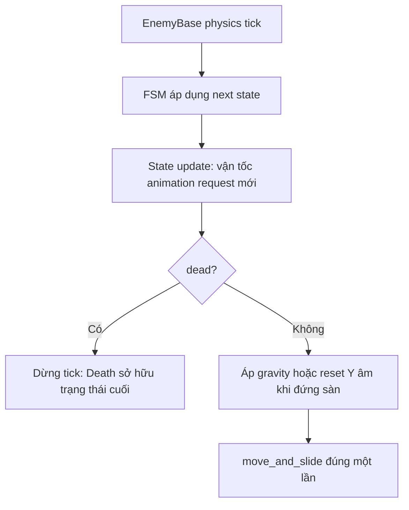
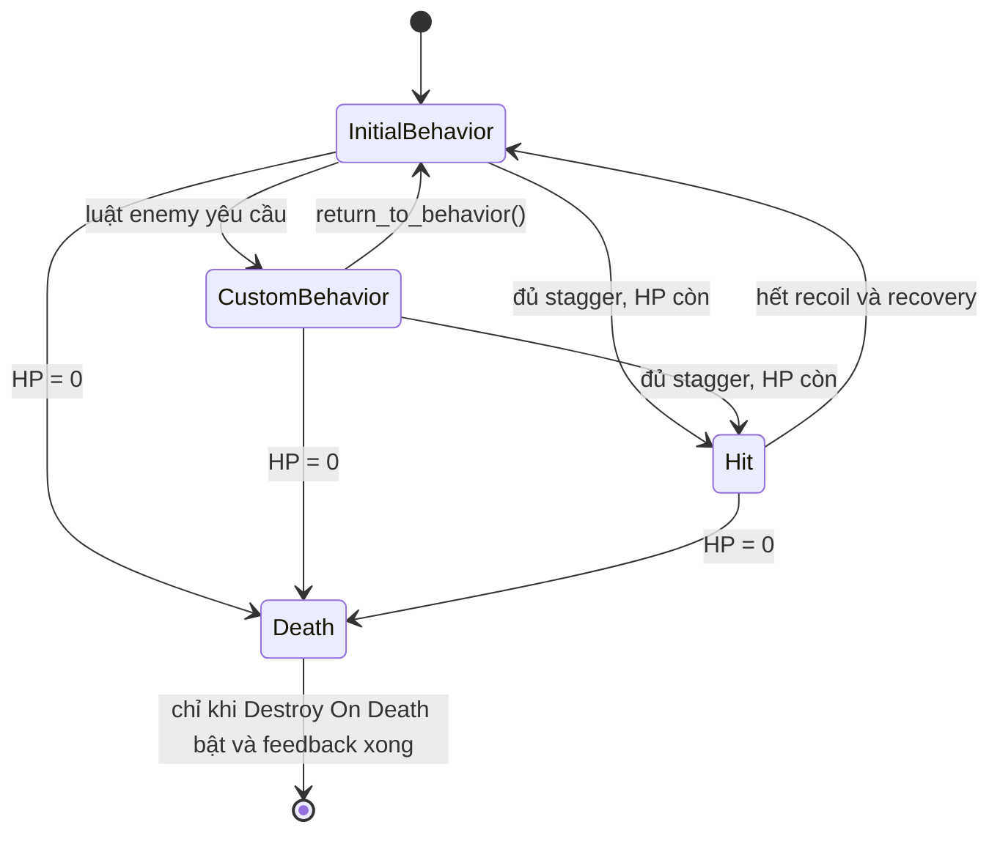

# Business logic: EnemyBase và enemy FSM

`EnemyBase` là khung dùng chung cho enemy 3D: máu, nhận sát thương, di
chuyển, hướng nhìn, animation theo hướng và FSM. Mỗi enemy chỉ thêm collider,
animation, state và luật riêng của mình.

> [!IMPORTANT]
> `EnemyBase` **không tự tạo hành vi tấn công hay phát hiện Player cho mọi
> enemy**. `TargetDetector`, `ActiveHitBox`, `ContactHitBox`, Front/Ground ray
> đều là thành phần tùy chọn. Chỉ thêm và bật chúng khi luật của enemy cần đến.

Scene gốc:

```text
gameplay/enemies/base/enemy_base.tscn
```

## Danh sách enemy và vai trò gameplay

| Enemy | Hành vi thường | Biến thể elite / lưu ý |
| --- | --- | --- |
| **Crab** | Nhận diện và đuổi player trong vùng hoạt động, chỉ đi ngang hoặc chéo 45°, không bao giờ đi thẳng lên/xuống; tuần tra khi không có mục tiêu. Khi đuổi, Crab đứng sang bên cạnh Foxy rồi kẹp càng (clip `attack`): rung màn hình 6 px và nứt đất nhỏ đúng lúc càng chạm đất. Trúng projectile của player khiến Crab tức giận và tạm mở rộng vùng nhận diện/di chuyển. | **EliteCrab** kế thừa hành vi Crab, giữ telegraph, charge và slam. Charge gồm các đoạn ngang/chéo (Foxy ở thẳng trên/dưới thì lao hai đoạn chéo hình chữ V). Slam có screenshake mạnh, hitstop ngắn, dư chấn và mặt đất nứt tại chỗ càng đập. Một lần khi còn tối đa 50% HP, Elite phóng số trứng ngẫu nhiên; trứng rơi và nở thành Crab thường. |
| **Hermit Crab** | Tuần tra đến khi thấy Foxy; khóa vị trí Foxy, wind-up rồi dash đến vị trí đã khóa. Contact damage chỉ bật trong lúc dash. Kết thúc mỗi dash phải đứng yên chạy stun (stunned, mặc định 1.6 giây); nếu va người chơi hoặc vật cản thì chạy hit (charge_hit, mặc định 0.84 giây) trước stun. Nếu dash gặp tường hoặc mép rơi, nó dừng damage, quay đầu, xóa target và tạm tắt `TargetDetector` trong `unreachable_target_ignore_duration` (mặc định 2 giây), rồi mới quét lại player. | **EliteHermitCrab** lấy đà một lần, rồi lao ba lần liên tục và khóa lại vị trí Foxy ở đầu mỗi lần; không lấy đà hoặc stun giữa chuỗi. Chỉ sau lần thứ ba mới stun. Trong lúc lao, hitbox phía trước gây damage cho player, phá DestructibleProp và hất enemy khác vuông góc sang bên gần nhất, không gây damage cho enemy. Tường cố định/mép vực ngắt chuỗi an toàn; va tường chạy hit rồi stun. Thân elite xuyên qua player/enemy chỉ trong dash; kết thúc hoặc Hit/Death phải khôi phục va chạm. |
| **Barrel** | Đứng yên; thấy player thì charge rồi bắn một loạt 3 viên. Hướng bắn khóa lúc hết charge nên cả loạt bay thẳng một đường (`retarget_each_shot` trên state `Shoot` để ngắm lại từng viên). Đã charge là bắn hết loạt, kể cả khi player rời tầm. | **EliteBarrel** bắn 2 quạt × 4 viên trong một lượt thường, quạt sau lệch nửa khoảng cách để lấp khe quạt trước. Sau số lượt thường được cấu hình, nó chuyển đỏ, phình và rung, rồi sau `charged_cooldown` tự vào lượt 360° (không cần player trong tầm): cảnh báo vòng đỏ 1 s, bắn 4 vòng × 8 viên, tia đầu hướng về player và mỗi vòng xoay so le nửa khoảng cách (`special_volley_stagger`). Sau đó bắt đầu đếm lại. |
| **Coral Skeleton** | Bắt đầu ngủ; thức dậy khi player vào vùng gần, đuổi và bắn chùm hoặc liên tiếp. Mất mục tiêu thì đi quanh co về vị trí ban đầu, canh gác rồi ngủ lại. | Enemy thường; quy tắc và cấu hình chi tiết trong [business logic Coral Skeleton](./coral_skeleton_business_logic.md). |
| **Mushroom** | Ngụy trang xen kẽ đi lang thang theo nhịp nhảy; đuổi theo và có thể nhảy xa áp sát, gồng phun mây bào tử độc (tránh sinh chồng lên mây cũ), bật lùi ngắn và phản công khi bị đánh. | **EliteMushroom** giữ toàn bộ chiêu cũ, bổ sung **hai thế đứng chuyển đổi** (`FOOTLESS <-> LEGGED` với bộ bước chân mượt, né đòn/bọc sườn và giữ cự ly), chiêu **Thổi Luồng Khói & Bào Tử Vật Lý** (`SporeStream`) và chiêu cận tử **Đại Bào Tử** (`GreatSpore`: thả bào tử bay lơ lửng đáp xuống thành bãi độc hoặc Trứng Nấm nở ra Mushroom thường). Chi tiết tại [business logic Mushroom](./mushroom_business_logic.md). |
| **Venom Vine** | Cố định vị trí (không di chuyển, miễn nhiễm knockback), bắt đầu ở `Dormant` trên mặt đất, phát hiện theo 2 vòng cự ly, bắn parabol đón đầu & lệch ngẫu nhiên quanh Player (kèm xác suất `direct_aim_chance = 0.3` ném thẳng đúng vị trí Player khi chưa có vũng axit phủ sẵn) và tránh chồng vũng axit cũ, phản công hoặc chui gốc ngắn (`0.4s`, chui thì phải trồi lên chứ không trốn dưới đất). | **EliteVenomVine** kế thừa `VenomVine` (`21 HP`, `attack_damage = 0.5`, `knockback_resistance = 1.0`, mọi sát thương nhân từ `data.attack_damage`, giữ `direct_aim_chance = 0.0` lệch quanh Player), **bắt đầu `Dormant` trên mặt đất** (kèm node `BurrowPit` chỉnh tay trong scene), tầm phát hiện `10.0m` / tầm bắn `9.2m`, tắt mọi vòng telegraph mặt đất vùng Forest và tắt hoàn toàn hào quang Elite khi đang lặn dưới đất, giữ sát thương độc `<= 0.5 HP/tick`, nâng cấp **Bramble Pod Split**, **Thorny Snare Pool** (axit tím thạch anh + hạt sáng tím qua shader riêng, làm chậm còn `0.28×` nặng hơn độc thường `0.45×` mà không khóa Dash), **Smart Keep-Away Tunnel Relocate** (không dùng mô đất trượt trên cỏ; ẩn thân lâu `1.25s ± 0.35s` + pha ngầm `2.65s`, di chuyển xa ra vùng thoáng `5.4–10.6m` quanh Player ở cự ly ưu tiên `7.2m` thông qua `VenomVineRelocateHelper`; các chấm/đụn đất chỉ **trồi lên rồi chìm xuống tại chỗ** và giảm dần theo 3 nấc HP: `> 75%` `6–9` chấm không chấm giả, `40–75%` `3–4` chấm + `2` nhánh chấm giả + `1` mô đất nhử giả trồi rồi tụt xuống, `<= 40%` `2–3` chấm thật + bụi rung đất + `3` nhánh chấm giả + `2` mô đất nhử giả rồi mới nứt đất trồi lên thật ở `90%`; hễ vừa trồi lên thấy Player là phản phun độc nhanh `0.32s`) và **Lightning Thorn Tendril** (`<= 50% HP`, rễ gai mọc theo đường sấm sét rẽ nhánh dài hơn và animation `1.82s`). |

Các nhóm **Elite Normal Attack**, **Elite Special Attack** và **Elite Charged
Feedback** trong Inspector của EliteBarrel cấu hình số đợt, số viên, góc bắn,
nhịp bắn và cảnh báo; state `Scattershot` giữ thời gian cảnh báo thường/360°,
`cooldown` và `charged_cooldown`. Khi đã vào cảnh báo, lượt luôn bắn hết dù player
rời tầm; chỉ chết hoặc bị đổi state mới ngắt. Một lượt thường bị ngắt không được
tính; nếu lượt đặc biệt bị ngắt trước khi hoàn tất, Elite giữ trạng thái tích lũy
và tự thử lại sau cooldown. Damage của các viên vẫn lấy từ dữ liệu Elite.
Ngưỡng trong script mặc định là 5 lượt; scene EliteBarrel hiện cấu hình 3 lượt.

**Tầm gần của EliteBarrel.** Miệng thùng cao hơn hurtbox của Foxy nên đạn chỉ trúng khi đã bay
đủ xa để hạ xuống. Ba cơ chế che vùng mù đó:

- **Xịt mực sát miệng:** mỗi quạt xịt thêm hình nón mực xuống đất, tầm `point_blank_radius`
  (4,8), góc `point_blank_arc_degrees` (110°). Cảnh báo là hình nón tô đầy trong lúc telegraph.
- **Ink Slam** (state `Slam`, `states/elite_barrel_slam.gd`): Foxy vào trong
  `slam_trigger_radius` (3,6) thì thùng nện ngay, không chờ cooldown loạt đạn. Vận 0,75 giây
  trên vòng cảnh báo bán kính `slam_radius` (4,9), nhảy 0,3 giây, nện: gây một đòn, đẩy
  văng (`slam_push_multiplier`) kèm làm chậm và mực dính màn hình. Sau đó khựng 0,9 giây để
  phản công. Hồi `slam_cooldown` (4,5 giây); mỗi cú tính là một lượt thường cho việc tích lũy.
  Chỉ hình ảnh nhảy lên, thân và hurtbox ở yên. Bị ngắt hoặc chết thì cảnh báo được dọn.
- **Bùng mực mở đầu lượt 360°:** cảnh báo vòng đầy, nổ cùng bán kính Ink Slam rồi mới bắn
  các vòng. Đã tích đủ thì không dùng Slam. `special_spawn_radius` là 1,2 để đạn kịp hạ tới
  tầm người ngay ngoài vùng nổ; đổi bán kính nổ, điểm sinh hoặc vật lý đạn thì phải kiểm tra
  lại để không hở khoảng trúng.

Đòn bùng không xuyên tường (`WORLD`), chỉ trúng Player cùng cao độ; miễn nhiễm sau đòn của
Foxy ngăn đạn và mực xịt trúng hai lần. VFX ở `elite_barrel_ink_vfx.gd` và
`elite_barrel_ink_zone.gdshader` (cảnh báo, sóng mực, vũng loang), tái dùng tóe mực
`barrel_bullet_impact.tscn`.

Đạn Barrel là cục mực (`barrel_Projectiles.png`) quay theo hướng bay, rung nhẹ khi bay và
méo dẹt khi nảy. Mỗi loạt bắn phụt mực ở miệng (`barrel_muzzle_ink.tscn`, to theo
`Visual.scale`). Đạn chạm đất bắn tóe giọt mực và để lại vết loang mờ dần
(`barrel_bullet_impact.tscn`); chạm giữa không trung chỉ tóe giọt. `bullet_visual_scale`
chỉ phóng to hình (EliteBarrel 1.5); bán kính va chạm vẫn là shape `Sweep` của đạn.

Khi đạn làm Foxy **mất máu** (dash né hoặc đang miễn nhiễm sau đòn thì không), resource
`BarrelInkHit` trong ô `ink_hit` của Barrel đẩy Foxy theo hướng đạn bay, làm chậm và bắn
mực lên màn hình. Mực dùng `ink_overlay.gd` của bạch tuộc, không chặn thao tác.

| | `barrel_ink_hit.tres` | `elite_barrel_ink_hit.tres` |
| --- | --- | --- |
| Đẩy lùi (`knockback_multiplier`) | 0.6 | 0.85 |
| Làm chậm | còn 75% trong 1,2 s | còn 70% trong 1,6 s |
| Mực: độ đậm / độ loang | 0.75 / 0.12 | 0.82 / 0.14 |
| Mực: giữ / tan | 0,35 s / 0,9 s | 0,6 s / 1,4 s |

Làm chậm dùng `Player.apply_snare`, không cộng dồn với các hiệu ứng chậm khác (lấy mức
mạnh nhất).

Đạn Barrel phản xạ trên world và thân enemy, không gây sát thương hay đẩy chúng.
Đạn chỉ gây damage cho player, không knockback; chạm player hoặc hết thời gian
sống thì biến mất cùng VFX. Barrel chết cũng kết thúc các viên đạn do nó bắn.
Chế độ AUTO có thể bắn theo hướng đặt sẵn hoặc chỉ bắn khi có player để ngắm.
Trong Inspector của Barrel, nhóm **Bullet Physics** cho phép chỉnh thời gian sống,
trọng lực và độ đàn hồi khi chạm đất. Đạn tạo hạt va chạm khi nảy đủ mạnh;
thời gian sống giới hạn tổng số lần nảy, không có giới hạn đếm riêng.
Tăng trọng lực để đạn rơi và nảy thường xuyên hơn; tăng độ đàn hồi để giữ chiều
cao nảy qua nhiều lần chạm đất.

Crab có thể chỉnh bán kính nhận diện, bán kính hoạt động quanh điểm sinh, độ dài
đoạn đuổi và thời gian/hệ số mở rộng khi tức giận trong Inspector. Crab chỉ tính
đòn projectile của player đã gây damage; hit tiếp theo làm mới thời gian tức giận.
Crab thường và Elite Crab không gây damage khi chạm thân, kể cả lúc tuần tra,
đuổi hoặc lao. Chỉ hitbox đòn kẹp/đập càng gây damage trong active frame.
Sau khi gây damage cho player bằng đòn kẹp hoặc slam, Crab thường và Elite tạm
ngừng đuổi player đó và tiếp tục tuần tra. Khi player ra khỏi detector, Crab mới
có thể nhận diện lại ở lần player đi vào vùng; đòn không gây damage không kích hoạt.
Tốc độ tuần tra và tốc độ đuổi player của Crab được chỉnh riêng bằng
`patrol_speed_scale` và `chase_speed_scale`, nhân với `move_speed` trong data.
Hệ số đuổi mặc định trong script là 1.2; scene Crab thường hiện đặt 1.5. Khi quay
về vùng hoạt động, Crab dùng tốc độ tuần tra. EliteCrab kế thừa hệ số đuổi từ
scene Crab và có thể cấu hình riêng.
Crab không đi dọc: `CrabPatrol` đổi mọi hướng thẳng lên/xuống thành đường chéo
45°; mục tiêu gần như ở thẳng trên/dưới thì Crab đi zigzag chéo. Sau Hit, Crab
đổi giữa đi ngang và đi chéo. Mọi hướng đi đều dùng clip Spine bò ngang `walk_left`.
Slam của EliteCrab (`EliteCrabCharge`, nhóm **Slam** và **Impact Feel**): đòn gây
damage khi càng chạm đất (`slam_impact_delay` sau khi bắt đầu slam), kèm screenshake
14 px, hitstop 0,07 giây, một dư chấn 8 px và `crab_slam_impact.tscn` (vết nứt, vòng
xung kích, bụi, đá văng; vết nứt còn khoảng 1,8 giây). Vết nứt đặt tại bone
`fx_impact` của Spine lúc chạm đất (`slam_impact_bone`), nên vẫn khớp khi đổi kích
thước cua. Wind-up rung nhẹ và mỗi bước lao rung 3,5 px. Sau đòn Elite đứng lại
`slam_recovery_duration` để player phản công. Hitbox slam riêng là cylinder bán
kính 2,4 m, cao 2 m (`Direction/ActiveHitBox/CollisionShape3D` trong scene Elite).
Tại frame va đập, hitbox được đặt ở cùng điểm càng với vết nứt, lấy mẫu va chạm
ngay rồi bật trong `slam_active_duration`. Wind-up, charge và recovery không gây
damage; Hit/Death ngắt đòn sẽ tắt hitbox và phục hồi transform ban đầu.
Crab thường kẹp càng bằng state `Attack` (`CrabAttack`): `CrabPatrol` dẫn nó tới điểm
cách Foxy `attack_spacing_meters` theo chiều ngang (càng chỉ vung ngang), rồi kẹp khi
hết `attack_cooldown_seconds`. Contact damage luôn tắt theo cấu hình mặc định
của cả Crab và Elite Crab. Damage, rung và vết nứt
(`crab_slam_impact.tscn` thu nhỏ) xảy ra ở `impact_delay` (0,7 giây, lúc càng chạm
đất trong clip) qua `Direction/ActiveHitBox`. EliteCrab kế thừa node này nhưng tắt
đòn kẹp (`use_claw_attack = false`) và ghi đè kích thước hitbox cho slam.
Trứng Elite chọn điểm rơi có nền và khoảng trống, có bóng, va chạm và 1 HP.
Sau khi rơi, trứng chờ ấp và rung cảnh báo trước khi nở thành Crab thường.
Trứng không nhận sát thương khi đang bay; sau khi rơi, đòn của player có thể phá
trứng trước khi nở. Cả khi phá và khi nở đều tạo khói.
Một đòn chí mạng không kích hoạt đợt trứng; trứng đã phóng vẫn nở nếu Elite chết.
Số trứng, bán kính rải, thời gian bay, thời gian ấp, thời gian cảnh báo và độ rung
được cấu hình trên Elite trong nhóm **Elite Crab Eggs**.

Mọi elite có 12 HP, 2 attack damage, 50% kháng hất văng và rơi đúng item của enemy thường với số lượng gấp ba.
Nhận diện thường trực là một overlay shader xanh-trắng trực tiếp trên `Visual/Sprite3D`: mười hai đốm sáng
nhỏ, trắng ở lõi và cyan ở viền, bay theo quỹ đạo chậm sát quanh elite. Shader đồng bộ UV của từng frame atlas
và mở rộng đúng mặt phẳng billboard của sprite, nên hiệu ứng luôn khớp hướng, animation frame và ảnh 2D; không
tạo node, icon, chữ, mesh hay offset world-space cạnh enemy.
Overlay tắt khi enemy chết. Khói trắng-xám mờ chỉ xuất hiện khi di chuyển. Vì body lớn 1.5×, EliteCrab giảm tốc
từ 2.5 xuống 1.8 và EliteHermitCrab giảm từ 2.0 xuống 1.5.
Telegraph pulse trực tiếp trên sprite gốc của elite trong pha chuẩn bị/wind-up: sprite sáng nhẹ và nở rất ít
theo nhịp. Đồng thời chỉ một vòng cảnh báo màu vàng-cam xuất hiện trên mặt đất, nhấp nháy trong wind-up và tắt
ngay trước khi đòn bắt đầu. Nó chỉ cảnh báo, không có collider và không gây damage; không tạo billboard/sprite
thứ hai hoặc aura hiển thị thường trực.
Presentation không quyết định thời điểm gây damage; mỗi enemy state vẫn sở hữu vòng đời
HitBox và contact damage của chính nó. Các scene elite bật `Show Debug Health` để hiện HP
trong scene test; đây là debug presentation, không phải UI gameplay.

### Cấu hình theo enemy script

Mỗi archetype có root script riêng, kể cả khi chỉ dùng để chứa cấu hình. Scene chỉ gán giá trị
gameplay, còn script áp dụng chúng vào component lúc `_ready()`; vì vậy level design không cần
chỉnh trực tiếp `CollisionShape3D` chỉ để đổi vùng nhận diện. Crab và EliteCrab
dùng `player_detection_radius` để thiết lập detector riêng khi scene chạy; detector
Crab thường được tạo khi khởi tạo. Hermit Crab và Barrel đồng bộ collider bằng setter.

| Script | Cấu hình đặc trưng |
| --- | --- |
| `crab/crab.gd` | Contact damage, nhận diện, vùng di chuyển và tức giận của Crab. |
| `crab/elite_crab.gd` | Sinh trứng một lần và cấu hình số lượng/vị trí trứng của EliteCrab. |
| `hermit_crab/hermit_crab.gd` | `player_detection_radius` và `unreachable_target_ignore_duration` cho TargetDetector; `dash_impact_duration_seconds` (0.84 giây) và `dash_stun_duration_seconds` (1.6 giây) cho hồi phục sau dash của cả bản thường và elite. |
| `hermit_crab/elite_hermit_crab.gd` | Patrol đổi trục; `dash_side_push_speed` (14 m/s) và `dash_sweep_padding_meters` (0,15 m) cho quét đường lao. Enemy chỉ nhận một lần hất mỗi dash. |
| `barrel/barrel.gd` | `player_detection_radius`, tốc độ đạn và tham số volley Barrel. |
| `barrel/elite_barrel.gd` | Thông số lượt thường, lượt 360°, tích lũy và cảnh báo. |
| `coral_skeleton/coral_skeleton.gd` | Vùng nhận diện khi ngủ/thức, thời gian thức và ngủ, di chuyển về nhà và cấu hình đợt bắn. |
| `mushroom/mushroom.gd` | Vùng nhận diện/ngụy trang, dáng nhảy, nhảy áp sát, thông số mây bào tử độc và bật lùi phản công. |
| `mushroom/elite_mushroom.gd` | Thế đứng chuyển đổi (`FOOTLESS <-> LEGGED`, tốc độ chạy chân, lọc vật cản/bọc sườn), Chiêu 1 (`SporeStream`: vận tốc đẩy, góc quạt, bán kính lõi độc) và Chiêu 2 (`GreatSpore`: ngưỡng HP kích hoạt 1–2 lần, số lượng bay lơ lửng, tỉ lệ & thời gian nở Trứng Nấm). |
| `mushroom/mushroom_egg.gd` | Thời gian ủ mầm, ngưỡng rung sáng báo sắp nở và nở thành `mushroom.tscn`. |
| `venom_vine/venom_vine.gd` | Nhận diện 2 vòng cự ly, `direct_aim_chance = 0.3` ném thẳng vừa phải xen kẽ bắn lệch ngẫu nhiên, `Burrow` né combo, bắn parabol đón đầu và hook mở rộng cho Elite. |
| `venom_vine/elite_venom_vine.gd` | Khởi đầu `Dormant` trên mặt đất, tắt hào quang Elite khi chui đất, **Bramble Pod Split**, **Thorny Snare** tím + hạt sáng tím (`0.28×`), **Smart Keep-Away Tunnel Relocate** không mô trượt trên đất (ẩn thân `1.25s + 2.65s`, nhảy xa `5.4–10.6m` qua `venom_vine_relocate_helper.gd`, đụn chấm & mô nhử chỉ trồi lên/tụt xuống theo `3` nấc HP `> 75%` / `40–75%` / `<= 40%`, trồi thật thấy Player phun độc ngay) và **Lightning Thorn Tendril** (`<= 50% HP`). |

Elite Hermit Crab dùng hitbox gây damage 2,1 × 1,6 × 2,7 m, tâm cao 0,9 m
và nhô về trước 0,45 m; hurtbox 3 × 2,1 × 2,7 m bám phần thân/vỏ. Query quét
cả bước di chuyển tiếp theo để tránh bỏ sót props khi lao nhanh. Lực hất dùng
`EnemyBase.apply_external_push()` và không đổi HP/state của enemy bị hất.
`DestructibleProp.break_from_impact()` dùng chung luồng vỡ, loot và signal
`destroyed`, kể cả với props không bật `receives_enemy_attacks`.

Ví dụ, đổi vùng nhận diện EliteCrab chỉ cần sửa `player_detection_radius` trên node root
EliteCrab; script cập nhật bán kính `CylinderShape3D` của `TargetDetector` trước khi Base quét
Player. Collider vẫn là nơi định nghĩa hình dạng và chiều cao, không còn là nơi chứa range gameplay.

### Tránh chồng enemy khi tấn công

`ENEMY_BODY_MASK` bao gồm `ENEMY_BODY`, nên `CharacterBody3D` của các enemy va chạm với nhau.
`FrontRayCast3D` cũng dùng `WORLD | ENEMY_BODY`: patrol xem enemy phía trước là vật cản, còn
charge/dash của elite sẽ hủy hoặc quay đầu theo luật state hiện có thay vì chồng lên cùng một vị trí
của Player. `GroundRayCast3D` chỉ giữ mask `WORLD`, để enemy khác không làm sai kiểm tra mép rơi.

Ví dụ sử dụng: `Crab`, `Barrel` và `HermitCrab` trong
`gameplay/enemies/`.

## HP và cân bằng damage dạng float

`EnemyData.max_hp`, `attack_damage`, HP runtime và các payload damage đều dùng
`float`. HP hiện tại được cân theo dao Pristine 1.0 damage/hit; ba combo step
hiện có damage multiplier 1.0. Chưa thay đổi damage vũ khí, tốc độ hay damage enemy.

| Enemy | HP cũ | HP mới | Hit Pristine 1.0 | Hit Heavy Edge 1.3 |
| --- | --- | --- | --- | --- |
| Hermit Crab | 3 | 2.6 | 3 | 2 |
| Crab | 3 | 3.2 | 4 | 3 |
| Barrel | 3 | 4.0 | 4 | 4 |

Hermit Crab là mục tiêu nhẹ, Crab chịu thêm một hit cơ bản, Barrel có HP cao hơn
để bù vai trò đứng bắn. Đây là mốc cân bằng
ban đầu theo số hit, cần đánh giá cảm giác chiến đấu trong game. Bảng không tính
Charm, bỏ lỡ đòn hoặc Doomsday Edge đang gắn thử trên scene Foxy.

HealthComponent xử lý sai số ở đòn kết liễu, không để enemy sống với HP dư gần 0.
Debug label hiển thị tối đa hai chữ số thập phân; số HP dùng tính toán không bị làm tròn.
`test/float_combat_test.gd` kiểm tra các mốc trên bằng scene enemy thật.

## 1. Bản đồ code và ownership

| Thành phần | Ownership / trách nhiệm |
| --- | --- |
| [enemy_base.tscn](../../../gameplay/enemies/base/enemy_base.tscn) | Lắp body, Visual, Direction, HurtBox, FSM, state chung, HP và debug label. |
| [enemy_base.gd](../../../gameplay/enemies/base/enemy_base.gd) | Điều phối vòng đời, physics, hướng, target, stat/combat layer, damage và yêu cầu state; không chứa luật attack cụ thể. |
| [enemy_visual.gd](../../../gameplay/enemies/base/enemy_visual.gd) | Chọn clip theo hướng, flip sprite ngang, feedback hit/death. |
| [enemy_state.gd](../../../gameplay/enemies/base/states/enemy_state.gd) | API state: `enemy`, `request_state()` và `return_to_behavior()`. |
| `enemy_idle.gd`, `enemy_hit.gd`, `enemy_death.gd` | Hành vi chung đứng yên, phản ứng khi bị đánh và kết thúc vòng đời. |
| [enemy_patrol.gd](../../../gameplay/enemies/base/states/enemy_patrol.gd) | State tuần tra tái sử dụng, chỉ thêm vào enemy cần nó. |
| [fsm.gd](../../../core/state_machine/fsm.gd) | Đăng ký state, giữ `current_state`/`next_state`, áp dụng priority và khóa terminal state. |
| [health_component.gd](../../../core/components/health_component.gd) | Sở hữu HP runtime; phát `hp_changed`, `damaged`, `died`. |
| [hitbox_component.gd](../../../core/components/hitbox_component.gd) và [hurtbox_component.gd](../../../core/components/hurtbox_component.gd) | Lọc va chạm combat, tạo/chuyển `DamageContext`, kiểm soát số lần trúng. |
| [enemy_data.gd](../../../data/enemies/enemy_data.gd) | Chỉ số chung được tách khỏi scene/script enemy. |

Nguyên tắc ownership: **Base sở hữu cơ chế**, state sở hữu **quyết định hành
vi theo thời điểm**, scene enemy sở hữu **collider, animation, data và component
tùy chọn**. Ví dụ Hermit Crab sở hữu luật khóa vị trí Player rồi dash; Base chỉ
cung cấp target, di chuyển và contact damage.

### Enemy lớn / elite

Elite không có base class riêng. Mỗi elite kế thừa trực tiếp scene của archetype thường,
dùng `EnemyData` riêng cho stat và chỉ override collider, state và presentation trong scene đó.
`EliteFeedback` là component presentation tái sử dụng cho overlay ánh sáng gắn trên sprite gốc, telegraph
pulse trên sprite gốc, một vòng cảnh báo attack-only trên mặt đất và khói di chuyển; state riêng chỉ bật/tắt
telegraph, còn `EnemyBase` không biết hoặc không quyết định elite.

`EliteCrab`, `EliteHermitCrab` và `EliteBarrel` đều có 12 HP, 2 damage và 50% kháng hất văng.

Không gán group `boss` hoặc bật `charm_grapple_large` chỉ vì enemy có kích thước lớn.
Hai cơ chế đó thay đổi kết quả Tide Grapple, nên chỉ dùng khi game design quy định rõ
enemy là mục tiêu lớn/boss của charm này.

## 2. Khởi tạo

`EnemyBase._ready()` chạy theo thứ tự:

1. Kiểm tra component bắt buộc. Thiếu `EnemyData`, `HealthComponent`,
   `Direction/HurtBox`, FSM, initial state, `Hit` hoặc `Death` thì báo lỗi và
   tắt physics process.
2. Nối signal HP và gọi `hp.init(data.max_hp)`.
3. Gán combat runtime: body, HurtBox và HitBox có mặt nhận layer/mask,
   `actor = self` và team Enemy.
4. Gán mask `WORLD | ENEMY_BODY` cho FrontRayCast và `WORLD` cho GroundRayCast.
5. Nếu có `TargetDetector`, gán layer/mask, nối signal enter/exit và quét ngay
   các body đang nằm trong vùng.
6. Đặt `initial_facing`, xoay `Direction`, force update raycast đang bật.
7. Gọi `fsm.setup(self, States, initial_state)`. Setup chỉ queue initial state;
   `_enter()` thực sự chạy ở `fsm._update()` đầu tiên.

`initial_state_name` là tên node trong `States`, mặc định `Idle`. Enemy có thể
bắt đầu `Patrol`, nhưng `Hit` và `Death` vẫn phải là node cùng cấp dưới `States`.

## 3. Luồng mỗi physics tick



State **không** tự gọi `move_and_slide()`. State chỉ dùng Base để đặt vận tốc
ngang; Base thực hiện di chuyển vật lý đúng một lần. Các API chính:

| API | Hành vi |
| --- | --- |
| `move_in_direction(direction, delta, speed_scale)` | Chuẩn hóa XZ, cập nhật facing nếu có hướng, tiến tới `move_speed * speed_scale` theo acceleration/deceleration. |
| `move_forward(delta, speed_scale)` | Đi theo `last_facing_direction`. |
| `move_toward_target(delta, stop_distance)` | Đi tới target; trả `false` nếu không có target hoặc đã đủ gần. |
| `stop_movement(delta)` | Giảm vận tốc ngang về 0 theo `deceleration`. |
| `_set_horizontal_velocity()` | Đặt ngay XZ; chỉ dùng khi state cần hành vi chính xác như Idle/Hit. |
| `_damp_horizontal_velocity()` | Giảm XZ theo tốc độ giảm riêng, dùng cho knockback. |

`last_facing_direction` chỉ thay đổi khi gọi `face_direction()` hoặc di chuyển
với hướng khác zero. `Down` tương ứng `Vector3.BACK`, `Up` tương ứng
`Vector3.FORWARD`; đây là quy ước world XZ, không phải trục sprite.

## 4. Cơ chế FSM và chuyển state

`Fsm.change_state()` chỉ ghi `next_state`; nó không gọi `_exit()`/`_enter()`
ngay. Ở đầu lần `fsm._update()` tiếp theo, nếu state chờ khác state hiện tại,
FSM thực hiện:

```text
old_state._exit()
previous_state = old_state
current_state = next_state
current_state.timer = 0
current_state._enter()
state_changed(previous_state, current_state)
current_state._update(delta)
```

Request tạo trong `_enter()` hoặc `_update()` chỉ được áp dụng ở physics tick
sau; không có chuỗi enter nhiều state trong một tick. Request về state hiện tại
cũng không restart `_enter()`.

| Yêu cầu | Priority | Ý nghĩa |
| --- | --- | --- |
| Chuyển behavior thông thường | `0` | Luồng mặc định. |
| Hit từ `EnemyBase._notify_hit()` | `50` | Đè request behavior priority thấp hơn đang chờ. |
| Death từ `EnemyBase.die()` | terminal | Chặn non-terminal ghi đè và khóa FSM khi Death enter. |

Priority chỉ phân xử request đang chờ, không phải thuộc tính cố định của state.
State cùng priority có thể ghi đè request trước đó. Sau khi terminal state enter,
FSM từ chối mọi state khác.



`InitialBehavior` không phải node mới: nó là initial state cấu hình trên root.
`return_to_behavior()` luôn quay về state đó. Vì vậy enemy bắt đầu `Patrol` sẽ
trở về `Patrol` sau Hit, trừ khi state riêng chủ động yêu cầu behavior khác.

## 5. Damage, Stagger, Hit và Death

Mất HP không tự chuyển enemy vào `Hit`. `HealthComponent.damaged` vẫn phát
`EnemyBase.damaged` và flash/pulse xác nhận đòn trúng. `receive_damage()` chỉ tích
`DamageContext.stagger_damage` khi thực sự mất HP và enemy còn sống.

- Ngưỡng `EnemyData.stagger_threshold`: thường 60, elite 120.
- Đủ ngưỡng: reset lượng tích lũy, queue `Hit` priority 50 và áp dụng knockback.
- Chưa đủ ngưỡng: enemy tiếp tục hành động, không bị ngắt đòn hoặc đẩy lùi qua Hit.
- Trong Hit/recovery: không tích thêm stagger và không reset thời gian choáng.
- Khi thoát Hit: reset stagger và kháng tích stagger trong 1 giây mặc định;
  sát thương HP, feedback và damage popup vẫn hoạt động.
- Sau 1.25 giây không tích thêm stagger, lượng tích lũy giảm 30 điểm/giây.
  Các giá trị này chỉnh riêng bằng EnemyData trong Inspector.
- Stagger độc lập với HP damage và crit. Charm khống chế chủ động vẫn có thể yêu
  cầu Hit riêng; đây không phải đường nhận damage thông thường.

`Hit` kết thúc hai HitBox, phát `hit_*`, đặt recoil theo pending direction,
giảm recoil trong `hit_duration`, đứng hồi phục trong `hit_recovery_duration`,
rồi `return_to_behavior()`. Knockback đầy đủ chỉ áp dụng khi phá thế hoặc chết;
quy tắc kháng knockback và boss được giữ nguyên.

`HealthComponent` phát `hp_changed`, `damaged`, rồi `died` khi HP về 0. Đòn kết
liễu vào `Death` terminal, không cần chờ đủ stagger. `receive_damage()` trả HP
thực sự mất; HitBox không giữ lượt trúng nếu kết quả bằng 0.

`Death` dừng movement/attack, tắt combat/HurtBox/detector và xóa target.
`Destroy On Death` quyết định giữ corpse hay chờ animation và fade rồi xóa.

## 6. Contract khi viết state riêng

State riêng kế thừa `EnemyState`, là con **trực tiếp** của `States` và chỉ sở
hữu luật của chính state đó:

```gdscript
class_name MyEnemyAttack
extends EnemyState

func _enter() -> void:
	enemy.stop_movement()
	enemy.play_directional_animation(&"charge", true)

func _update(_delta: float) -> void:
	if not enemy.has_target():
		return_to_behavior()
		return
	# Bật ActiveHitBox đúng active frame của đòn.

func _exit() -> void:
	enemy.end_active_attack()
```

- Không viết luật của enemy cụ thể vào `EnemyBase` hay `EnemyPatrol`. Crab đổi
  giữa đi ngang/chéo sau Hit thuộc `CrabPatrol`; Hermit Crab khóa vị trí thuộc `HermitCrabAttack`.
- State bật `ActiveHitBox` phải tắt nó trong `_exit()`, kể cả khi Hit/Death
  ngắt giữa đòn. State sở hữu contact damage cũng phải gọi `_stop_contact_damage()`.
- Không đổi layer/mask hoặc kích thước runtime để biểu đạt active frame; giữ
  collider trong scene và dùng `begin_attack()` / `end_attack()`.
- Không gọi `_disable_combat_collision()` ngoài Death, và không `queue_free()`
  trong state custom khi chết. Death sở hữu cleanup/animation cuối.
- Kiểm tra `has_target()` trước `face_target()` hoặc trước khi đọc `target`.

## 7. Phạm vi component Base

- `EnemyData`: máu, tốc độ, gia tốc/giảm tốc, sát thương và phản lực khi bị
  đánh.
- `HealthComponent` + `HurtBox`: nhận damage; đủ stagger mới yêu cầu `Hit`,
  hết HP thì vào `Death` ngay.
- Di chuyển trên mặt phẳng: `move_in_direction`, `move_forward`,
  `move_toward_target`, `stop_movement`.
- Hướng nhìn: `face_direction`, `face_target`, `turn_around`. Tất cả node nằm
  trong `Direction` sẽ xoay cùng hướng enemy.
- `EnemyVisual`: gọi animation theo hướng, hiệu ứng flash/pulse khi trúng đòn
  và fade khi chết.
- FSM, state chung `Idle`, `Hit`, `Death`, và thanh máu gameplay ẩn mặc định.

Base không quyết định enemy đi tuần ra sao, có đuổi Player hay không, đạn bay
thế nào, thời điểm bật HitBox hoặc điều kiện chuyển state. Những luật đó thuộc
về state hoặc script riêng của enemy.

## 8. Cấu trúc scene

```text
EnemyBase (CharacterBody3D)
├── Visual (EnemyVisual)
│   ├── Sprite3D
│   └── AnimationPlayer
├── Direction (Node3D)                         # pivot quay theo facing
│   ├── FrontRayCast3D              [tùy chọn]
│   ├── GroundRayCast3D             [tùy chọn]
│   ├── HurtBox (Area3D)                        # bắt buộc
│   │   └── CollisionShape3D
│   ├── ActiveHitBox (HitBox)        [tùy chọn]
│   │   └── CollisionShape3D
│   └── ContactHitBox (HitBox)       [tùy chọn]
│       └── CollisionShape3D
├── FSM
├── States
│   ├── Idle
│   ├── Hit                                  # bắt buộc
│   ├── Death                                # bắt buộc
│   └── ... state riêng của enemy
├── CollisionShape3D                         # body collider
├── HealthComponent
├── HealthBar (ẩn mặc định; hiện khi bị đánh)
└── TargetDetector (Area3D)        [tùy chọn]
	└── CollisionShape3D
```

`EnemyBase` kiểm tra lúc chạy rằng có `EnemyData`, `HealthComponent`,
`Direction/HurtBox`, `FSM`, initial state, `Hit` và `Death`. Thiếu một trong
những phần bắt buộc này, enemy sẽ báo lỗi và dừng xử lý physics.

Đặt **mọi collider/hitbox/raycast phụ thuộc hướng** vào `Direction`. Base sẽ
báo lỗi nếu các node tùy chọn này nằm ngoài pivot, vì khi enemy quay chúng sẽ
không còn khớp với hình ảnh.

## 9. Tạo enemy mới

1. Tạo scene kế thừa hoặc instance `enemy_base.tscn`.
2. Tạo `EnemyData` `.tres` riêng và gán vào `Data` của root.
3. Thay `Sprite3D` và gán `AnimationLibrary` cho `Visual/AnimationPlayer`.
4. Chỉnh body collider và `Direction/HurtBox/CollisionShape3D` theo kích thước
   thật của enemy. Collider không bị cố định theo Base.
5. Thêm các component tùy chọn cần dùng: detector, raycast, hitbox, điểm bắn…
6. Thêm state con trực tiếp dưới `States`; đặt `Initial State Name` đúng tên
   node state ban đầu.
7. Chọn `Initial Facing` (`Down`, `Up`, `Left`, `Right`), sau đó chạy scene để
   kiểm tra collider, hướng và animation.

Đặt scene và animation trong `gameplay/enemies/<enemy_name>/`, data trong
`data/enemies/<enemy_name>_data.tres`, và sprite trong
`assets/sprites/enemies/<enemy_name>/`.

`EnemyData` có các nhóm thông số sau:

| Nhóm | Thông số |
| --- | --- |
| Health | `max_hp` |
| Movement | `move_speed`, `acceleration`, `deceleration` |
| Combat | `attack_damage` |
| Hit Reaction | `hit_duration`, `hit_recovery_duration`, `hit_knockback_speed`, `hit_deceleration` |
| Stagger | `stagger_threshold`, `stagger_decay_delay`, `stagger_decay_per_second`, `stagger_immunity_duration` |

## 10. State chung và Patrol tái sử dụng

`EnemyState` đã có `enemy`, `request_state()` và `return_to_behavior()`.
Tên state được FSM tra bằng key chữ thường, nhưng `Initial State Name` vẫn phải
trùng tên node trong `States`.

| State | Khi enter | Update / thoát |
| --- | --- | --- |
| `Idle` | Đặt ngay vận tốc ngang 0, phát `idle_*`. | Mỗi tick tiếp tục giữ XZ bằng 0. Có thể thay bằng Idle riêng nếu cần kiểm tra target hoặc timer. |
| `EnemyPatrol` | Random generator được randomize mỗi lần vào; bắt đầu phase di chuyển; reset timer đổi trục; bật ContactHitBox nếu `Use Contact Damage`. | Khi di chuyển: đổi trục nếu đến hạn, `move_forward`, phát movement animation rồi quay khi ray tường/vực báo nguy hiểm. Khi pause: giảm tốc và phát pause animation. `_exit()` tắt contact damage. |
| `Hit` | Dừng hai loại attack, phát `hit_*`, feedback và recoil. | Giảm knockback trong hit duration, đứng recovery rồi quay về initial behavior. |
| `Death` | Dừng ngang, kết thúc hai HitBox, tắt combat/detector/target, phát `death_*`. | Terminal; chỉ callback animation/fade mới có thể xóa node khi `Destroy On Death` bật. |

`EnemyPatrol` **không có sẵn trong scene Base**. Thêm node `Patrol` có script
này nếu enemy cần nó. Tùy chọn của state gồm quay ở tường/vực, scale tốc độ,
damage khi chạm, random pause và random đổi giữa trục ngang/dọc. Khi tắt random
pause, nó đi liên tục; khi tắt random axis change, nó giữ trục hiện tại.

Attack, shoot, dash, charge hoặc luật đổi quỹ đạo riêng phải nằm trong state
riêng. Ví dụ Hermit Crab lưu vị trí Player và dash đến vị trí đã lưu; Barrel có
state bắn đạn. Không thêm các luật này vào `EnemyBase` hoặc `EnemyPatrol`.

## 11. Phát hiện Player

Enemy cần phát hiện Player thì thêm một `Area3D` **tên chính xác**
`TargetDetector` ở root, cùng `CollisionShape3D` có bán kính/phạm vi mong muốn.
Base tự cấu hình layer/mask và chỉ chọn node thuộc group `player`; target gần
nhất trong vùng được lưu tại `enemy.target`. Hermit Crab có thể tạm tắt detector sau một dash
không thể đi tiếp; khi hết cooldown, detector bật lại và quét chồng lấp hiện tại.

Trong state, dùng:

```gdscript
if enemy.has_target():
	enemy.face_target()
	# enemy.target là Node3D của Player
```

Không thêm detector cho enemy không cần Player, như trap thuần hoặc enemy chỉ
patrol. Kích thước collider của detector chính là phạm vi nhận diện, không có
một giá trị range riêng trong Base.

## 12. Combat: HurtBox và hai loại HitBox

| Node | Mục đích | Khi dùng |
| --- | --- | --- |
| `HurtBox` | Vùng enemy **bị Player đánh trúng**. | Bắt buộc. |
| `ActiveHitBox` | Vùng enemy **gây damage trong một đòn chủ động**. | State attack gọi `begin_active_attack()` đúng frame gây sát thương, rồi `end_active_attack()`. |
| `ContactHitBox` | Damage khi Player chạm body enemy. | `EnemyPatrol.use_contact_damage` hoặc state riêng gọi `_start_contact_damage()` / `_stop_contact_damage()`. |

`ActiveHitBox` và `ContactHitBox` không bắt buộc; enemy bắn đạn có thể không
cần cả hai. Giữ HurtBox lớn hơn vùng gây damage nếu thiết kế yêu cầu Player có
thể đánh từ khoảng an toàn. Collider của chúng cũng thuộc từng enemy, không bị
Base ép cùng kích thước.

Base gán collision layer/mask lúc `_ready()`, vì vậy không cần gán tay các số
layer mặc định trên từng enemy:

| Thành phần | Layer | Mask |
| --- | --- | --- |
| Enemy body | `ENEMY_BODY` | World + Player body + Enemy body |
| HurtBox | `ENEMY_HURTBOX` | Player attack |
| HitBox | `ENEMY_ATTACK` | Player hurtbox |
| TargetDetector | `TARGET_DETECTOR` | Player body |
| FrontRayCast / GroundRayCast | — | `WORLD | ENEMY_BODY` / `WORLD` |

`team` là luật combat tách biệt với physics layer: nó ngăn một HitBox gây damage
cho cùng team. Các tên/layer được khai báo ở
`gameplay/combat/combat_layers.gd`; cần giữ nhãn 3D Physics Layer trong
`project.godot` đồng bộ với file này.

`begin_active_attack(attack_id, tag)` lấy `data.attack_damage` và dùng policy
`ONCE_PER_ATTACK`: mỗi actor chỉ mất HP một lần trong một lần mở ActiveHitBox,
dù actor có nhiều HurtBox. `_start_contact_damage()` cũng lấy damage từ data,
nhưng dùng `ONCE_PER_CONTACT`: Player chỉ có thể bị đánh lại sau khi toàn bộ
HurtBox của Player đã rời ContactHitBox rồi chạm lại. Mỗi lần `begin_attack()`
đều xóa danh sách target đã trúng của lần trước.

## 13. Animation và hướng

`Visual` dùng `AnimationPlayer`. State thường gọi:

```gdscript
enemy.play_directional_animation(&"run")
```

Tên clip ưu tiên theo mẫu sau:

```text
<action>_down
<action>_up
<action>_side
```

Khi đi ngang, sprite `side` tự flip cho hướng trái. Nếu art có clip riêng, có
thể dùng `<action>_left` và `<action>_right`; chúng được ưu tiên hơn `side`.
Ví dụ: `idle_down`, `run_up`, `hit_side`, `charge_left`, `death_right`.

`play_directional_animation()` tự lấy hướng hiện tại của enemy. Nếu không tìm thấy
clip theo hướng, nó tự fallback sang clip đúng tên action. Vì vậy animation không theo
hướng có thể đặt tên `idle`, `run`, `hit`, `death`.
`enemy.play_animation(&"spawn")` chỉ cần cho clip một lần không thuộc action của state.
Mỗi action mà state gọi phải có ít nhất một clip hợp lệ, theo hướng hoặc exact action;
nếu thiếu, state vẫn chạy nhưng không có clip để phát.

Màu toàn thân (elite đỏ rực, cua nổi giận) đặt qua `visual.set_tint(color)` /
`visual.get_tint()`, không sửa thẳng `visual.sprite.modulate`, để dùng được cả với Spine.

### Enemy dùng Spine

Đổi script của `Visual` sang `EnemySpineVisual`
([enemy_spine_visual.gd](../../../gameplay/enemies/base/enemy_spine_visual.gd)). Đang
dùng cho Barrel (`Enemy_Barrel`), Crab và Elite Crab (`Enemy_Crab`), Hermit Crab và Elite
Hermit Crab (`Enemy_HermitCarb`); bản elite kế thừa scene thường và chỉ phóng to `Visual`.

- `AnimationPlayer` và `Sprite3D` (đã ẩn) vẫn giữ nhịp gameplay, giống Foxy: độ dài
  pha bắn, chờ clip chết, hitstop, choáng. Hitstop và choáng dừng `AnimationPlayer`,
  và Spine dừng theo.
- `clip_map` ánh xạ action hoặc tên clip sang clip Spine. Tên theo hướng (`shoot_up`)
  được ưu tiên hơn tên action (`shoot`).
  - Action chỉ Spine có (ví dụ `charge` → `pop_up`) vẫn phát được. State nên gọi
    action mới và fallback về clip cũ nếu `play_directional_animation` trả `false`.
  - Action không có trong map (`hit`, `death`) giữ nguyên tư thế Spine hiện tại; hiệu
    ứng trúng đòn và chết vẫn chạy.
- `action_start_seconds` cho một action bắt đầu giữa clip Spine (Elite Crab vồ bằng đoạn
  sau của `attack`). Elite Crab gọi thêm `windup`, `charge_run`, `slam`, `egg_spawn`; nếu
  visual không có thì quay về clip sprite cũ.
- Clip lặp hay không do code quyết định theo action: `idle`, `run`, `attack` (dash của Hermit
  Crab) và `charge_run` thì lặp (`CONTINUOUS_ACTIONS`); clip khác chạy một lần và giữ khung
  cuối. Không cấu hình trong scene, vì editor từng lưu đè làm mất danh sách này.
  `mix_seconds` là thời gian hòa giữa hai clip.
- `clip_faces_left` khai các clip vẽ quay về hướng khác với `artwork_faces_left` (đòn vung càng
  `attack` của Crab vung sang phải). Khi đó con quái quay theo vị trí mục tiêu, không theo
  hướng đang đi.
- `spine_pixel_size` đặt kích thước; gốc skeleton nằm ở chân enemy, `lift_meters` nâng
  lên khi chân vẽ thấp hơn gốc. Node Spine luôn quay về camera như billboard.
- Lật hình: mặc định theo `Sprite3D.flip_h`. Art nhìn ngang (Crab đi ngang, HermitCrab) bật
  `mirror_from_facing` để lật theo hướng enemy trên màn hình và giữ hướng cũ khi đi lên/xuống.
- Cảnh báo tụ lực của elite (`EliteFeedback`) làm Spine sáng lên và phồng nhẹ qua
  `visual.set_telegraph_pulse()`.
- Hiệu ứng trúng đòn dùng dark color (two-color tint) của Spine để nháy màu
  `hit_flash_color`, kèm nén giãn. Hiệu ứng chết mờ dần và thu nhỏ.
- Build không có extension spine-godot tự quay về sprite sheet.

File `.skel` xuất từ Spine 3.8 phải chuyển sang `.spine-json` 4.3 bằng
`tools/spine/spine38_to_43.py`, giống Foxy. Xem README trong
`assets/spine/enemies/Enemy_Barrel/`.

## 14. Raycast, Patrol và debug

Thêm `EnemyPatrol` vào `States` nếu cần tuần tra. Bật `FrontRayCast3D` để quay
khi gặp tường/enemy, bật `GroundRayCast3D` để tránh rơi vực. Base cấu hình
FrontRayCast với `WORLD | ENEMY_BODY` và GroundRayCast chỉ với `WORLD`; cả hai
phải ở dưới `Direction`.

`EnemyPatrol` cho phép:

- `Turn On Wall`, `Turn At Ledge`.
- `Use Random Pauses` với thời gian đi/dừng ngẫu nhiên.
- `Use Random Axis Changes` để đổi giữa trục trái-phải và lên-xuống.
- `Use Contact Damage` nếu enemy thực sự gây damage khi chạm.

`HealthBar` trên scene base dùng `enemy_health_bar.gd`, thay cho số HP debug cũ.
Mặc định thanh ẩn; mỗi lần nhận damage thực sẽ hiện rõ, giữ 3 giây rồi fade
trong 0,6 giây. Đòn tiếp theo đặt lại thời gian và alpha về 1, kể cả giữa lúc
fade. Hồi máu chỉ cập nhật phần fill, không làm thanh hiện; chết thì ẩn ngay.

Thanh đỏ, viền mực đen có mép vát, lòng tối và vệt sáng ấm. Enemy thường dài
54 px, elite dài 76 px, cùng cao 11 px trong hệ tọa độ UI; độ dài không phụ
thuộc max HP, scale model hay khoảng cách camera. Component `EliteFeedback`
hiện có xác định nhóm elite. Thanh bám đỉnh artwork (sprite hoặc Spine), bỏ
phần padding trong atlas, không hiển thị số HP và không bắt input chuột.

Các tham số `normal_width_pixels`, `elite_width_pixels`, `hold_seconds`,
`fade_seconds`, `headroom_pixels`, `minimum_height_meters` và
`artwork_top_padding_ratio` chỉnh được trên `HealthBar` trong Inspector.
`EnemyVisual.get_top_position()` trả vị trí neo có tính hướng billboard;
Spine ghi đè bằng bounds của pose đang vẽ. Các enemy/trứng được sinh mới tự
kế thừa thanh này, không còn truyền cấu hình `show_debug_health`.

## 15. Checklist trước khi dùng

1. Data, body collider và HurtBox đã gán/chỉnh đúng kích thước.
2. `Hit`, `Death` và initial state đều là state con trực tiếp của `States`.
3. Collider theo hướng đều nằm trong `Direction`.
4. Animation có đúng tên action/hướng mà state gọi.
5. Chỉ thêm detector/hitbox/raycast nếu enemy thực sự dùng.
6. Test damage, recoil, death, raycast và việc Player vào/ra detector trong
   scene test trước khi đặt vào map.
