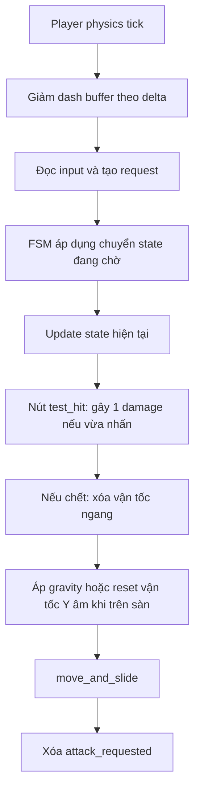
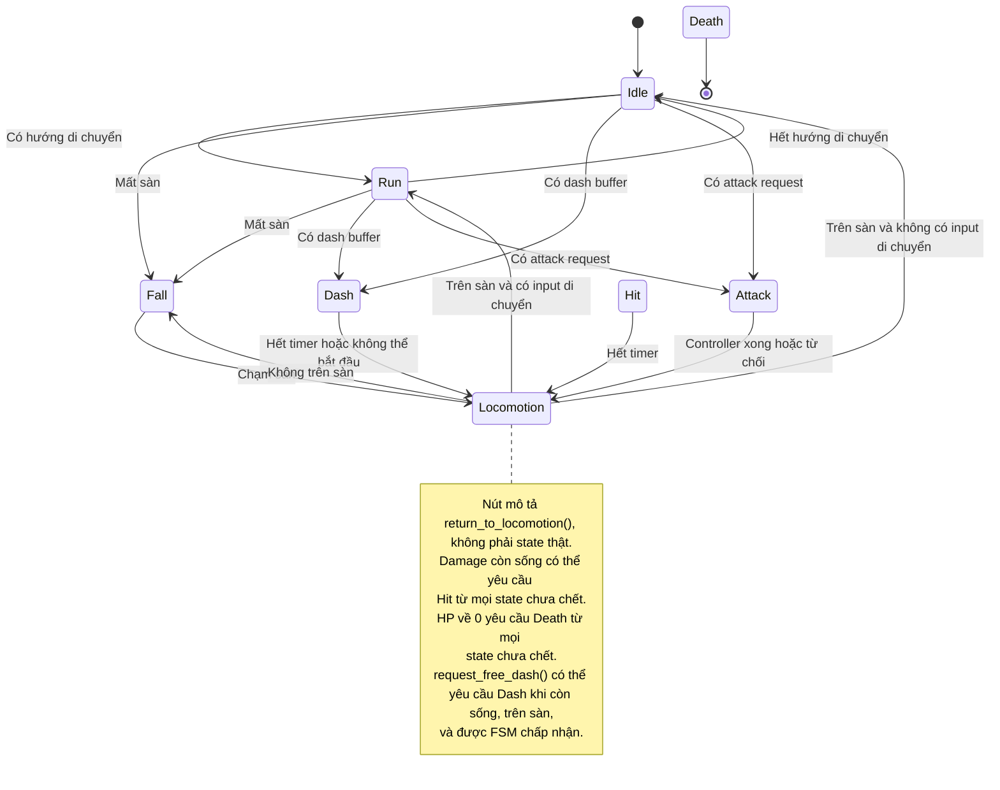
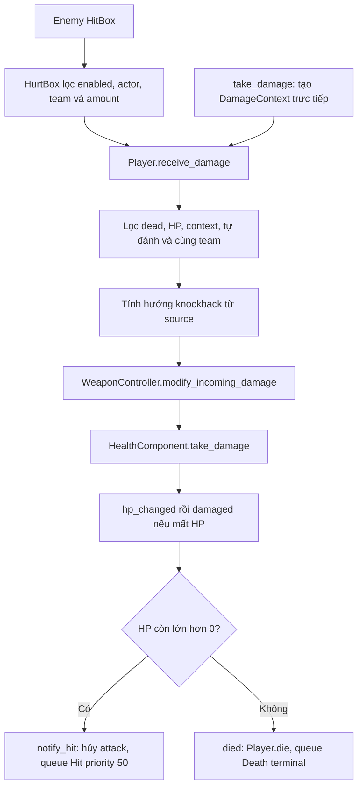

# Business logic: Player và state machine


## 1. Bản đồ code và trách nhiệm

| Thành phần | Trách nhiệm |
| --- | --- |
| [foxy.tscn](../gameplay/player/foxy.tscn) | Lắp Player, Visual, FSM, 7 state, HP, SP, HurtBox, WeaponController, camera, HUD và effects |
| [player.gd](../gameplay/player/player.gd) | Đọc input, giữ hướng nhìn, điều phối FSM, áp gravity và di chuyển vật lý, tiếp nhận damage, xử lý chết |
| [fsm.gd](../core/state_machine/fsm.gd) | Đăng ký state, giữ state hiện tại/đang chờ, xét priority, gọi lifecycle và khóa terminal state |
| [state.gd](../core/state_machine/state.gd) | API chung `_enter`, `_update`, `_exit`, timer và yêu cầu chuyển state |
| [player_state.gd](../gameplay/player/states/player_state.gd) | Luật chung chọn Fall/Dash/Attack và quay về Idle/Run/Fall |
| [states/](../gameplay/player/states/) | Hành vi riêng của Idle, Run, Fall, Dash, Attack, Hit, Death |
| [PlayerData](../data/foxy/foxy_data.gd), [resource Foxy](../data/foxy/foxy_data.tres) | Chỉ số gốc và giá trị override cho Foxy |
| [WeaponController](../gameplay/weapons/weapon_controller.gd) | Trang bị, kiểm tra đòn đánh, thanh toán tài nguyên, chạy các phase và hiệu ứng vũ khí |
| [HealthComponent](../core/components/health_component.gd), [StaminaComponent](../core/components/stamina_component.gd) | Quản lý HP, SP và phát signal khi thay đổi |
| [HurtBox](../core/components/hurtbox_component.gd), [HitBox](../core/components/hitbox_component.gd) | Lọc mục tiêu nhận damage và kiểm soát số lần trúng đòn |
| [PlayerVisual](../gameplay/player/player_visual.gd) | Chọn animation theo hướng camera, lật sprite, đồng bộ tốc độ animation đánh |

State chọn vận tốc và animation. `Player` thực hiện `move_and_slide()` đúng một lần
trong mỗi physics tick của nó. WeaponController có vòng physics riêng để chạy đòn đánh;
không phải state con của FSM player.

## 2. Khởi tạo và thông số thực tế

`Player._ready()` thực hiện theo thứ tự:

1. Kiểm tra `data`; thiếu thì báo lỗi và tắt physics process của Player.
2. `fsm.setup(self, $States, $States/Idle)`; thất bại cũng tắt physics process.
3. Gán thời gian hit mặc định vào `pending_hit_duration`.
4. Nối signal HP/SP, khởi tạo đầy HP và SP theo data.
5. Gán actor/team và collision layer/mask cho HurtBox; setup WeaponController.

FSM chỉ đăng ký các node con trực tiếp kế thừa `FsmState` của `$States`, dùng tên
chữ thường làm key. Tên trùng, initial state không thuộc nhóm hoặc state đã thuộc
FSM khác làm setup thất bại. Setup chỉ được thực hiện một lần.
Sau setup, `next_state = Idle`, `current_state = null`; Idle thực sự được enter ở
lần `fsm._update()` đầu tiên.

Giá trị đang dùng trong scene Foxy là default của script kết hợp override trong
`foxy_data.tres`:

| Thông số | Giá trị |
| --- | --- |
| HP tối đa | 8 |
| SP tối đa | 350 |
| Hồi SP | 25 SP/giây, chờ 1 giây sau lần tiêu SP có cost > 0 |
| Tốc độ chạy | 8 đơn vị/giây |
| Gia tốc / giảm tốc | 25 / 25 |
| Dash | 5 đơn vị trong 0,2 giây; cost 50 SP; buffer 0,1 giây |
| Hit stun mặc định | 0,6 giây |
| Hit knockback / giảm tốc knockback | 8 / 16 |
| Hit hop speed | 3,2 theo trục Y |
| Vũ khí khởi đầu | Dagger, chỉ có normal attack |
| Normal attack của dagger | 1 damage, 1 SP; windup/active/recovery mỗi phase 0,125 giây; cooldown 0 |

Thông số Hit nằm trong `player_hit.gd`; thông số dagger nằm trong
[weapon_dagger.tres](../data/weapon/weapon_dagger.tres) và default của
[AttackData](../data/weapon/attack_data.gd). Tổng thời gian đòn dagger hiện tại là
0,375 giây trước modifier tốc độ đánh.

## 3. Luồng mỗi physics tick và input



`_read_input()` luôn reset `move_direction` về zero; player chết thì ngừng đọc input.
WASD (`left/right/up/down`) được đổi thành hướng XZ theo trục right/back của camera,
bỏ Y rồi chuẩn hóa. Vì vậy chạy chéo không nhanh hơn chạy thẳng. Camera export được
ưu tiên; nếu thiếu thì lấy camera hiện tại của viewport; không có camera thì dùng
trục thế giới.

| Input/API | Kết quả |
| --- | --- |
| WASD | Cập nhật `move_direction`; state quyết định có dùng để di chuyển hay không |
| Shift / `request_dash()` | Đặt lại dash buffer về `dash_buffer_duration` khi còn sống |
| Chuột trái / `request_attack()` | Đặt `pending_attack_action = normal`, bật `attack_requested` |
| `request_attack(secondary)` | Yêu cầu đòn phụ; Input Map hiện chưa khai báo `secondary_attack` |
| T / `test_hit` | Gọi `take_damage(1)` sau update FSM; đây là đường debug đang hoạt động |

Input dash/attack chỉ nhận cạnh nhấn (`is_action_just_pressed`), không tự lặp khi giữ.
Normal có ưu tiên hơn secondary nếu cùng vừa nhấn. `attack_requested` bị xóa cuối
tick, không được giữ đến khi đòn hiện tại kết thúc. Dash buffer tiếp tục đếm ở mọi
state nhưng chỉ Idle/Run kiểm tra để nhận dash thông thường.

`last_facing_direction` khởi đầu là `Vector3.BACK`, giữ nguyên khi đứng yên.
Nó được cập nhật từ hướng di chuyển ở những nơi gọi `update_facing()` hoặc từ hướng
đánh/free dash. Không phải mọi lần đọc WASD đều lập tức đổi hướng nhìn.

## 4. Cơ chế chuyển state

`change_state()` ghi `next_state`, không gọi `_exit()`/`_enter()` ngay.
Ở đầu `_update()`, nếu state chờ khác state hiện tại, FSM gọi:

```text
old._exit()
previous_state = old
current_state = target
current_state.timer = 0
target._enter()
state_changed(previous_state, current_state)
current_state._update(delta)
```

Yêu cầu sinh ra trong `_enter()` hoặc `_update()` chờ lần cập nhật FSM tiếp theo;
không có chuỗi enter nhiều state ngay trong một lần update. Yêu cầu chuyển về cùng
state hiện tại không tự chạy lại `_enter()`.

| Yêu cầu | Priority | Ý nghĩa |
| --- | --- | --- |
| Idle / Run / Attack kết thúc / Dash kết thúc | 0 | Chuyển thông thường |
| Dash / Attack từ locomotion; free dash | 10 | Hành động |
| Fall | 20 | Mất sàn ưu tiên hơn hành động thông thường |
| Hit từ `notify_hit()` | 50 | Ngắt các yêu cầu có priority thấp hơn |
| Death | Terminal | Vượt chặn priority của non-terminal, khóa FSM khi enter |

Priority chỉ phân xử yêu cầu đang chờ; không phải mức ưu tiên cố định của state.
Yêu cầu có priority bằng nhau có thể ghi đè nhau, yêu cầu đến sau thắng.
`_pending_priority` được reset ở đầu mỗi `_update()`. Khi Death đang chờ,
non-terminal không được ghi đè; khi Death đã enter, FSM từ chối mọi chuyển state.

Trong Idle/Run, thứ tự kiểm tra là **chết → mất sàn → dash buffer → attack →
đổi Idle/Run**. Dash và attack cùng tick thì dash được xét trước. Nếu có component
SP nhưng thiếu SP, vẫn queue Dash, rồi Dash từ chối ở `_enter()`; attack cùng tick
không được tự thử lại. Nếu thiếu component SP, buffer bị xóa và phát rejection,
sau đó mới tiếp tục xét attack.

## 5. Sơ đồ và hành vi từng state



Death là terminal trong FSM; sơ đồ không hàm ý player tự bị xóa khỏi scene.

| State | Khi enter | Trong update / điều kiện thoát |
| --- | --- | --- |
| **Idle** | Phát idle theo hướng cũ | Giảm vận tốc ngang về 0; xét Fall/Dash/Attack; có hướng di chuyển thì cập nhật facing và queue Run |
| **Run** | Cập nhật facing, phát run | Xét Fall/Dash/Attack trước; hết input thì giảm tốc và queue Idle; còn input thì cập nhật facing, tăng tốc tới vận tốc mục tiêu, cập nhật animation |
| **Fall** | Restart fall | Giảm vận tốc ngang về 0, không điều khiển trên không; chạm sàn thì chọn Idle/Run |
| **Dash** | Xóa buffer, lấy và xóa cờ free dash; kiểm tra sàn/SP; chốt hướng, timer; phát animation và `dash_started` | Gán vận tốc theo hướng đã chốt; hết timer queue locomotion; không xét input attack/dash thường |
| **Attack** | Dừng vận tốc ngang; kiểm tra controller; nối `attack_finished`; tạo context và gọi `try_attack()`; được nhận mới phát animation | Giữ vận tốc ngang bằng 0; accepted và finished/controller mất thì queue locomotion |
| **Hit** | Gán timer, xóa dash buffer; knockback và hop; hủy attack; restart hit | Giảm knockback về 0; timer hết thì queue Idle/Run/Fall |
| **Death** | Đặt dead; xóa request; hủy attack; dừng ngang; restart death | Giữ vận tốc ngang bằng 0, không chuyển sang state khác |

Di chuyển thường dùng `move_toward(target_velocity, acceleration * delta)` khi chạy,
và `move_toward(Vector3.ZERO, deceleration * delta)` khi dừng/rơi.
Các hàm sửa vận tốc ngang giữ nguyên Y. Gravity vẫn hoạt động trong Attack, Dash,
Hit và Death; trạng thái chết không làm nhân vật lơ lửng.

### Dash và free dash

Dash thường dùng hướng `last_facing_direction` tại lúc enter, không tự cập nhật
facing từ input mới. Dash từ Run được xét trước bước cập nhật facing của Run;
đổi hướng và dash cùng tick có thể dash theo hướng trước đó.

Dash chỉ tiêu SP một lần lúc enter. Thiếu SP phát `action_rejected(dash)` rồi queue
locomotion. Không có hoàn SP khi bị ngắt. Vận tốc cơ sở là `distance / duration`
(hiện tại 25 đơn vị/giây); tick cuối nhân thêm `min(timer, delta) / delta` để không
đi quá phần thời gian còn lại. Va chạm có thể làm quãng đường thực tế ngắn hơn.

`request_free_dash(direction)` yêu cầu còn sống, đang trên sàn, hướng XZ khác zero
và FSM nhận request priority 10. API trả true nghĩa là đã queue thành công, không
đảm bảo Dash đã bắt đầu. Hướng được chuẩn hóa, bỏ chi phí SP và cập nhật facing
khi enter. Hit/Death xóa cờ free dash đang chờ.

Khi Dash thoát, vận tốc ngang bị xóa. Nếu đã bắt đầu hoặc hoàn tất, nó phát
`dash_finished(interrupted)`; hết timer bình thường là false, bị ngắt là true.
Lần enter bị từ chối không phát started/finished. Hoàn tất ở đây được xác định theo
timer, không theo việc đi đủ khoảng cách hay animation kết thúc.

## 6. Luồng tấn công

```text
Input/API → attack_requested + pending_attack_action
→ Idle/Run queue Attack
→ Attack._enter(): tạo AttackContext → controller.try_attack(context)
→ kiểm tra state, vũ khí, animation, cooldown, mục tiêu, tài nguyên, scene đòn đánh
→ chốt context + attack_id → busy → tạo execution trong world → thanh toán cost
→ WINDUP → ACTIVE (activate/tick_active) → RECOVERY (deactivate)
→ controller cleanup → attack_finished
→ Attack đánh dấu finished → update kế tiếp queue locomotion
→ FSM update tiếp theo áp dụng locomotion
```

Controller kiểm tra mọi điều kiện trước khi trừ tài nguyên; `AttackData.is_valid()`
không cho một đòn đồng thời có cả SP cost > 0 và ammo cost > 0.

Context player chứa actor, team, action, origin và hướng nhìn ngang. Nếu có camera,
chuột được chiếu xuống mặt phẳng XZ ngang player để lấy target; không raycast vào
geometry của map. Controller quyết định aim mode: FACING dùng hướng nhìn; các mode
khác cần target, tính hướng tới chuột và giới hạn target theo range.
Hướng cuối cùng được trả về context request để Player quay animation đúng hướng.

Controller chốt chỉ số sau forge: damage, range, hitbox scale, SP cost và thời gian
phase. Thời gian phase/cooldown chia theo attack speed multiplier. Animation đánh
được fit theo tổng windup + active + recovery; khi đổi góc camera trong đòn, Visual
giữ cùng phần trăm tiến độ animation.

Dagger đặt hitbox phía trước hướng đánh khi ACTIVE và tắt khi RECOVERY.
HitBox mặc định chỉ gây damage thành công một lần trên mỗi actor trong một đòn,
kể cả actor có nhiều HurtBox; damage bị chặn hoàn toàn không được ghi là đã trúng.
Policy `ONCE_PER_CONTACT` cho phép trúng lại khi toàn bộ HurtBox của actor đã rời
vùng va chạm rồi vào lại; đây là lựa chọn cho từng HitBox, không phải bất tử của Player.

Attack bị từ chối thì phát `action_rejected(normal_attack)` và queue locomotion.
Tên rejection này hiện dùng chung cả khi request là secondary. Thoát Attack luôn
reset tốc độ animation, ngắt kết nối signal và gọi cancel controller. Hủy đòn không
hoàn tài nguyên/cooldown; execution có `persist_after_release` và đã launched có
thể tiếp tục tồn tại theo logic của `WeaponAttack`.

## 7. Nhận sát thương, Hit và Death



`receive_damage()` trả số HP thực sự bị trừ, tối đa bằng HP còn lại. Amount sau phòng
thủ <= 0 không làm mất HP, không phát damaged, không vào Hit.
Damage trực tiếp từ `take_damage()` cũng đi qua phòng thủ, nhưng không qua bộ lọc
`HurtBox.enabled`. API này tạo context không có source; hướng knockback mặc định
là ngược `last_facing_direction`. Có source Node3D thì hướng đẩy là từ source ra player.

Khi mất HP nhưng chưa chết, `notify_hit()` hủy attack ngay và yêu cầu Hit. Nếu đang
ở Hit, nó chỉ reset timer; không enter lại, không áp lại knockback/hop hay restart
animation. Duration mặc định lấy từ data; duration truyền vào không âm được chặn
tối thiểu 0,01 giây. Hit không tạo khoảng miễn nhiễm damage.

Health cập nhật HP trước khi phát `hp_changed`, rồi `damaged`, cuối cùng `died` nếu
HP bằng 0. Vì `_on_damaged()` kiểm tra `hp.is_alive()`, đòn chí mạng không queue Hit.
`die()` có guard để chỉ xử lý một lần và lập tức:

1. Đặt `dead = true`, tắt HurtBox.
2. Xóa cờ free dash, dash buffer và attack request.
3. Tắt hồi SP, cancel attack, xóa vận tốc ngang.
4. Queue Death; state terminal được áp dụng ở lần cập nhật FSM kế tiếp.

Chưa có respawn, hồi sinh, game over hoặc tự xóa Player trong luồng này.
Health chỉ cho heal khi còn sống và chặn HP vượt max.

## 8. Điều kiện đổi vũ khí và bắt đầu đòn

Các guard kiểm tra **cả `current_state` lẫn `next_state`**, bỏ qua state null.
Nhờ vậy Hit/Death đang chờ cũng có thể chặn thao tác trước khi state thực sự enter.

| API | Điều kiện |
| --- | --- |
| `can_equip_weapon()` | Còn sống, có FSM; mọi state hiện tại/đang chờ chỉ thuộc Idle/Run/Fall |
| `can_start_weapon_attack()` | Còn sống, trên sàn, có FSM; mọi state hiện tại/đang chờ chỉ thuộc Idle/Run/Attack |
| `WeaponController.equip()` | Không busy; weapon/data/đòn/animation hợp lệ, actor cho phép đổi; chuẩn bị effect mới trước khi gỡ effect cũ |
| `Player.equip_attack()` | Guard đổi vũ khí; controller có `try_attack`, `cancel`, signal `attack_finished`; animation prefix hợp lệ |

`equip_attack()` chỉ thay tham chiếu controller và prefix trên Player; không tự
setup controller mới hay gỡ lifecycle controller cũ. Luồng trang bị weapon instance
đang dùng là `WeaponController.equip()`.

## 9. SP, HUD, animation và effects

SP được hồi bởi physics process riêng của StaminaComponent. Tiêu cost > 0 reset thời
gian chờ hồi; cost 0 không reset. Nếu thời gian chờ hết giữa tick, chỉ phần delta
còn lại được dùng để hồi. Chỉ Death chủ động tắt regen trong logic Player; Attack,
Dash, Hit không tự tắt regen. Modifier max SP theo source không cộng dồn cùng source,
không tự làm đầy SP và sẽ clamp current nếu max giảm.

PlayerVisual chọn suffix `down/up/side` dựa vào hướng nhìn tương đối camera, lật
ngang sprite khi nhìn trái. Camera đổi góc thì hướng hiển thị được tính lại mỗi
render frame. Animation không quyết định sát thương; phase của controller quyết định.

`PlayerHUD` nghe HP/SP và sync deferred sau khởi tạo; cập nhật thanh cung và tooltip.
Portrait ưu tiên chết → vừa trúng đòn → máu thấp (<= 30%) → khỏe. Thời gian phản ứng
portrait mặc định 0,25 giây là timer UI riêng, không phải hit stun của player.
Các label `TestHUD/HP`, `TestHUD/SP` vẫn được Player cập nhật nếu tồn tại.

`dash_started`/`dash_finished` điều khiển bụi và ghost, đồng thời được chuyển tới
effect vũ khí. Bụi chạy chỉ phát khi current state là Run, player còn sống, trên sàn
và vận tốc thực vượt ngưỡng. Effects không điều khiển state.

## 10. Điểm cần lưu ý khi đọc hoặc mở rộng code

- **Hit thoát theo timer:** `_animation_finished` có được cập nhật từ signal, nhưng
  `_update()` không kiểm tra nó. Comment nói chờ cả animation và stun chưa khớp hành vi.
- **Dash không tự có i-frame:** state Dash không tắt HurtBox hay bỏ qua damage.
  Phòng thủ bổ sung chỉ có nếu effect vũ khí cài đặt.
- **Không combo hoặc giữ lệnh attack:** request trong Attack/Dash/Hit/Fall không được
  các state này xử lý và bị xóa cuối tick. Không có jump input trong luồng hiện tại.
- **Không chuyển Fall ngay ở mọi state:** Idle/Run kiểm tra mất sàn; Attack/Dash/Hit
  chỉ chọn Fall khi quay về locomotion. Gravity vẫn áp dụng trong thời gian đó.
- **Idle không tự quay sprite liên tục:** nếu dash/attack không chen vào, Idle cập
  nhật facing khi queue Run. Dash được ưu tiên trước bước này nên có thể dùng hướng cũ.
- **Setup combat cần controller hợp lệ:** trong `_setup_combat()`, lời gọi
  `weapon_controller.call("setup", ...)` nằm ngoài guard valid/has_method phía trên.
  Không nên hiểu rằng thiếu controller vẫn khởi tạo an toàn.
- **Tấn công xong dựa vào signal:** controller tùy chỉnh nhận đòn nhưng không phát
  `attack_finished` có thể giữ Player trong Attack; không có timeout dự phòng.

## 11. Các tình huống đối chiếu

| Tình huống | Kết quả theo code |
| --- | --- |
| Run + nhấn dash và attack cùng tick | Queue Dash; attack không được giữ lại |
| Idle + dash khi thiếu SP | Enter Dash, xóa buffer, từ chối; queue Idle/Run/Fall, không tự thử attack |
| Attack + nhận damage không chí mạng | Cancel controller ngay, queue Hit priority 50 |
| Đang Hit + nhận thêm damage | HP tiếp tục giảm; còn sống thì reset timer Hit |
| Dash + damage chí mạng | `dead` có hiệu lực ngay; queue Death; Dash phát finished khi exit, cờ interrupted tùy đã hết timer hay chưa |
| Đang Fall + nhấn attack | Không queue Attack; request bị xóa cuối tick |
| Muốn đổi vũ khí khi Hit đang chờ | Guard từ chối dù current state có thể còn là Idle/Run |
| Damage bị phòng thủ chặn hết | Trả 0; không damaged, không Hit |
| Chết khi đang ở trên không | Khóa ngang và input, vẫn chịu gravity |

## 12. Phạm vi kiểm thử hiện có

Các script test cũ đã được xóa theo yêu cầu dọn dự án; hiện chưa có test tự động.
Các tình huống ở mục 11 là danh sách để kiểm tra thủ công khi chạy game,
không phải khẳng định đã có automated test tương ứng.
