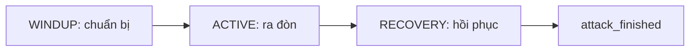

# Hệ thống vũ khí

WeaponController quyết định có cho đánh hay không và quản lý thời gian đòn đánh.
Scene đòn đánh chịu trách nhiệm tạo hitbox, đạn hoặc hiệu ứng thực tế.

## Các thành phần chính

| Thành phần | Dùng để làm gì? |
| --- | --- |
| [WeaponData](../data/weapon/weapon_data.gd) | Cấu hình chung: tên, loại, đòn thường, đòn phụ và effect |
| [AttackData](../data/weapon/attack_data.gd) | Cấu hình một đòn: damage, cách ngắm, thời gian, tài nguyên và scene thực hiện |
| [WeaponInstance](../gameplay/weapons/weapon_instance.gd) | Một món vũ khí cụ thể, giữ forge và cooldown riêng |
| [WeaponForge](../data/weapon/weapon_affix.gd) | Các hệ số thay đổi chỉ số sau rèn |
| [WeaponController](../gameplay/weapons/weapon_controller.gd) | Trang bị, nhận yêu cầu đánh, trừ tài nguyên và quản lý đòn đang chạy |
| [WeaponAttack](../gameplay/weapons/weapon_attack.gd) | Lớp gốc cho scene thực hiện đòn đánh |
| [WeaponEffect](../gameplay/weapons/weapon_effect.gd) | Hiệu ứng đi kèm khi trang bị vũ khí |
| [AttackContext](../gameplay/combat/attack_context.gd) | Thông tin một lần đánh: nguồn, hướng, mục tiêu và chỉ số đã chốt |

Hai món vũ khí có thể dùng chung WeaponData nhưng có forge và cooldown khác nhau
qua WeaponInstance. Controller trang bị một món và chạy một đòn tại một thời điểm.

## Trang bị vũ khí

Khi setup, controller nhận Player, component SP và ammo. Nếu có `default_weapon`,
nó tạo WeaponInstance rồi trang bị làm vũ khí khởi đầu.

`equip()` kiểm tra vũ khí mới trước khi thay vũ khí cũ:

1. Controller không đang đánh và Player cho phép đổi vũ khí.
2. Đòn thường tồn tại, dữ liệu và animation hợp lệ.
3. Nếu có đòn phụ, đòn này cũng phải hợp lệ.
4. Nếu có scene effect, scene phải tạo được một `WeaponEffect`.

Sau đó, controller gọi `on_unequip()` và xóa effect cũ, gán vũ khí mới, tạo effect
mới rồi gọi `on_equip()`. Cuối cùng nó phát `weapon_changed`. Lỗi ở các bước kiểm
tra thì giữ vũ khí cũ.

Player chỉ cho đổi vũ khí trong Idle, Run hoặc Fall, xét cả state hiện tại và state
đang chờ. Đổi đi rồi đổi lại không reset cooldown. Trang bị lại cùng một instance
vẫn khởi tạo lại effect.

## Một đòn đánh bắt đầu như thế nào?

State Attack của Player tạo yêu cầu và gọi `try_attack()`. Controller kiểm tra:

- Có vũ khí, actor hợp lệ và không đang bận chạy đòn khác.
- Player cho phép bắt đầu đánh: còn sống, trên sàn, state phù hợp.
- Action `normal` hoặc `secondary` có dữ liệu và animation hợp lệ.
- Vũ khí không bị khóa, action đã hết cooldown.
- Hướng ngắm/mục tiêu hợp lệ và đủ SP hoặc đạn.
- Scene tạo được `WeaponAttack` và vượt qua `validate()`.

Một đòn hợp lệ cần damage/range dương, active time dương; các thời gian và chi phí
còn lại không âm. Đòn có thể miễn phí, dùng SP hoặc dùng đạn. Dữ liệu hiện không cho
một đòn đồng thời tốn cả SP và đạn.

```text
Nhận yêu cầu → kiểm tra điều kiện → chốt context và chỉ số
→ tạo scene đòn đánh trong world → trừ SP hoặc đạn → bắt đầu cooldown
→ chuẩn bị → ra đòn → hồi phục → báo kết thúc
```

Controller đặt `busy = true` trước khi scene vào tree và trước khi trừ tài nguyên,
để callback không nhận thêm đòn trong lúc này. Các lỗi kiểm tra thông thường được
phát hiện trước khi trừ tài nguyên. Nếu bước thanh toán cuối thất bại, đòn bị hủy.

`try_attack()` trả false thì Player phát `action_rejected` và quay về di chuyển.
Trả true nghĩa là đòn đã được nhận; callback trong lúc trừ tài nguyên vẫn có thể
hủy đòn trước khi hàm trả về.

## Ba giai đoạn và cooldown



| Giai đoạn | Controller làm gì? |
| --- | --- |
| **WINDUP** | Chờ trước khi triển khai đòn |
| **ACTIVE** | Gọi `activate()` lúc bắt đầu, sau đó gọi `tick_active()` |
| **RECOVERY** | Gọi `deactivate()` khi vào giai đoạn này, chờ hết thời gian rồi kết thúc |

Trong cả ba giai đoạn, `busy` chặn đánh tiếp và đổi vũ khí. Nếu một tick đi qua nhiều
giai đoạn, controller chia thời gian cho từng phần. Windup bằng 0 có thể ra đòn ngay;
recovery bằng 0 thì kết thúc ngay sau khi tắt đòn.

Cooldown bắt đầu sau khi trả chi phí, nên giảm cả trong lúc đòn còn chạy. Hết cooldown
vẫn chưa được đánh tiếp nếu controller còn busy. Các vũ khí từng trang bị cũng được
cập nhật cooldown khi không cầm trên tay.

`cooldowns[action]` khóa từng đòn riêng; `unavailable_seconds` khóa cả món vũ khí.
Hiện đã có kiểm tra và giảm timer khóa toàn bộ, nhưng chưa có đòn cụ thể đặt timer này.

## Ngắm và rèn vũ khí

Controller tạo context mới khi nhận đòn, chốt hướng và các chỉ số sau forge để dùng
cho lần đánh đó. Dữ liệu gốc trong WeaponData/AttackData được giữ nguyên.

| Cách ngắm | Hành vi hiện tại |
| --- | --- |
| `FACING` | Đánh theo hướng nhìn của Player |
| `CURSOR_DIRECTION` | Lấy hướng từ Player tới vị trí chuột, giới hạn mục tiêu theo range |
| `CURSON_POSITION` | Hiện xử lý giống mode trên; tên enum trong code đang viết như vậy |

Các mode dùng chuột cần target hợp lệ. Player lấy target bằng cách chiếu chuột xuống
mặt phẳng ngang qua nhân vật. Hướng ngang bằng zero bị từ chối. Controller trả hướng
cuối cùng về Player để animation quay đúng hướng.

| Chỉ số sau forge | Cách tính |
| --- | --- |
| Damage | Damage gốc × damage multiplier, làm tròn và giữ tối thiểu 1 |
| Range | Range gốc × range multiplier, multiplier tối thiểu 0,01 |
| Kích thước hitbox | Dùng hitbox multiplier, tối thiểu 0,01 |
| SP tiêu hao | SP gốc × cost multiplier, multiplier tối thiểu 0 |
| Thời gian từng giai đoạn và cooldown | Giá trị gốc ÷ speed multiplier, multiplier tối thiểu 0,01 |

Ví dụ, speed multiplier bằng 2 làm thời gian đòn và cooldown còn một nửa.
Ammo cost không đổi theo forge. Hiện mới có dữ liệu và cách áp chỉ số rèn,
chưa có luồng thao tác rèn trong game.

## Dagger gây sát thương ra sao?

[DaggerAttack](../gameplay/weapons/attack%20scenes/dagger_attack.gd) dùng HitBox phía
trước hướng đánh. Khi ACTIVE bắt đầu, nó xoay scene theo hướng đã chốt, đặt HitBox
ra phía trước và mở đòn. Sang RECOVERY thì tắt HitBox.

```text
DaggerAttack → HitBox → HurtBox của mục tiêu → xử lý damage → trừ HP
```

HurtBox lọc mục tiêu cùng đội và tự đánh. HitBox mặc định chỉ cho một actor mất HP
một lần trong mỗi đòn, kể cả có nhiều HurtBox. Nếu damage bị chặn hết, actor chưa
bị đánh dấu là đã trúng nên có thể được xét lại. Policy `ONCE_PER_CONTACT` cho phép
trúng lại sau khi rời hẳn vùng va chạm rồi quay vào; dagger dùng `ONCE_PER_ATTACK`.

Scene đòn được đặt trong world tại vị trí bắt đầu, không bám theo Player từng tick.
Tầm cận chiến của dagger phụ thuộc hình dạng hitbox và hitbox multiplier;
`range_units` không tự kéo dài hitbox.

Thông số của [dagger hiện tại](../data/weapon/weapon_dagger.tres):

| Thuộc tính | Giá trị |
| --- | --- |
| Đòn / cách ngắm | Chỉ có normal, đánh theo hướng nhìn |
| Damage / SP tiêu hao | 1 HP / 1 SP |
| Windup / active / recovery | Mỗi giai đoạn 0,125 giây |
| Tổng thời gian / cooldown | 0,375 giây / 0 giây |
| Khoảng đặt HitBox phía trước | 0,8 đơn vị |
| Forge / effect | Chưa gán |

## Khi đòn kết thúc hoặc bị ngắt

Đòn hoàn tất thì controller gọi `release()`; bị ngắt thì gọi `cancel()`.
Cả hai đều bỏ khóa busy và phát `attack_finished`. Signal này không có tham số
để phân biệt hai trường hợp. Hủy đòn không hoàn SP, đạn hoặc cooldown đã trả.

Player dùng signal để rời state Attack và trả tốc độ animation về bình thường.
Khi bị Hit hoặc chết, Player hủy đòn ngay. Controller cũng hủy nếu actor hoặc scene
đòn đánh không còn hợp lệ.

Mặc định, hoàn tất hoặc hủy sẽ xóa scene. Nếu bật `persist_after_release`, scene đã
activate có thể tiếp tục tồn tại sau khi bị hủy; hoàn tất cũng không tự xóa scene.
Loại đòn này phải tự quản lý vòng đời còn lại. Đây là phần hỗ trợ cho đạn/phép,
chưa có vũ khí cụ thể sử dụng.

## Effect và những phần còn thiếu

WeaponEffect có các hook khi trang bị, tháo, dash, gây damage và nhận damage.
Effect tự thêm/gỡ thay đổi trong `on_equip()`/`on_unequip()`. Phòng thủ được gọi
trước khi trừ HP; kết quả được giữ tối thiểu bằng 0. Hiện chưa có effect cụ thể.

**Dagger đã trừ HP nhưng chưa báo kết quả về AttackContext.** Controller có nghe
`damage_applied`, nhưng DaggerAttack/HitBox chưa phát signal này. Vì vậy
`on_damage_dealt()` và `damage_dealt` của controller chưa tự chạy khi dagger đánh
trúng. Khi nối luồng này, effect gây damage chỉ được gọi nếu vũ khí nguồn vẫn đang
được trang bị.

[AmmoComponent](../gameplay/combat/ammo_component.gd) đã quản lý số đạn theo loại,
thêm/tiêu đạn và báo `ammo_changed`. Controller hỗ trợ ammo cost nhưng Foxy chưa gắn
component này; dagger chỉ dùng SP. Đòn phụ cũng mới có API và chỗ khai báo dữ liệu,
chưa được dùng trong dagger.

Khi thêm vũ khí mới, cần kiểm tra layer/mask bên cạnh team. Scene dagger đang dùng
PLAYER_ATTACK và ENEMY_HURTBOX; đổi team không tự đổi bộ lọc va chạm.

Hiện chưa có test tự động. Nên kiểm tra trong game các trường hợp: thiếu tài nguyên,
đánh khi đang busy, đổi vũ khí rồi quay lại, forge tăng tốc và bị Hit giữa ACTIVE.
