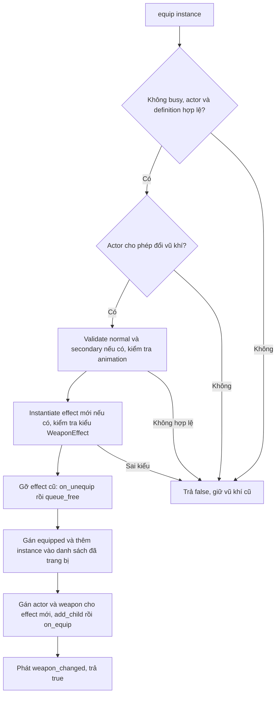
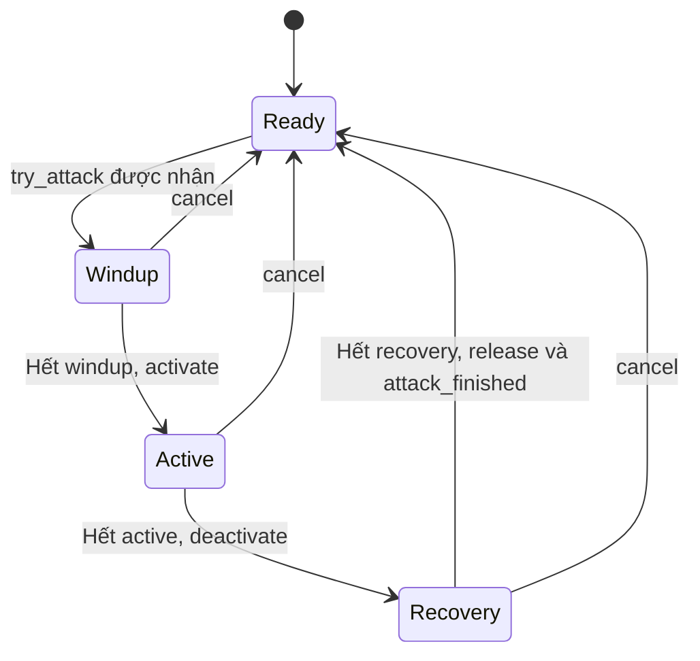

# Business logic: Weapon

## 1. Bản đồ code

| Thành phần | Vai trò |
| --- | --- |
| [WeaponData](../data/weapon/weapon_data.gd) | Định nghĩa dùng chung: id, tên, category, normal/secondary attack, scene effect khi trang bị |
| [AttackData](../data/weapon/attack_data.gd) | Cấu hình một action: scene đòn, animation, aim mode, damage, thời gian phase, range, cost và cooldown |
| [WeaponForge](../data/weapon/weapon_affix.gd) | Resource chứa các multiplier rèn; tên file hiện là `weapon_affix.gd` |
| [WeaponInstance](../gameplay/weapons/weapon_instance.gd) | Một vũ khí cụ thể: definition, forge, thời gian khóa và cooldown theo action |
| [WeaponController](../gameplay/weapons/weapon_controller.gd) | Trang bị instance, nhận request, chốt chỉ số, trừ tài nguyên, chạy phase và kết thúc đòn |
| [WeaponAttack](../gameplay/weapons/weapon_attack.gd) | Interface scene thực thi: validate, activate, tick, deactivate, cancel, release |
| [DaggerAttack](../gameplay/weapons/attack%20scenes/dagger_attack.gd) | Thực thi cận chiến bằng HitBox đặt trước nhân vật |
| [WeaponEffect](../gameplay/weapons/weapon_effect.gd) | Hook trang bị/tháo, phòng thủ, gây damage và dash |
| [AttackContext](../gameplay/combat/attack_context.gd) | Thông tin một đòn đã chốt: actor, weapon, action, hướng, vị trí, damage và range |
| [DamageContext](../gameplay/combat/damage_context.gd) | Thông tin gửi tới mục tiêu trong một lần gây damage |
| [AmmoComponent](../gameplay/combat/ammo_component.gd) | Số đạn theo item id, kiểm tra và tiêu đạn |
| [HitBox](../core/components/hitbox_component.gd), [HurtBox](../core/components/hurtbox_component.gd) | Phát hiện mục tiêu, lọc team và giới hạn số lần trúng |

`WeaponData`/`AttackData` giữ cấu hình gốc; cooldown thuộc `WeaponInstance`, không thuộc
definition. Hai instance dùng chung definition vẫn có thể giữ cooldown/forge khác nhau.
Controller giữ một `equipped`, một đòn đang chạy và tối đa một effect đang trang bị.

## 2. Setup và trang bị

Player gọi `WeaponController.setup(actor, stamina, ammo)` sau khi khởi tạo HP/SP.
Setup từ chối nếu actor đầu vào không hợp lệ hoặc controller đã có actor hợp lệ.
Nó lưu actor/component, nối signal dash nếu actor có, rồi tạo instance từ
`default_weapon` và gọi `equip()` nếu default được gán. Không có default vẫn có thể
setup thành công nhưng chưa có vũ khí để đánh.



Luật trang bị:

- Normal attack bắt buộc có và hợp lệ. Secondary không bắt buộc; nếu đã khai báo thì
  phải hợp lệ, nếu không sẽ từ chối cả vũ khí.
- Nếu actor có `has_attack_animation()`, controller dùng API đó để kiểm tra animation.
  Với Player, prefix phải có đủ down/up/side, animation không loop, có track, độ dài
  dương và tốc độ AnimationPlayer dương. Actor không có API này thì bỏ qua kiểm tra.
- Nếu actor có `can_equip_weapon()`, actor phải đồng ý. Player chỉ cho khi còn sống
  và cả current/next state thuộc Idle/Run/Fall.
- Effect mới được kiểm tra kiểu trước khi gỡ effect cũ. Đây là thứ tự bảo vệ lỗi
  cấu hình trước khi đổi, không phải cơ chế rollback khi callback effect tự gây lỗi.
- `_owned` lưu các instance từng equip thành công, không phải inventory đầy đủ.
  Chưa có API tháo bỏ instance khỏi danh sách này.
- Equip lại cùng instance vẫn gỡ/tạo lại effect và phát `weapon_changed`; không reset
  cooldown hoặc thời gian khóa trên instance.

Setup đã lưu actor và nối signal trước khi equip default. Nếu equip default thất bại,
setup trả false nhưng không rollback các bước trên; gọi setup lại với actor còn hợp
lệ sẽ bị từ chối.

## 3. Điều kiện hợp lệ của AttackData

`AttackData.is_valid()` yêu cầu:

| Nhóm | Điều kiện |
| --- | --- |
| Scene và animation | `attack_scene != null`, prefix không rỗng |
| Damage và range | `damage_hp > 0`, `range_units > 0` |
| Phase | Windup/recovery >= 0; active > 0 |
| Cooldown | >= 0 |
| Cost | SP cost và ammo cost >= 0; ammo cost > 0 thì ammo id không rỗng |
| Loại tài nguyên | Không cho cùng lúc SP cost > 0 và ammo cost > 0 |

Đòn có thể miễn phí nếu cả hai cost bằng 0. `category` MELEE/RANGED/STAFF là metadata;
controller không phân nhánh thực thi theo category. Scene đòn đánh quyết định cách
triển khai. Validation data chưa kiểm tra scene có đúng kiểu `WeaponAttack`; bước
này diễn ra khi thực sự gọi `try_attack()`.

## 4. Từ request tới một đòn được nhận

Player tạo request trong state Attack. `try_attack(request)` kiểm tra theo thứ tự:

1. Controller không busy; request, actor, equipped tồn tại.
2. Actor đang trong scene tree và có parent để gắn scene đòn đánh.
3. Actor đồng ý qua `can_start_weapon_attack()` nếu có API này. Player yêu cầu còn
   sống, trên sàn, current/next state chỉ thuộc Idle/Run/Attack.
4. Action tìm được AttackData hợp lệ và animation hợp lệ.
5. `unavailable_seconds` và cooldown của action đều không còn dương.
6. Tạo context mới, kiểm tra hướng/mục tiêu; áp forge.
7. Đủ SP hoặc ammo theo cost.
8. Instantiate scene; phải là `WeaponAttack` và `validate()` trả true.

Các lỗi trên trả false trước khi thanh toán tài nguyên. `get_attack()` chỉ hiểu
`normal` và `secondary`; action khác trả null. Request normal không tự fallback
sang secondary và ngược lại.

Sau khi kiểm tra thành công:

```text
Chốt thời gian phase và animation prefix
→ tăng attack_id của controller
→ nối snapshot.damage_applied với callback có bind source weapon
→ lưu context/execution, gán execution.context, đặt WINDUP
→ busy = true
→ gắn execution vào parent của actor, đặt vị trí theo origin
→ thanh toán SP hoặc ammo
→ ghi cooldown của action
→ nếu windup = 0 và đòn vẫn còn hiện hành: chuyển ACTIVE ngay
→ trả true
```

`busy` được đặt trước signal tài nguyên và trước khi execution vào tree để hạn chế
nhận đòn mới trong callback. Scene được validate trước khi nhận context và trước
khi vào tree; `validate()` của subclass cần phù hợp thời điểm này.
Nếu thanh toán cuối cùng thất bại, controller cancel và trả false. Cancel không có
logic hoàn lại tài nguyên. Attack id tăng theo controller, không phải id toàn cục.

`try_attack()` trả true là đã đi qua luồng nhận đòn; không bảo đảm đòn vẫn đang chạy
khi hàm trả về. Callback của việc trừ tài nguyên có thể đã hủy đòn; code kiểm tra lại
busy/context trước khi activate sớm, nhưng vẫn ghi cooldown và trả true sau khi
thanh toán thành công.

## 5. Aim và chỉ số sau forge

Controller tạo `AttackContext` mới từ actor và equipped hiện tại. Actor/team/origin
do controller quyết định; không lấy actor/team/origin của request làm nguồn tin.
Action, direction và thông tin target được lấy từ request. Chỉ số gốc không bị sửa.

| AimMode | Hành vi trong controller |
| --- | --- |
| `FACING` | Lấy direction request, bỏ Y và chuẩn hóa; không yêu cầu target |
| `CURSOR_DIRECTION` | Cần `has_target`; lấy hướng XZ từ actor tới target; giới hạn target theo range |
| `CURSON_POSITION` | Hiện xử lý giống `CURSOR_DIRECTION`; tên enum đang viết là `CURSON_POSITION` |

Hướng ngang bằng zero bị từ chối, kể cả cursor nằm ngay tại origin theo XZ.
Target của mode chuột nằm trên mặt phẳng ngang qua actor; direction đã chuẩn hóa
được ghi ngược vào request để Player quay đúng animation. Player tạo target bằng
chiếu ray chuột xuống mặt phẳng XZ, không kiểm tra geometry hoặc vật cản của map.

Khi có forge:

| Chỉ số thực tế | Công thức |
| --- | --- |
| Damage | `max(1, round(base_damage * damage_multiplier))` |
| Range | `base_range * max(0.01, range_multiplier)` |
| Hitbox scale multiplier | `max(0.01, hitbox_multiplier)` |
| SP cost | `base_sp_cost * max(0, stamina_cost_multiplier)` |
| Speed | `max(0.01, attack_speed_multiplier)` |
| Mỗi phase | `base_phase_seconds / speed` |
| Cooldown | `base_cooldown_seconds / speed` |

Ammo cost không đổi theo forge. `forge_id` hiện chỉ là dữ liệu định danh, không tự
chọn hiệu ứng. Không có luồng roll/reroll, UI rèn hoặc thanh toán rèn trong các file
này. Các giá trị vô hướng của đòn được chốt lúc nhận; context vẫn giữ tham chiếu
WeaponInstance, không phải bản sao độc lập hoàn toàn của toàn bộ vũ khí.

## 6. Phase và cooldown



Đây là trạng thái nội bộ WeaponController, tách biệt state Attack của Player.

| Phase | Công việc |
| --- | --- |
| WINDUP | Chờ chuẩn bị; chưa gọi activate |
| ACTIVE | Gọi activate khi bắt đầu; gọi tick_active theo phần delta thuộc phase này |
| RECOVERY | Đòn đã deactivate, tiếp tục khóa busy cho tới hết recovery |

Controller chia delta thành budget qua từng phase; một tick đủ dài có thể đi qua
nhiều phase. Windup bằng 0 có thể activate ngay trong `try_attack()`; recovery bằng
0 kết thúc ngay sau deactivate. Sau `tick_active()`, controller kiểm tra busy/context
để không tiếp tục cập nhật đòn cũ nếu callback damage đã hủy hoặc thay đòn.

Cooldown được ghi ngay sau khi trả cost thành công, không chờ recovery kết thúc.
Mỗi physics tick, controller gọi `advance(delta)` cho tất cả instance trong `_owned`
trước khi cập nhật đòn. Vì vậy cooldown giảm cả khi đang đánh và khi đổi sang vũ khí
khác. Hết cooldown chưa đủ để nhận đòn mới nếu controller vẫn busy.

`unavailable_seconds` khóa mọi action của instance; `cooldowns[action]` chỉ khóa
action đó. Hai loại timer được clamp về 0. Code hiện chưa có đòn cụ thể nào đặt
`unavailable_seconds` lên giá trị dương; comment về dao ném chưa phải hành vi đã có.

## 7. Cancel, release và kết nối Player

`_finish(interrupted)` xóa busy/context/execution khỏi controller trước khi gọi
lifecycle execution và phát `attack_finished`. Khi không busy, cancel không làm gì
và không phát thêm signal. Khi actor/execution mất hoặc execution đang chờ xóa,
physics update cũng gọi cancel. Controller rời tree thì cancel và gọi effect.on_unequip.

| Trường hợp | `WeaponAttack` mặc định |
| --- | --- |
| Activate | `active = true`, `launched = true` |
| Deactivate | `active = false` |
| Cancel, không persist hoặc chưa launched | Deactivate rồi queue_free |
| Cancel, persist và đã launched | Giữ execution tồn tại; không tự deactivate |
| Release sau hoàn tất, không persist | Queue_free |
| Release sau hoàn tất, có persist | Giữ execution tồn tại; ACTIVE đã được deactivate trước đó |

Execution persist phải tự xử lý vòng đời còn lại; không có timeout/xóa tự động bổ
sung trong base class. Persist và launched được thiết kế cho đạn/phép tiếp tục sau
khi người dùng kết thúc động tác, nhưng chưa có implementation cụ thể trong repo.
Không hoàn cost hoặc cooldown khi bị hủy sau khi đã trả tài nguyên.

State Attack của Player nối signal trước khi gọi `try_attack()`. Được nhận thì nó
lấy prefix/tổng duration từ controller và fit animation theo duration. Signal kết
thúc chỉ đánh dấu `finished`; update state sau đó queue locomotion, rồi FSM áp dụng
ở lần update tiếp theo. Khi thoát Attack, Player reset tốc độ animation, disconnect
signal và cancel controller. Hit/Death cũng gọi cancel ngay khi nhận sự kiện.

`attack_finished` hiện không có tham số; người nghe không phân biệt hoàn tất bình
thường hay bị ngắt từ signal này. Controller không phát `action_rejected`; Player
phát rejection khi nhận false, hiện dùng tên `normal_attack` kể cả cho secondary.

## 8. Dagger hiện tại và đường gây damage

Resource [weapon_dagger.tres](../data/weapon/weapon_dagger.tres) gán một normal attack,
không có secondary, forge hoặc equipped effect. Các giá trị không override dùng
default trong script:

| Thuộc tính | Giá trị |
| --- | --- |
| Category / aim | MELEE / FACING |
| Damage / cost | 1 HP / 1 SP |
| Windup / active / recovery | 0,125 / 0,125 / 0,125 giây |
| Tổng đòn / cooldown | 0,375 giây / 0 giây |
| Range dữ liệu / hitbox multiplier | 1,5 / 1 |
| Forward offset | 0,8 |
| Persist | false |

Khi ACTIVE, DaggerAttack kiểm tra context/actor/HitBox rồi gọi base activate, xoay
execution theo direction, đặt HitBox local Z = -0,8 và scale theo context. Actor/team
của HitBox được gán lại từ context trước khi `begin_attack()`.
Execution được tạo tại origin trong world và không cập nhật vị trí theo actor từng
tick. `range_units` không trực tiếp thay đổi chiều dài hitbox dagger; kích thước cận
chiến nằm trong scene và `hitbox_multiplier`.

```text
DaggerAttack.activate()
→ HitBox.begin_attack(damage_hp, attack_id, action)
→ area_entered hoặc quét get_overlapping_areas trong physics tick
→ chỉ xử lý HurtBox có actor hợp lệ
→ giữ chỗ actor trong danh sách đã trúng
→ HurtBox lọc enabled, source, team và amount
→ target.receive_damage(context), hoặc target.take_damage(amount) nếu không có API đầu
→ trả số HP thực sự mất
→ nếu kết quả <= 0: bỏ giữ chỗ để có thể thử lại
```

Mặc định một actor chỉ mất HP một lần trong một lần `begin_attack()`, dù có nhiều
HurtBox. `end_attack()` xóa danh sách và tắt quét physics. Đòn mới bắt đầu bằng cách
kết thúc đòn cũ và tạo DamageContext mới. Dagger dùng policy mặc định ONCE_PER_ATTACK.
Policy ONCE_PER_CONTACT cho phép trúng lại sau khi toàn bộ HurtBox đã ra rồi vào lại.

Scene dagger dùng PLAYER_ATTACK layer (32) và ENEMY_HURTBOX mask (16). Team runtime
được cập nhật nhưng layer/mask không tự đổi theo team, nên không thể chỉ đổi team
để dùng nguyên scene này làm vũ khí enemy. Physics layer và team là hai bộ lọc riêng.

HitBox chạy physics riêng. Budget qua các phase của controller không tự tạo bước
physics va chạm giữa từng phase; không thể suy ra một cửa sổ ACTIVE cực ngắn luôn
được ghi nhận va chạm chỉ vì controller đã đi qua phase đó.

## 9. Effect, phòng thủ và thông báo damage

| Hook / signal | Thời điểm và ý nghĩa |
| --- | --- |
| `on_equip()` / `on_unequip()` | Effect tự thêm/gỡ modifier hoặc hành vi liên quan trang bị |
| `modify_incoming_damage()` | Player gọi controller trước khi trừ HP; kết quả effect được clamp >= 0 |
| `on_dash_started()` / `on_dash_finished(interrupted)` | Controller chuyển tiếp signal dash từ actor tới effect hiện tại |
| `on_damage_dealt()` | Chỉ gọi khi nhận context.damage_applied và source weapon vẫn đang equipped |
| `damage_dealt` | Controller chuyển tiếp khi nhận context.damage_applied, kể cả source weapon đã bị đổi |
| `weapon_changed` | Equip thành công sau khi effect mới được khởi tạo |
| `attack_finished` | Controller đã bỏ khóa đòn và gọi cancel/release execution |

`WeaponEffect` base chỉ có hook rỗng và phòng thủ trả lại amount gốc. Repo hiện chưa
có subclass effect cụ thể. Effect phải tự dọn modifier trong `on_unequip()`.

**Đường báo damage chưa được nối trong dagger:** AttackContext khai báo signal
`damage_applied` và controller có listener, nhưng DaggerAttack/HitBox hiện không emit
signal này. HitBox tự tạo DamageContext, gửi trực tiếp tới HurtBox. Vì vậy dagger
vẫn trừ HP nhưng không tự kích hoạt `on_damage_dealt` hoặc signal `damage_dealt` của
controller. `AttackContext.create_damage_context()` cũng chưa được execution hiện
tại gọi. Khi mở rộng on-hit effect cần hoàn thiện đường báo kết quả này.

## 10. Ammo và những phần chưa triển khai

AmmoComponent copy `initial_ammo` vào runtime ở `_ready()`, clamp số âm về 0; không
phát signal cho lần copy ban đầu. Loại đạn chưa có trả 0. `try_consume()` không nhận
amount âm, không thay đổi/phát signal khi cost 0; tiêu thành công cost > 0 mới phát
`ammo_changed`. `add_ammo()` chỉ nhận amount dương và item id không rỗng, chưa có max.

Controller đã có đường validate/tiêu ammo nhưng scene Foxy hiện không gắn AmmoComponent.
Dagger dùng SP nên không bị ảnh hưởng. Chưa có scene cung/súng/staff, projectile,
dao ném, nhặt lại dao, reload, durability, combo, charge attack hoặc inventory UI
trong module weapon hiện tại. Secondary có API/data slot nhưng dagger chưa định nghĩa
đòn phụ và Input Map chưa có `secondary_attack`.

## 11. Tình huống đối chiếu và phạm vi kiểm thử

| Tình huống | Kết quả theo code |
| --- | --- |
| Đánh khi busy dù cooldown đã hết | Từ chối trước thanh toán |
| Thiếu SP/ammo hoặc scene validate thất bại | Trả false, không thanh toán |
| Chỉ khai báo secondary lỗi, normal hợp lệ | Equip cả vũ khí thất bại |
| Forge speed = 2 | Phase và cooldown còn một nửa; cost chỉ đổi theo cost multiplier |
| Đòn normal cooldown dương, secondary sẵn sàng | Secondary có thể được nhận nếu không busy và instance không bị khóa toàn bộ |
| Đổi vũ khí rồi quay lại | Cooldown cũ vẫn được giữ và đã giảm trong thời gian không equip |
| Hit giữa ACTIVE của dagger | Cancel, tắt hitbox, queue_free; không hoàn SP |
| Dagger đánh trúng | Target mất HP; chưa phát callback damage_applied của AttackContext |
| Hủy execution persist trước activate | Chưa launched nên bị deactivate và queue_free |
| Vũ khí mới sai cấu hình trước bước thay effect | Trả false, giữ vũ khí/effect cũ |

Các script test cũ đã được xóa theo yêu cầu dọn dự án; hiện chưa có test tự động.
Những tình huống ở bảng trên là danh sách để đối chiếu thủ công với code và game,
không phải khẳng định đã được test tự động.
