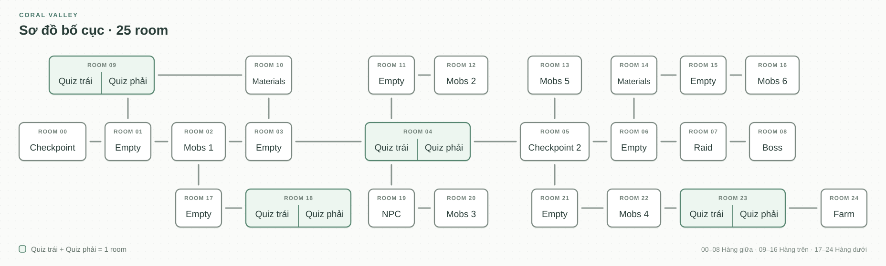

# Bố cục Coral Valley

Tài liệu của game designer: cấu trúc map, vai trò và nội dung của từng phòng. Cách đặt quái
trong phòng theo [enemy placement](coral_valley_enemy_placement.md); hình ảnh theo
[art direction](../art/coral_valley_art_direction.md); phòng kỳ quan theo
[wonder rooms](coral_valley_wonder_rooms.md).



## Mục tiêu thiết kế

Bản cũ là một đường thẳng từ lửa trại đầu tới boss. Người chơi bỏ qua được mọi nhánh, nhánh
cụt thì trống hoặc nhạt, thủy triều chỉ là cảnh, quái ngẫu nhiên. Bản này sửa bằng năm luật:

1. **Cổng Ngọc Triều chặn đường tới boss.** Lối từ lửa trại thứ hai (`room_05`) sang phía boss
   bị một cổng đá chặn, cần đủ **3 Ngọc Triều**. Ba viên nằm ở cuối ba thử thách, mỗi thử thách
   dạy và kiểm tra một kỹ năng: chiến đấu (Raid), suy nghĩ (giải đố bệ), đu móc (Tide Grapple).
   Người chơi thấy cổng ngay khi tới lửa trại thứ hai, nên mục tiêu luôn rõ.
2. **Mỗi phòng một trải nghiệm.** Không có hai phòng cùng một ý đồ. Bảng phòng bên dưới ghi ý
   đồ của từng phòng; phòng mới phải có ý đồ chưa ai dùng.
3. **Ngõ cụt luôn có lý do để tới:** cửa hàng, kho báu, thử thách có Ngọc Triều, hoặc phòng ẩn.
4. **Quái có kịch bản.** Quái đặt tay hoặc tới theo đợt đã thiết kế (vị trí, thứ tự, ý đồ). Không
   còn bộ quái ngẫu nhiên. Rong biển và vật trang trí vẫn có thể ngẫu nhiên.
5. **Thủy triều phải đổi cách chơi:** nó chở quái tới, cuốn quái đi, mở hoặc nhấn chìm đường đi,
   hoặc là vũ khí người chơi điều khiển. Phòng nào có thủy triều thì ghi rõ thủy triều làm gì.

### Ngôn ngữ màu

Màu biển của phòng báo trước điều sắp xảy ra, nên chỉ dùng cho các phòng có vai trò sau:

| Màu | Nghĩa | Phòng |
| --- | --- | --- |
| Đỏ (`red_tide`) | Phòng Raid: vào là bị nhốt tới khi dọn xong | `room_16`, `room_18`, `room_22` |
| Tím (`violet_glow`) | Bí ẩn: hai phòng ẩn và thử thách Vực Sâu | `room_12`, `room_13`, `room_20` |
| Thường | Mọi phòng còn lại | |

### Phòng an toàn

Chỉ phòng có lửa trại mới là phòng an toàn (`safe_room = true`): `room_00`, `room_05`,
`room_07`. Phòng boss `room_08` trở thành phòng an toàn khi Blubberbeard đã bị hạ, và lửa
trại bùng lên ở giữa đấu trường (xem [phòng boss](#room_08-hang-ổ-blubberbeard)). Không phòng
nào khác là phòng an toàn, kể cả phòng Silas `room_19`.

## Sơ đồ

Ô lưới trên bản đồ thế giới (`world/world_map/world_map.tres`), x sang phải, y xuống dưới.
`=` là lối đi thường, `#` là lối bị cổng hoặc bí mật chặn.

```
y=-1        [09]=========[10]   [11]#[12]       [13]==[14]==[15]==[16]
              |            |      |              |
y= 0  Hub=[00]=[01]=[02]=[03]=[04]=====[05]#[06]=[07]=[08]
                     |          |     \  |
y= 1                [17]=[18]  [19]#[20] [21]=[22]=[23]#[24]
```

| Ô | Phòng | Ô | Phòng | Ô | Phòng |
| --- | --- | --- | --- | --- | --- |
| (0, 0) | `room_00` | (2, -1) | `room_09` | (4, 1) | `room_17` |
| (2, 0) | `room_01` | (6, -1) | `room_10` | (5, 1) | `room_18` |
| (4, 0) | `room_02` | (8, -1) | `room_11` | (8, 1) | `room_19` |
| (6, 0) | `room_03` | (9, -1) | `room_12` | (9, 1) | `room_20` |
| (8, 0) | `room_04` | (10, -1) | `room_13` | (10, 1) | `room_21` |
| (10, 0) | `room_05` | (12, -1) | `room_14` | (11, 1) | `room_22` |
| (12, 0) | `room_06` | (13, -1) | `room_15` | (12, 1) | `room_23` |
| (14, 0) | `room_07` | (14, -1) | `room_16` | (14, 1) | `room_24` |
| (16, 0) | `room_08` | | | | |

Phòng ẩn (`hidden = true` trên bản đồ, không hiện tới khi đã vào): `room_12`, `room_20`,
`room_24`.

### Luồng chơi

**Hồi 1, Bờ Biển (dạy):** `00` → `01` dạy thủy triều → `02` dạy quái theo triều và sóng cuốn
→ `03` dạy cần gạt và bệ → `04` câu đố bệ xoay để tới lửa trại thứ hai. Lối `03` → `10` nằm ở
bờ tây của `03`, nên vòng `01`–`09`–`10`–`03` là đường thay cho `02` mà không cần qua cầu. Nhánh phụ: vòng
`01`–`09`–`10`–`03` (phà ẩn, rừng dừa, rương) là đường thay cho `02`; `02`–`17`–`18` (doi cát
và Raid hai đảo); `04`–`19` (cửa hàng Silas); `04`–`11` (đấu elite, vách san hô giấu phòng ẩn
`12`).

**Hồi 2, Ba thử thách (tự chọn thứ tự):** từ lửa trại `05`:
- Bắc: `13` (đi qua phần đảo trước) → `14` → `15` → **`16` Raid Xác Tàu Neo**: Ngọc Dũng Khí và
  Charm **Tide Grapple**.
- Có Tide Grapple, quay lại **`13` Đền Vực Tím**: đu qua chuỗi đảo lấy Ngọc Vực Sâu.
- Nam: `21` → **`22` Raid Đập Thủy Triều** → **`23` Vòng Thời Gian**: Ngọc Trí Tuệ.

Tide Grapple mở thêm: đảo rương của `21`, mỏm đá cầu tàu của `23` (lối ẩn sang `24`).

**Hồi 3, Tiến vào hang boss:** cổng ở `05` mở khi đặt đủ 3 ngọc → `06` Eo Biển Neo (bài thi
cuối: móc + triều + quái) → `07` Trại Cuối Bờ (lửa trại và Silas) → `08` boss.

## Bảng phòng

| Phòng | Kiểu nền | Vai trò | Ý đồ chính | Cửa |
| --- | --- | --- | --- | --- |
| `room_00` | Medium | Lửa trại 1 | Điểm vào từ Hub, an toàn | trái: Hub, phải: `01` |
| `room_01` | Small | Dạy thủy triều | Một làn triều cắt ngang đường; triều rút để lại quái | trái `00`, phải `02`, trên `09` |
| `room_02` | Medium | Phục kích theo triều | 3 đợt quái theo kịch bản tới cùng con nước; dạy sóng cuốn quái | trái `01`, phải `03`, dưới `17` |
| `room_03` | Small, 2 mảnh | Dạy cần gạt | Hai bệ ghép thành cầu qua lạch; cần trên bệ gọi bệ kia; Barrel bắn vào đường cầu | trái `02`, phải `04`, trên `10` |
| `room_04` | 2 đảo | Câu đố bệ xoay | +3 / −2 bước trên vòng 8 điểm dừng; cặp cần trên bệ giữa | trái `03`, phải `05`, trên `11`, dưới `19` |
| `room_05` | Medium | Lửa trại 2 + Cổng Ngọc Triều | Ngã tư; cổng chặn lối phải | trái `04`, trên `13`, phải `06` (cổng), dưới `21` |
| `room_06` | Small, 3 mảnh | Eo Biển Neo | Bài thi cuối: hai vực móc, đảo giữa có triều quét, elite canh | trái `05`, phải `07` |
| `room_07` | Medium | Trại Cuối Bờ (lửa trại 3) | Trại của Silas trước boss, bố cục riêng | trái `06`, phải `08` |
| `room_08` | Đấu trường | Boss | Blubberbeard; an toàn sau khi thắng | trái `07` |
| `room_09` | 2 đảo | Phà ẩn | Phà hai điểm, cần gạt giấu trong rong; rương | dưới `01`, phải `10` |
| `room_10` | Small, đỏ | Raid Rừng Dừa | Nhốt, 2 đợt quái, không thưởng; cọ dừa tài nguyên giữ nguyên | trái `09`, dưới `03` |
| `room_11` | Small | Vách San Hô | Đấu Elite Crab đầu tiên; vách san hô nứt giấu lối ẩn | dưới `04`, phải `12` (bí mật) |
| `room_12` | Medium, tím | Hang Kho Báu (ẩn) | Rương lớn, phục kích xương khi lại gần | trái `11` |
| `room_13` | Medium, tím, chia mảnh | Đền Vực Tím | Đường đi bộ nối `05`–`14`; chuỗi đảo chỉ móc tới được có Ngọc Vực Sâu | dưới `05`, phải `14` |
| `room_14` | Small | Vườn San Hô | Tài nguyên san hô, 3 ốc mượn hồn đặt tay | trái `13`, phải `15` |
| `room_15` | Small, 3 mảnh | Bãi Chướng Ngại | Eo đất duy nhất bị rào gỗ chặn, hai Elite Barrel bắn, đá làm chỗ nấp | trái `14`, phải `16` |
| `room_16` | Medium, đỏ | Raid Xác Tàu Neo | 4 đợt; Ngọc Dũng Khí + Tide Grapple | trái `15` |
| `room_17` | Small, chia mảnh | Doi Cát Ngầm | Doi cát chỉ đi được khi triều rút | trên `02`, phải `18` |
| `room_18` | 2 đảo, đỏ | Raid Hai Đảo | Raid hai đảo nối bằng phà (giữ nguyên) | trái `17` |
| `room_19` | Small, 3 mảnh | Lều Silas | Cửa hàng; doi cát lúc triều rút dẫn tới lối ẩn | trên `04`, phải `20` (bí mật) |
| `room_20` | Medium, tím | Rạn Đá Ngầm (ẩn) | Kho báu canh bởi elite | trái `19` |
| `room_21` | Small, chia mảnh | Bãi Cọc Neo | Ốc phục kích khi qua giữa bãi; đảo rương chỉ móc tới được | trên `05`, phải `22` |
| `room_22` | Medium, đỏ | Raid Đập Thủy Triều | Nhốt; người chơi gạt cần xả triều cuốn quái | trái `21`, phải `23` |
| `room_23` | 2 đảo | Vòng Thời Gian | Bệ quay tự động, dừng đúng lúc để nhảy sang bệ ngọc; Ngọc Trí Tuệ | trái `22`, phải `24` (móc) |
| `room_24` | Medium, chia mảnh | Đảo Vỡ (ẩn) | Ba mảnh nối bằng lạch; hai đảo nhỏ chỉ móc tới | trái `23` |

## Cơ chế dùng chung

| Cơ chế | Dùng ở | Tài liệu / code |
| --- | --- | --- |
| Raid (nhốt, quái trồi theo đợt, rương) | `10`, `16`, `18`, `22` | [raid_room.md](../systems/raid_room.md), `world/gimmick/raid/` |
| Thủy triều nền phẳng | `01`, `02`, `06`, `17`, `19`, `22` | [flat_tide.md](flat_tide.md) |
| Đợt quái theo triều (`TideWaveDirector`) | `01`, `02` | [flat_tide.md](flat_tide.md#đợt-quái-theo-kịch-bản) |
| Doi cát (`TideSandbar`) | `17`, `19` | [flat_tide.md](flat_tide.md#doi-cát) |
| Cần xả triều (`TideLever`) | `22` | [flat_tide.md](flat_tide.md#cần-xả-triều) |
| Cửa bị chặn (`ExitSeal`): Cổng Ngọc Triều, vách bí mật | `05`, `11` | [coral_valley_progression.md](../systems/coral_valley_progression.md) |
| Bệ thử thách (`TrialAltar`): Ngọc Triều, Charm | `13`, `16`, `23` | [coral_valley_progression.md](../systems/coral_valley_progression.md) |
| Phục kích không nhốt (`RaidStage.locks_room = false`) | `12`, `21` | [raid_room.md](../systems/raid_room.md) |
| Bệ di chuyển, cần gạt | `03`, `04`, `09`, `18`, `23` | `world/objects/moving_platform.gd` |
| Cọc neo Tide Grapple | `06`, `08`, `13`, `21`, `23`, `24` | [wonder rooms](coral_valley_wonder_rooms.md#đất-chia-mảnh) |

## Thưởng

| Nguồn | Thưởng |
| --- | --- |
| Rương Raid (`16`, `18`, `22`) | 8–13 vàng; `18` thêm ghi chép Hermit Crab |
| Rương câu đố (`04`, `09`, `23`) | 10–20 vàng; `09` thêm bản vẽ Bow và ghi chép Coral Skeleton; `04`, `23` giữ ghi chép cũ |
| Rương đảo móc `21` | 8–13 vàng và 1 bình hồi máu |
| Phòng ẩn `12` | 30–50 vàng và bản vẽ Harpoon |
| Phòng ẩn `20` | 30–50 vàng và ghi chép Elite Crab |
| Phòng ẩn `24` | 30–50 vàng (rương trên đảo móc, giữ nguyên) |
| Bệ thử thách | 1 Ngọc Triều mỗi bệ; Charm Tide Grapple ở rương thưởng Raid `16` |
| Boss `08` | 10–20 vàng, Chìa khóa Thủy Triều, Nhật ký Thủy Triều |

Tide Grapple không còn là thưởng boss: nó là chìa khóa giữa map, nên các phòng móc nằm trong
luồng chơi chính thay vì chỉ là nội dung sau boss.

## Chi tiết từng phòng

Các bảng đợt quái dùng ký hiệu của Raid: neo `Foxy` hoặc `tâm` (tâm đảo/khu), độ lệch x
(đông) / y (nam) theo mét, độ trễ theo giây. Chi tiết cách hoạt động ở
[raid_room.md](../systems/raid_room.md#thiết-kế-đợt-quái).

### room_00 Bến Lửa Trại

Giữ nguyên: lửa trại, không quái, cửa trái về Hub.

### room_01 Bãi Sóng Đầu

Lần đầu người chơi gặp thủy triều. Một làn nước (`NorthShallows`) tràn từ bờ bắc xuống, cắt
ngang đường mòn trái–phải. Nhịp ngắn (nghỉ 6 s, dâng 4 s, đầy 4 s, rút 4 s) để người chơi thấy
cả vòng ngay khi bước vào: viền đỏ báo, sóng tới đẩy lùi, triều rút. Hai lần rút đầu để lại
quái trên cát ướt, dạy rằng nước rút là lúc quái tới:

| Đợt | Ý đồ | Quái |
| --- | --- | --- |
| 1 | Làm quen: hai con cua yếu trên cát vừa lộ | Crab (tâm, −5/−3, 0 s), Crab (tâm, 5/−3, 0,4 s) |
| 2 | Thêm loại mới | Hermit Crab (tâm, 0/−5, 0 s), Crab (Foxy, 5/0, 0,5 s) |

Hết hai đợt thì triều vẫn lên xuống nhưng không chở quái nữa tới lần nghỉ sau.

### room_02 Bãi Phục Kích

Hai làn triều trái và phải lần lượt dâng (như cũ). Mỗi lần một làn rút, một đợt quái đã thiết
kế trồi lên ở phần cát vừa lộ. Ba đợt, sau đó phòng yên tới lần nghỉ sau. Đợt 2 đặt Barrel
trong làn phải: lần triều phải kế tiếp sẽ cuốn chúng, dạy người chơi chờ sóng làm thay mình.

| Đợt (sau làn) | Ý đồ | Quái |
| --- | --- | --- |
| 1 (trái) | Gọng kìm | Crab (Foxy, −3/−5, 0 s), Crab (Foxy, −3/5, 0,3 s), Hermit Crab (tâm, −10/0, 0,8 s) |
| 2 (phải) | Hàng pháo trong làn sóng tới | Barrel (tâm, 11/−7, 0 s), Barrel (tâm, 11/7, 0,3 s), Coral Skeleton (Foxy, 0/5, 1 s) |
| 3 (trái) | Chốt chặn | **Elite Crab** (tâm, 0/0, 0 s), Hermit Crab (Foxy, −5/−3, 1,2 s), Hermit Crab (Foxy, 5/3, 1,4 s) |

Vật cản là vài tảng đá và khúc gỗ đặt tay làm chỗ nấp trước Barrel, không còn ngẫu nhiên.

### room_03 Bến Cầu Ghép

Tên cũ "Bến Cầu Gạt". Một lạch rộng 8 m tách bãi chính (phía tây, có cầu tàu trái và cầu tàu
trên sang `room_10`) khỏi bến đông (một doi đá nhỏ có cầu tàu phải). Hai bệ (`MovingPlatform`,
hai điểm dừng) phải trượt vào đường cầu thì mới đi qua được:

- Bệ A nghỉ phía bắc lạch, bệ B nghỉ phía nam.
- Cần gạt bờ tây gọi bệ A vào (đánh lần nữa thì A về chỗ nghỉ).
- Cần gạt **trên bệ A** gọi bệ B; cần trên bệ B gọi bệ A (để đi ngược lại).
- Cần gạt ở bến đông gọi bệ B, cho người từ `room_04` sang.

Bài học: cần gạt có thể nằm trên bệ, và thứ tự gạt quan trọng. Đường cầu nằm lệch lên phía bắc
(z = −5), nên đi thẳng từ cầu tàu phải vào thì gặp tường, không rơi xuống lạch. Lối mở
`boundary_openings` chỉ ở chỗ cầu; bước ra lạch khi bệ chưa tới là rơi xuống biển. Một Barrel ở góc bắc bãi tây bắn vào đường cầu trong
lúc người chơi gạt cần.

### room_04 Vòng Bệ Xoay

Giữ câu đố cũ (bệ giữa cố định, bệ quay 8 điểm dừng, cần trên +3 bước, cần dưới −2 bước).
Rương và hai Elite Barrel ở đảo phải giữ nguyên.

Cơ chế (đã chạy thử bằng Foxy thật):

- Bệ xoay đi vòng 8 điểm dừng quanh bệ giữa theo chiều kim đồng hồ nhìn từ camera:
  Đông (0, chỗ bắt đầu), Đông Nam, Nam, Tây Nam, Tây (4), Tây Bắc, Bắc, Đông Bắc. Đứng trên bệ
  thì được chở theo.
- Chỉ điểm Tây và điểm Đông chạm được: mỗi điểm cách đảo cùng phía và bệ giữa một cú dash
  (khe 3,6–4,3 m, dash 4 m). Đi bộ không qua được khe nào.
- Có ba cặp cần gạt điều khiển cùng một bệ xoay: hai cặp trên hai đảo và một cặp trên bệ giữa.
  Cần trên +3 điểm (biển cam, mũi tên theo chiều kim đồng hồ), cần dưới −2 điểm (biển xanh ngọc,
  ngược chiều). Mỗi lần chỉ chạy một lệnh: khi bệ đang chạy, đánh thêm cần nào cũng không
  có tác dụng (cần không bật) cho tới khi bệ dừng.
- Đường qua: đưa bệ xoay tới Tây (từ Đông: −2 −2), dash lên bệ, dash sang bệ giữa, đánh cần
  trên bệ giữa để đưa bệ xoay sang Đông (−2 −2, hoặc +3 bốn lần), dash lên bệ rồi dash sang đảo
  phải. Đường về đi ngược lại. Vũ khí cận chiến cũng giải được; cần trên bệ giữa được thêm để
  bệ giữa có vai trò và người chơi chỉ có dao không bị kẹt (trước đó phải bắn cần từ trên bệ xoay
  bằng vũ khí tầm xa).

### room_05 Ngã Tư Lửa Trại

Lửa trại 2. Cửa phải bị **Cổng Ngọc Triều** chặn: ba tảng đá trên cầu tàu và một bệ đá có ba
hốc ngọc cạnh cầu. Lại gần bệ thấy số ngọc đang có ("Tide Pearls 1/3"). Có đủ 3 viên, tương
tác để đặt ngọc: ba hốc sáng lần lượt, đá chìm xuống, cửa mở vĩnh viễn trong lượt chơi.

### room_06 Eo Biển Neo

Bài thi cuối trước boss, cần cả ba kỹ năng. Ba mảnh: đảo tây (từ `05`), đảo giữa (dải 6 × 24 m),
đảo đông (tới `07`). Hai vực rộng 4 m chỉ qua bằng Tide Grapple, cọc neo ở hai bờ mỗi vực (vực tây
trên đường z = −3, vực đông trên z = 4). Đảo giữa có một làn triều quét từ bắc xuống (nghỉ 6 s,
dâng 3 s, đầy 4 s, rút 3 s): tường biên giữ Foxy trên đảo, sóng chỉ đẩy anh về phía nam. Một
Elite Hermit Crab và một Coral Skeleton canh đảo giữa, thêm một Coral Skeleton bắn sang từ đảo
đông. Mỗi lần móc tốn 150 SP trên 350, nên đánh nhau ở đảo giữa phải chừa SP cho cú móc thứ hai.

### room_07 Trại Cuối Bờ

Lửa trại 3 và Silas, phòng an toàn cuối trước boss. Bố cục khác mọi phòng: một xác thuyền lớn
mắc cạn làm phông phía bắc, sân gỗ lát quanh lửa trại, quầy hàng của Silas với thùng gỗ và
đèn lồng, đường mòn thẳng tới cầu tàu phía đông. Không quái, không thủy triều.

### room_08 Hang ổ Blubberbeard

Giữ trận đánh. Sau khi Blubberbeard gục: phòng thành phòng an toàn (đổi Charm được), lửa trại
bùng lên ở giữa đảo (nghỉ và lưu được), rồi Foxy móc qua vực để ra như cũ. Vào lại phòng sau
khi thắng thì lửa trại đã có sẵn.

### room_09 Bến Phà Ẩn

Giữ câu đố phà hai điểm với cần gạt giấu trong rong, rương và bốn Elite Barrel quanh rương.

### room_10 Raid Rừng Dừa

Biển đỏ. Raid khóa cả hai cửa (trái về `09`, dưới về `03`) bằng cổng đá; vào sâu khoảng 7 m
qua cầu tàu thì trận bắt đầu. Dọn hết quái thì cửa mở lại. **Không có rương thưởng.** Giữ tài
nguyên cọ dừa ngẫu nhiên; 3 Crab đặt tay cũ được thay bằng các đợt dưới đây.

| Đợt | Ý đồ | Quái |
| --- | --- | --- |
| 1 Phục kích | Tam giác quanh Foxy | Crab (Foxy, 0/−5, 0 s), Crab (Foxy, −4,5/3, 0,35 s), Crab (Foxy, 4,5/3, 0,7 s) |
| 2 Hàng pháo | Barrel ở mép bắc giữa hàng cọ, ốc ép từ phía sau | Barrel (tâm, −7/−12, 0 s), Barrel (tâm, 7/−12, 0,3 s), Hermit Crab (Foxy, 0/5, 1 s) |

### room_11 Vách San Hô

Trận elite đầu tiên: một Elite Crab đứng giữa bãi, hai Crab đứng hai bên. Phía đông, một vách
san hô nứt có vệt sáng (`DestructibleProp`, nhiều máu) chắn cầu tàu bên phải. Phá vách thì cầu
tàu lộ ra và lối sang phòng ẩn `12` mở, nhớ suốt lượt chơi.

### room_12 Hang Kho Báu (ẩn)

Biển tím. Rương lớn ở cuối bãi. Lại gần rương (vùng kích hoạt quanh rương) thì đất nứt và quái
trồi lên, không khóa cửa:

| Đợt | Ý đồ | Quái |
| --- | --- | --- |
| 1 | Lính canh kho báu | **Elite Coral Skeleton** (tâm, 0/−6, 0 s), Coral Skeleton (Foxy, −5/2, 0,6 s), Coral Skeleton (Foxy, 5/2, 0,8 s) |

### room_13 Đền Vực Tím

Biển tím. Năm mảnh: đảo nam (cầu tàu dưới về `05`) và đảo đông nối liền nhau, có đường mòn đi bộ
sang cầu tàu phải (tới `14`); phía tây bắc là chuỗi đảo nhỏ trên vực nước: đảo A → đảo B → đảo bệ
thờ, mỗi bước một vực 4–4,5 m chỉ móc qua được. Bệ thờ trên đảo cuối giữ **Ngọc Vực Sâu**.

- Ba cú móc tốn 450 SP, hơn mức tối đa 350, nên phải đứng chờ hồi SP trên đảo A hoặc B. Một Coral
  Skeleton trên bờ đông bắn sang chuỗi đảo trong lúc chờ; một con nữa canh bệ thờ.
- Đường về chỉ một cú móc: từ mép đông đảo bệ thờ, móc vào cọc trên bờ đảo đông. Đảo bệ thờ
  không có cọc trên đường đó, nên từ đảo đông không móc ngược vào được (lối tắt một chiều).
- Lần đầu tới (chưa có móc) người chơi thấy bệ thờ sáng ở xa.

### room_14 Vườn San Hô

Giữ: tài nguyên san hô ngẫu nhiên, 3 ốc mượn hồn đặt tay.

### room_15 Bãi Chướng Ngại

Đảo chia hai nửa, nối nhau bằng một eo đất rộng khoảng 6 m; hai bên eo là nước sâu. Ba khúc gỗ
(phá được) chắn ngang eo. Hai Elite Barrel đứng ở nửa đông bắn sang; ba tảng đá ở nửa tây làm chỗ
nấp. Người chơi tiến từ đá này sang đá khác, phá rào, rồi qua eo xử lý Barrel. Không có thủy
triều.

### room_16 Raid Xác Tàu Neo

Biển đỏ. Raid hệ mới, khóa cửa trái bằng cổng đá. Dọn xong: rương thưởng và **bệ thờ** có Ngọc
Dũng Khí cùng Charm Tide Grapple. Charm chỉ gắn được ở lửa trại, gần nhất là `05`.

| Đợt | Ý đồ | Quái |
| --- | --- | --- |
| 1 Phục kích | Tam giác quanh Foxy | Crab (Foxy, 0/−5, 0 s), Hermit Crab (Foxy, −4,5/3, 0,35 s), Crab (Foxy, 4,5/3, 0,7 s) |
| 2 Hàng pháo | Barrel dọc mép bắc, xương ép Foxy di chuyển | Barrel (tâm, −8/−9, 0 s), Barrel (tâm, 0/−10, 0,3 s), Barrel (tâm, 8/−9, 0,6 s), Coral Skeleton (Foxy, 0/5, 1,2 s) |
| 3 Gọng kìm | Hai nhóm từ tây và đông | **Elite Crab** (Foxy, −6/0, 0 s), Crab (Foxy, −5/−3, 0,2 s), **Elite Hermit Crab** (Foxy, 6/0, 0,8 s), Hermit Crab (Foxy, 5/3, 1 s) |
| 4 Thuyền trưởng ma | Rung lâu, elite ở tâm, hộ vệ vây | **Elite Coral Skeleton** (tâm, 0/−3, 0 s), **Elite Barrel** (tâm, 0/−10, 0,5 s), Crab, Hermit Crab, Coral Skeleton (tam giác quanh Foxy, 2–2,6 s) |

### room_17 Doi Cát Ngầm

Một lạch chéo rộng khoảng 5 m chia đảo: mảnh bắc có cầu tàu trên (về `02`), mảnh nam có cầu tàu
phải (tới `18`). Lúc triều rút, một doi cát rộng 4 m nối hai mảnh (`TideSandbar`). Khi nước dâng
quá 55% vùng, doi đóng: tường biên khép lại, và ai còn đứng trên doi bị sóng đẩy về bờ gần nhất
(có phản ứng trúng đòn, không mất máu). Doi mở lại khi nước rút dưới 10%. Nhịp: nghỉ 7 s, dâng
4 s, đầy 6 s, rút 4 s. Hai Crab đặt tay ở mảnh nam; đánh nhau trên doi thì phải canh nước.

### room_18 Raid Hai Đảo

Giữ toàn bộ Raid hai đảo và phà. Biển đỏ. Rương: 8–13 vàng và ghi chép Hermit Crab.

### room_19 Lều Silas

Giữ Silas và quầy hàng, không quái. Bãi chính thu lại về phía tây; phía đông là một đảo nhỏ, nối
bằng doi cát như `room_17` (nhịp chậm hơn: nghỉ 10 s). Cầu tàu phải nằm trên đảo nhỏ đó và dẫn tới
phòng ẩn `20`. Trên bản đồ, `20` không hiện tới khi đã vào.

### room_20 Rạn Đá Ngầm (ẩn)

Biển tím, vành đá ngầm. Rương 30–50 vàng ở giữa đảo, một Elite Crab và một Elite Hermit Crab
đặt tay canh rương.

### room_21 Bãi Cọc Neo

Bước vào giữa bãi thì ba Hermit Crab trồi lên quanh Foxy (phục kích không khóa cửa). Ở góc tây
bắc, một đảo nhỏ cách bãi 4 m có rương (8–13 vàng và bình hồi máu) và cọc neo; cọc thứ hai đứng
trên bãi, cùng đường bắc–nam. Thấy từ đầu, cần Tide Grapple mới tới được.

| Đợt | Ý đồ | Quái |
| --- | --- | --- |
| 1 | Ốc nằm dưới cát | Hermit Crab (Foxy, 0/−5, 0 s), Hermit Crab (Foxy, −4,5/3, 0,3 s), Hermit Crab (Foxy, 4,5/3, 0,6 s) |

### room_22 Raid Đập Thủy Triều

Biển đỏ. Raid khóa cửa, nhưng người chơi có vũ khí: ba làn triều (tây, bắc, đông), mỗi làn có
một cần xả triều (`TideLever`) ở mép đảo. Đánh cần thì làn đó dâng ngay, sóng cuốn và làm choáng
mọi quái trong làn, kể cả Foxy nếu đứng đó. Mỗi cần nạp lại sau một vòng triều. Đợt quái được
đặt để dồn quái vào các làn.

| Đợt | Ý đồ | Quái |
| --- | --- | --- |
| 1 Làm quen | Ba Crab trong làn tây | Crab ×3 (tâm, −11/−4, −11/0, −11/4; 0, 0,2, 0,4 s) |
| 2 Hai làn | Barrel ở làn bắc, xương ép từ làn đông | Barrel ×2 (tâm, −4/−12, 4/−12; 0, 0,3 s), Coral Skeleton ×2 (tâm, 11/−3, 11/3; 0,8, 1 s) |
| 3 Lũ | Elite ở mỗi làn, rồi một con sau lưng Foxy | **Elite Crab** (tâm, −11/0, 0 s), **Elite Barrel** (tâm, 0/−12, 0,5 s), **Elite Hermit Crab** (tâm, 11/0, 1 s), Crab (Foxy, 0/5, 1,8 s) |

Làn tây phủ từ mép tây tới x = −6, làn bắc từ mép bắc tới z = −8, làn đông từ x = 6 tới mép
đông. Ba cần đứng ngay ngoài làn của mình: (−5, 5), (0, −6,5), (5, 5).

Dọn xong: rương 8–13 vàng.

### room_23 Vòng Thời Gian

Giữ bệ giữa cố định, bệ quay tự động 8 điểm dừng và cần gạt dừng/chạy trên bệ giữa. Thêm **bệ
ngọc** (bệ gỗ cố định) cách điểm dừng N 4 m về phía bắc: dừng vòng quay đúng ở N (hoặc NW/NE, nhảy
chéo) rồi dash sang. Trên bệ ngọc có bệ thờ Ngọc Trí Tuệ và một cần gạt dừng/chạy thứ hai để quay
về. Rương và hai Elite Barrel ở đảo phải giữ nguyên (Barrel lùi vào 3,5 m). Cầu tàu phải đứng trên
một mỏm đá tách khỏi đảo phải bởi một vực 4,5 m, có cọc neo hai bờ: lối sang phòng ẩn `24`.

### room_24 Đảo Vỡ (ẩn)

Giữ phòng chia mảnh cũ: ba mảnh nối bằng lạch, hai đảo nhỏ chỉ móc tới, rương bí mật 30–50 vàng.

## Định danh scene

Map có 25 phòng `room_00`–`room_24`, tên file và UID giữ nguyên để save cũ vẫn trỏ đúng lửa
trại và rương. Vai trò của nhiều phòng đổi, nhưng các node có trạng thái (`Campfire`,
`TreasureChest`) giữ tên.
